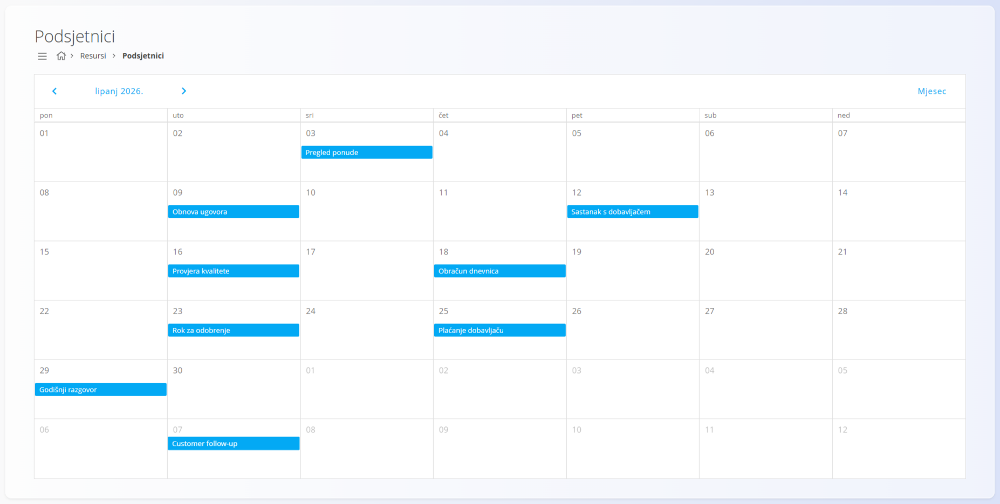
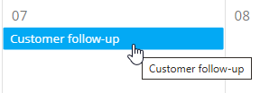
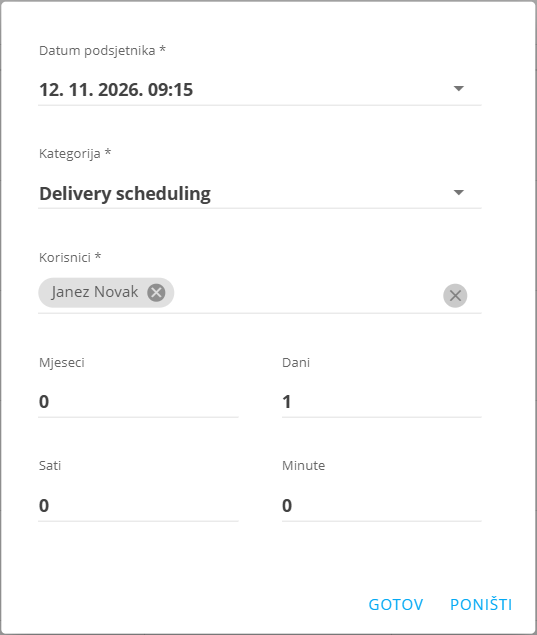

<!-- app_route: /management/resources/reminders -->
<!-- app_label: Podsjetnici -->
<!-- canonical_source_url: https://github.com/Tom-PIT/Connected.Docs/blob/main/hr/Domene/Resursi/Pogledi/Reminders.md -->
<!-- canonical_source_title: Podsjetnici -->

# Podsjetnici

Pogled **Podsjetnici** prikazuje kalendar zakazanih podsjetnika i omogućuje stvaranje obavijesti za važne događaje, rokove i praćenje.

Do ovog pogleda dolazite tako da u [navigaciji](../../../Zajednicko/UI/Navigacija.md) odaberete **Resursi / Podsjetnici**.

> [!NOTE]
> Nazivi podsjetnika na slikama (na primjer *Customer follow-up*) i kategorija (na primjer *Delivery scheduling*) su podaci iz aplikacije i prikazani su onako kako ih aplikacija prikazuje.

## Shema

Sljedeća polja koriste se pri stvaranju ili uređivanju podsjetnika:

| Polje | Opis |
|------|------|
| **Datum podsjetnika** | Ciljni datum i vrijeme na koji se podsjetnik odnosi (na primjer rok, datum isteka ili planirani događaj). |
| **Kategorija** | Vrsta podsjetnika, odabrana iz unaprijed definiranih [kategorija podsjetnika](../Upravljanje/KategorijePodsjetnika.md). |
| **Korisnici** | Korisnici koji će primiti obavijest o podsjetniku. |
| **Mjeseci, Dani, Sati, Minute** | Vremenski pomak koji određuje **koliko prije datuma podsjetnika** se obavijest šalje. |

## Kalendar podsjetnika

Podsjetnici se prikazuju u **mjesečnom kalendaru**.

- Svaki podsjetnik pojavljuje se na datumu na koji je zakazan
- Na istom danu može biti više podsjetnika
- Između mjeseci možete prelaziti strelicama iznad kalendara

### Pregled pri zadržavanju miša

Kada zadržite miš iznad podsjetnika, pojavljuje se oblačić s nazivom podsjetnika.

## Radnje

### Stvaranje novog podsjetnika

Novi podsjetnik stvara se **dvostrukim klikom na dan** u kalendaru. Otvara se dijalog za podsjetnik s unaprijed upisanim datumom tog dana.

U dijalogu odredite datum podsjetnika, kategoriju, korisnike i vremenski pomak, zatim kliknite **Gotov**.

### Uređivanje podsjetnika

**Dvostrukim klikom** na podsjetnik otvara se u načinu uređivanja. <!-- TODO: provjeriti na ekranu --> Datum, kategorija, korisnici i vremenski pomak mogu se mijenjati.

### Korištenje vremenskog pomaka

Vremenski pomak određuje **kada se obavijest o podsjetniku šalje u odnosu na datum podsjetnika**.

Pomak se računa **unatrag** od datuma podsjetnika.

Primjeri:

- **Mjeseci: 0, Dani: 0, Sati: 0, Minute: 0**  
  → podsjetnik se šalje **točno na datum i vrijeme podsjetnika**

- **Dani: 1**  
  → podsjetnik se šalje **jedan dan prije** datuma podsjetnika

- **Sati: 2, Minute: 30**  
  → podsjetnik se šalje **2 sata i 30 minuta prije**

- **Mjeseci: 1**  
  → podsjetnik se šalje **mjesec dana prije**

Taj mehanizam omogućuje da se podsjetnici zakazuju unaprijed za zadatke kao što su isteci ponuda, inspekcije, sastanci ili praćenje.
