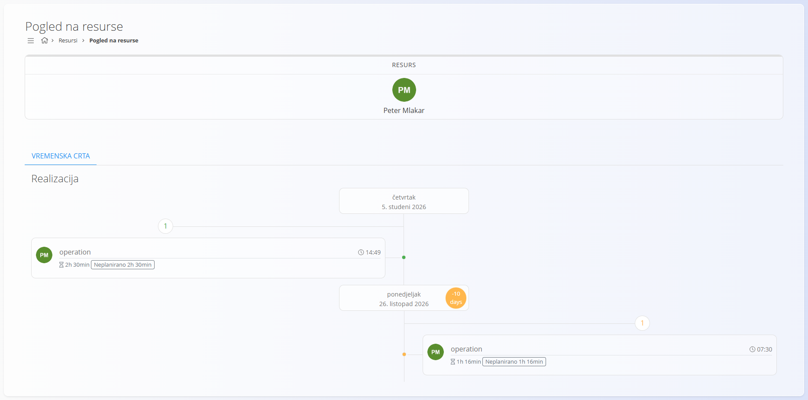

<!-- app_route: /resources/resource -->
<!-- app_label: Pogled na resurse -->
<!-- canonical_source_url: https://github.com/Tom-PIT/Connected.Docs/blob/main/hr/Domene/Resursi/Pogledi/ResourceView.md -->
<!-- canonical_source_title: Pogled na resurse -->

# Pogled na resurse

**Pogled na resurse** prikazuje **kronološku vremensku crtu evidentiranog truda u sustavu** za **trenutno prijavljenog korisnika**.

Do ovog pogleda dolazite tako da u [navigaciji](../../../Zajednicko/UI/Navigacija.md) odaberete **Resursi / Pogled na resurse**.

### Pregled

Ovaj pogled prikazuje **kada i gdje je trud evidentiran** od strane prijavljenog korisnika, na okomitoj vremenskoj crti.

> [!NOTE]
> Ovaj pogled namijenjen je **samo za pregled i analizu**, kako bi korisnici mogli vidjeti kako je evidentirani trud raspoređen kroz vrijeme. S ovog ekrana ne unose se niti uređuju podaci.

## Vremenska crta

Glavni dio ekrana je **vremenska crta** poredana po datumu.

Svaki unos predstavlja evidentirani trud i obično prikazuje:

- povezani zadatak ili operaciju
- količinu evidentiranog truda
- je li trud bio planiran ili neplaniran

Datumi se prikazuju kao oznake na crti, pa je lako vidjeti **kada je rad obavljen**.

## Realizacija

Vremenska crta prikazuje samo **ostvareni (stvarni) trud**.

Odražava trud koji je već evidentiran u sustavu kroz zadatke, operacije ili evidenciju vremena.
