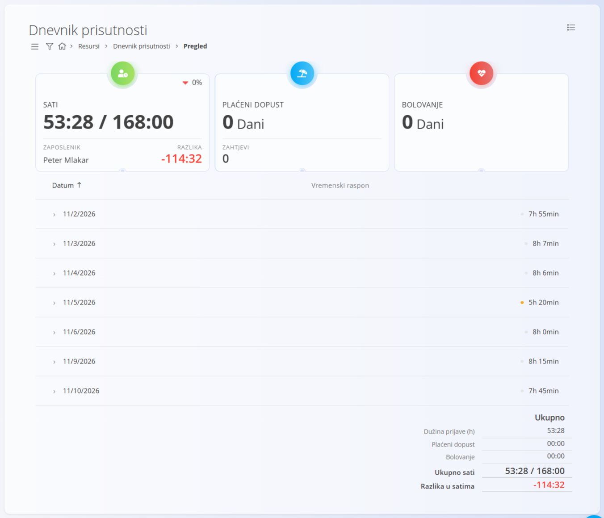
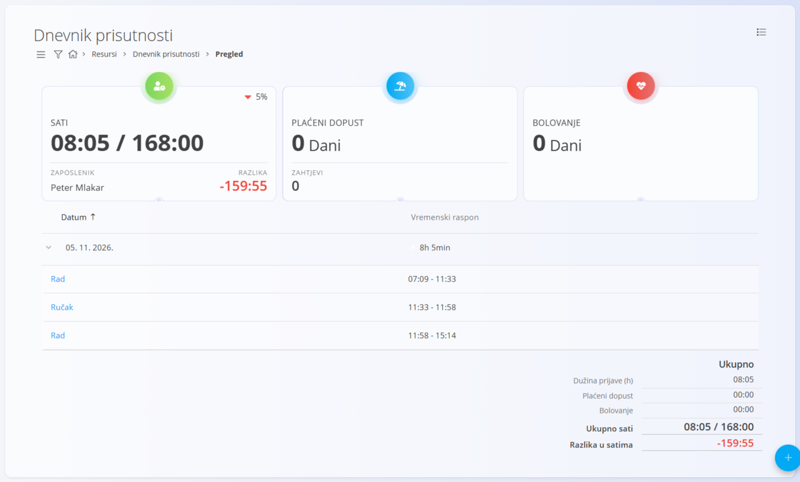
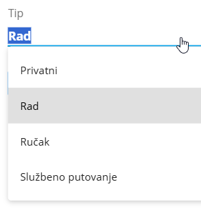
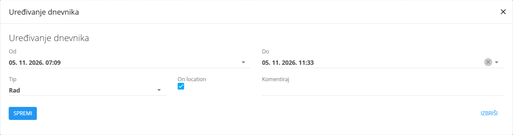
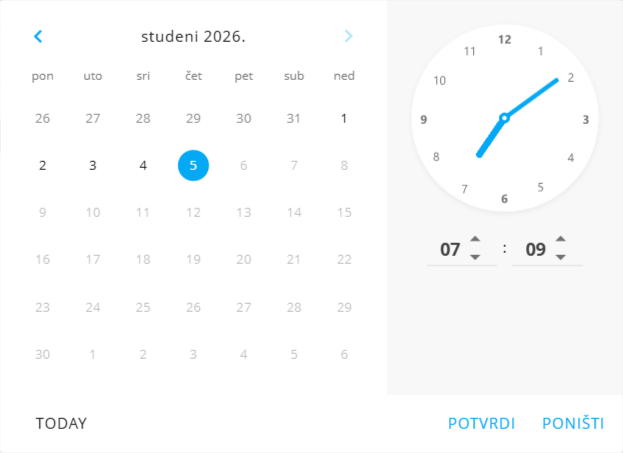

<!-- app_route: /time-logs/view -->
<!-- app_label: Dnevnik prisutnosti – Pregled -->
<!-- canonical_source_url: https://github.com/Tom-PIT/Connected.Docs/blob/main/hr/Domene/Resursi/Pogledi/TimeLogsView.md -->
<!-- canonical_source_title: Dnevnik prisutnosti – Pregled -->

# Dnevnik prisutnosti – Pregled

Ekran **Dnevnik prisutnosti – Pregled** prikazuje detaljan pregled evidentiranog radnog vremena za određenog zaposlenika i razdoblje. Koristi se za pregled dnevne prisutnosti, pregled pojedinačnih unosa vremena te ručno dodavanje ili ispravljanje evidencije vremena kada je potrebno.

Do pregleda **Dnevnik prisutnosti** dolazite tako da u [navigaciji](../../../Zajednicko/UI/Navigacija.md) odaberete **Resursi / Dnevnik prisutnosti / Pregled**.

### Namjena

Pregled dnevnika prisutnosti prvenstveno se koristi za:

- pregled evidentiranih radnih sati za odabrano razdoblje
- pregled dnevne raspodjele vremena (rad, ručak, privatno i drugo)
- dodavanje ili prilagodbu unosa vremena kada je potrebno
- usporedbu evidentiranih sati s očekivanim radnim satima

Zaposlenici obično ovaj ekran koriste za **praćenje vlastitog vremena**, dok odobreni korisnici mogu **pregledavati i upravljati evidencijom vremena** drugih zaposlenika.

## Filtri i kontekst

S lijeve strane nalaze se sljedeći filtri i izbornici:

- **Datum** – odabir razdoblja za prikaz (na primjer cijeli mjesec)
- **Zaposlenik** – odabir zaposlenika čija se evidencija prikazuje
  - ovaj izbornik vide samo odobreni korisnici
  - zaposlenici vide isti ekran bez izbornika za zaposlenika

Promjena bilo koje od ovih vrijednosti osvježava prikazane unose vremena i sažete pokazatelje.

## Sažeti pokazatelji

Na vrhu ekrana sažete kartice daju brz pregled odabranog razdoblja:

- **Sati** – evidentirani sati u odnosu na očekivane radne sate
- **Plaćeni dopust** – ukupan broj odobrenih dana plaćenog dopusta
- **Bolovanje** – ukupan broj odobrenih dana bolovanja

Ovi pokazatelji pomažu brzo procijeniti prisutnost i odstupanja.

## Dnevna lista evidencije vremena

Ispod sažetka unosi vremena grupirani su po **danu**.

Svaki redak prikazuje:

- **datum**
- **ukupno evidentirano vrijeme za dan**

Klik na dan proširuje redak i prikazuje pojedinačne unose vremena (na primjer **Rad** i **Ručak**), s početnim i završnim vremenom svakog unosa.

### Proširivanje dnevnog zapisa

Klik na dan proširuje redak i prikazuje pojedinačne unose vremena, na primjer:

- **Rad**
- **Ručak**
- **Privatni**
- **Službeno putovanje**

Svaki unos prikazuje svoje početno i završno vrijeme.

## Uređivanje unosa vremena

Klik na pojedinačni unos (na primjer **Rad** ili **Ručak**) otvara dijalog **Uređivanje dnevnika**.

U ovom dijalogu odobreni korisnici mogu:

- prilagoditi **početno i završno vrijeme** (polja **Od** i **Do**)
- promijeniti **tip vremena** (polje **Tip**, s vrstama: Privatni, Rad, Ručak i Službeno putovanje)
- odrediti je li unos bio **na lokaciji** (**On location**)
- dodati ili izmijeniti **komentar**

Kada uređujete polja **Od** i **Do**, koristi se kombinirani **izbornik za datum i sat**.

Tako se može precizno odabrati i datum i točno vrijeme unosa. Promjene se primjenjuju nakon potvrde i odmah se odražavaju u dnevnim zbrojevima.

## Dodavanje novog unosa vremena

Gumbom radnji (dolje desno) odobreni korisnici mogu ručno dodati novi unos vremena.

To se obično radi kada:

- zaposlenik nije mogao sam evidentirati vrijeme
- su nakon toga potrebne ispravke

Koristi se isti dijalog kao i za uređivanje postojećih unosa, pa je tijek rada dosljedan.

## Zbrojevi i očekivani radni sati

Na dnu ekrana prikazuju se zbrojevi za odabrano razdoblje:

- evidentirani radni sati (**Dužina prijave (h)**)
- plaćeni dopust
- bolovanje
- **Ukupno sati** u odnosu na očekivane sate
- **Razlika u satima** između evidentiranih i očekivanih sati

Ove vrijednosti daju jasan pregled usklađenosti i odstupanja za odabranog zaposlenika i razdoblje.
