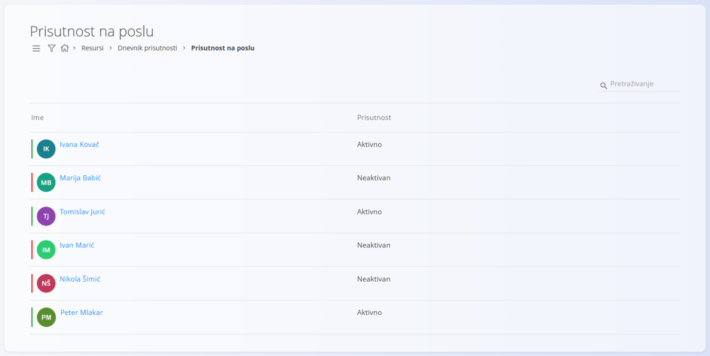
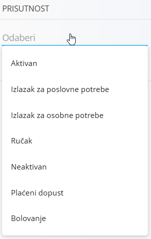

<!-- app_route: /time-logs/attendance -->
<!-- app_label: Prisutnost na poslu -->
<!-- canonical_source_url: https://github.com/Tom-PIT/Connected.Docs/blob/main/hr/Domene/Resursi/Pogledi/TimeLogsAttendanceAtWork.md -->
<!-- canonical_source_title: Prisutnost na poslu -->

# Prisutnost na poslu

Pogled **Prisutnost na poslu** pruža pregled trenutačnog stanja prisutnosti zaposlenika u stvarnom vremenu. Namijenjen je prvenstveno nadzornicima, voditeljima timova i rukovoditeljima koji trebaju brzo vidjeti tko je prisutan, odsutan ili u određenom stanju prisutnosti.

Do ovog pogleda dolazite tako da u [navigaciji](../../../Zajednicko/UI/Navigacija.md) odaberete **Resursi / Dnevnik prisutnosti / Prisutnost na poslu**.

## Pregled

Glavni popis prikazuje zaposlenike i njihovo **trenutačno stanje prisutnosti**.

Za svakog zaposlenika prikazuje se:

- **ime**
- **trenutačno stanje prisutnosti**

Stanje prisutnosti odražava posljednju radnju evidencije vremena ili prisutnosti zaposlenika (na primjer prijava, ručak, odsutnost ili odjava).

Ovaj se pogled automatski ažurira na temelju aktivnosti evidentiranja vremena.

## Stanja prisutnosti

Zaposlenici se mogu pojaviti u različitim stanjima prisutnosti, ovisno o trenutačnoj aktivnosti:

- **Aktivan** – zaposlenik trenutačno radi
- **Ručak** – zaposlenik je na pauzi za ručak
- **Izlazak za osobne potrebe** – zaposlenik je privremeno otišao iz privatnih razloga
- **Izlazak za poslovne potrebe** – zaposlenik je na službenom putovanju
- **Plaćeni dopust** – zaposlenik je na odobrenom plaćenom dopustu
- **Bolovanje** – zaposlenik je na bolovanju
- **Neaktivan** – zaposlenik trenutačno nije prijavljen niti prisutan

Ta se stanja izvode iz evidencije vremena i zapisa o odsutnostima i ne zahtijevaju ručno ažuriranje u ovom pogledu.

## Filtri

Filtri s lijeve strane omogućuju sužavanje popisa:

- **Prisutnost** – filtriranje prema određenom stanju prisutnosti (Aktivan, Ručak, Plaćeni dopust i tako dalje)
- **Org. jedinica** – prikaz samo zaposlenika iz odabrane organizacijske jedinice

Filtri se mogu kombinirati radi brzog pronalaženja određenih skupina zaposlenika.

## Tipični slučajevi korištenja

Ovaj se pogled obično koristi za:

- praćenje tko trenutačno radi na lokaciji
- provjeru je li zaposlenik na ručku, dopustu ili bolovanju
- brz pregled prisutnosti po timovima ili organizacijskim jedinicama
- podršku operativnim odlukama i koordinaciji radne snage

## Odnos prema ostalim pogledima evidencije vremena

- **Prisutnost na poslu** usmjeren je samo na *trenutačno stanje*
- povijesni unosi vremena i detaljne izmjene obrađuju se u **[Dnevnik prisutnosti – Pregled](Pregled.md)**
- aktivno evidentiranje vremena, zahtjevi za odsutnost i radnje prijave i odjave obrađuju se u **[Dnevnik prisutnosti – Upravljanje](UpravljanjePrisutnoscu.md)**
