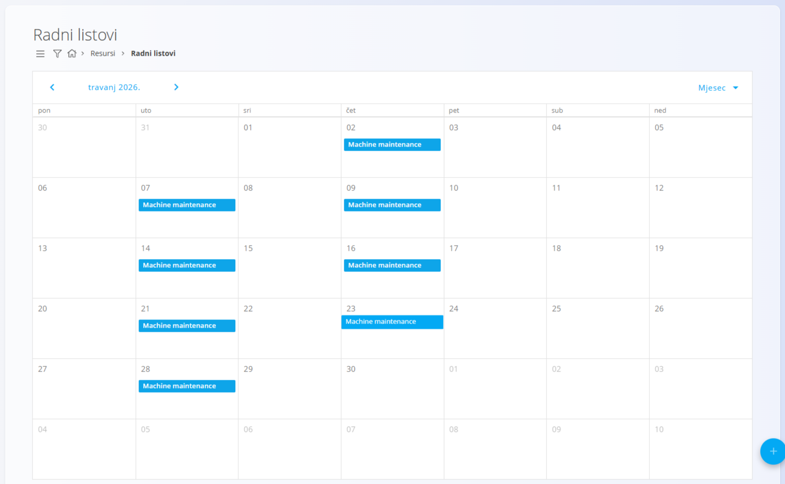
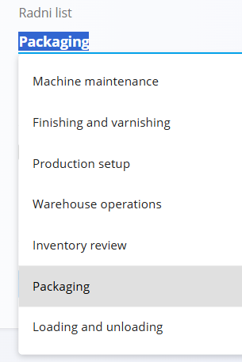
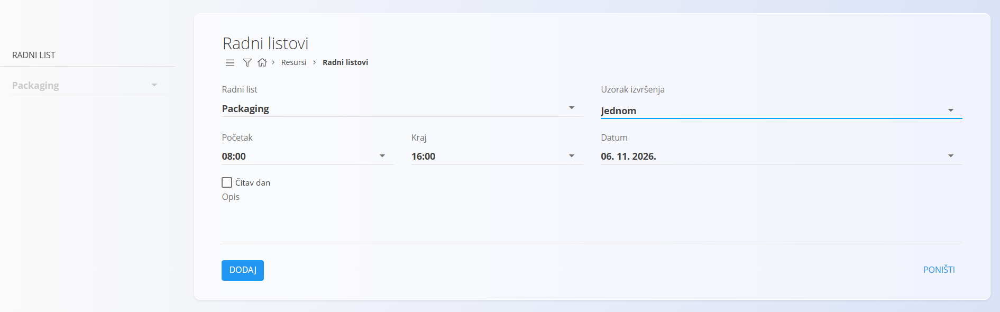

<!-- app_route: /management/resources/worksheets -->
<!-- app_label: Radni listovi -->
<!-- canonical_source_url: https://github.com/Tom-PIT/Connected.Docs/blob/main/hr/Domene/Resursi/Pogledi/RadniListovi.md -->
<!-- canonical_source_title: Radni listovi -->

# Radni listovi

Pogled **Radni listovi** prikazuje kalendar za planiranje rada na temelju **radnih listova**. Radni listovi predstavljaju *planirani rad* i omogućuju zakazivanje aktivnosti kroz vrijeme.

Do ovog pogleda dolazite tako da u [navigaciji](../../../Zajednicko/UI/Navigacija.md) odaberete **Resursi / Radni listovi**.

## Shema

### Polja radnog lista

| Polje | Opis |
|------|------|
| **[Radni list](../Upravljanje/RadniListoviUpravljanje.md)** | Određuje vrstu rada koji se planira. |
| **Uzorak izvršenja** | Određuje hoće li se radni list izvršiti **Jednom** ili **Više puta**. |
| **Početak** | Početno vrijeme planiranog rada. |
| **Kraj** | Završno vrijeme planiranog rada. |
| **Čitav dan** | Označava da radni list obuhvaća cijeli dan. |
| **Datum** | Datum izvršenja. Kada je odabrano **Više puta**, ovo polje određuje raspon datuma u kojem se radni list ponavlja. |
| **Opis** | Neobavezne dodatne informacije o planiranom radu. |

## Kalendar radnih listova

Kalendar prikazuje sve radne listove za odabrani **radni list**. Radni listovi mogu se prikazati u prikazu **dan**, **tjedan** ili **mjesec**.

S lijeve strane filtar omogućuje odabir **radnog lista** koji se prikazuje u kalendaru. Prikazuju se samo radni listovi koji pripadaju odabranom radnom listu.

## Radnje

### Stvaranje novog radnog lista

Za stvaranje novog radnog lista kliknite gumb **+** u donjem desnom kutu.

Ovisno o odabranom **uzorku izvršenja**, dostupne su različite mogućnosti.

#### Jednom

Koristite **Jednom** za zakazivanje jednog pojavljivanja.

#### Više puta

Koristite **Više puta** za zakazivanje ponavljajućeg radnog lista u razdoblju datuma.

<!-- TODO: snimka obrasca Više puta -->

Nakon spremanja radni list se pojavljuje u kalendaru na odgovarajućim datumima.

### Uređivanje radnog lista

Radni listovi mogu se uređivati izravno u kalendaru.

Za uređivanje radnog lista **dvaput kliknite na događaj u kalendaru**. Otvara se dijalog za uređivanje u kojem možete promijeniti polja poput vremena, uzorka izvršenja ili opisa.

### Brisanje radnog lista

Radni listovi mogu se obrisati iz **dijaloga za uređivanje**.

Za brisanje radnog lista:
1. Dvaput kliknite na događaj radnog lista u kalendaru da biste otvorili ekran za uređivanje.
2. Kliknite **Izbriši**.
3. Potvrdite brisanje.

Ako radni list koristi uzorak izvršenja **Više puta**, prikazuje se dodatna potvrda:
- **„Želite li ukloniti i sve buduće unose?"**

Nakon toga prikazuje se završni dijalog za potvrdu:
- **„Jeste li sigurni da želite izbrisati pojedinost radnog lista?"**

Nakon potvrde radni list se trajno uklanja.
