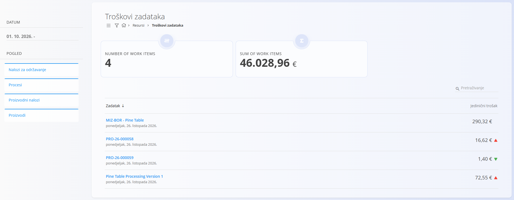
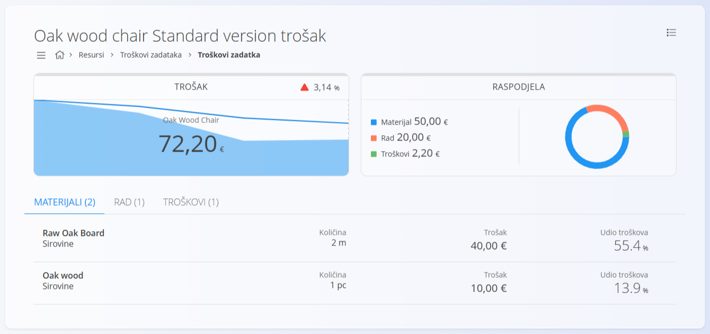

<!-- app_route: /work-items-costs -->
<!-- app_label: Troškovi zadataka -->
<!-- canonical_source_url: https://github.com/Tom-PIT/Connected.Docs/blob/main/hr/Domene/Resursi/Pogledi/WorkItemsCosts.md -->
<!-- canonical_source_title: Troškovi zadataka -->

# Troškovi zadataka

Pogled **Troškovi zadataka** pruža analizu troškova za zadatke proizvodnje i održavanja, proizvode i verzije procesa. Uglavnom se koristi za analizu procesa, [proizvodnih naloga](../../Proizvodnja/Dokumenti/ProizvodniNalozi.md) i naloga za održavanje te za razumijevanje raspodjele troškova i učinkovitosti.

Do ovog pogleda dolazite tako da u [navigaciji](../../../Zajednicko/UI/Navigacija.md) odaberete **Resursi / Troškovi zadataka**.

> [!NOTE]
> Kada je odabran pogled **Procesi**, ekran prikazuje procijenjene [troškove verzija procesa](../../Proizvodnja/Analiza/TrosakVerzije.md) umjesto stvarnih troškova zadataka.

## Popis troškova zadataka

Popis prikazuje zapise troškova koji odgovaraju odabranim filtrima.

Ovisno o odabranom **Pogledu**, svaki redak predstavlja zadatak, proizvod ili verziju procesa i prikazuje:

- oznaku ili naziv
- datum
- izračunati trošak po jedinici
- vizualne oznake koje pokazuju promjene troška u odnosu na prethodne vrijednosti, kada su dostupne

Filtrom **Pogled** odabirete jednu ili više vrsta analize troškova:

- **Nalozi za održavanje** – prikazuje stvarne troškove zadataka održavanja
- **Procesi** – prikazuje verzije procesa i procijenjeni trošak po jedinici
- **Proizvodni nalozi** – prikazuje stvarne troškove zadataka proizvodnje
- **Proizvodi** – prikazuje proizvode i njihov izračunati trošak po jedinici

Više pogleda može biti odabrano istodobno.

Filtrom **Datum** ograničavate zapise prikazane na popisu.

Klik na stavku otvara odgovarajuću analizu troškova.

### Pokazatelji

Na vrhu popisa prikazuju se dvije kartice:
- **Number of work items** – broj zadataka na popisu
- **Sum of work items** – zbroj troškova zadataka na popisu

> [!NOTE]
> Naslovi kartica prikazani su na engleskom jeziku, kao u aplikaciji.

## Detalji troška zadatka

Odabir zadatka otvara detaljan prikaz s potpunom analizom troška.

### Pregled troška

Na vrhu ekrana kartice daju brz sažetak:

- **Trošak** – trenutačni trošak po jedinici i trend u odnosu na prethodne vrijednosti
- **Raspodjela** – udio materijala, rada i troškova u ukupnom trošku

### Kartice pojedinosti

Ispod pregleda nalaze se tri kartice:

- **Materijali** – popis svih materijala upotrijebljenih za izradu stavke, s količinom, troškom i udjelom u ukupnom trošku.
- **Rad** – vrijeme koje su korisnici utrošili na zadatak, s izračunatim troškom rada i udjelom u ukupnom trošku. Troškovi rada izračunavaju se prema definicijama troškova resursa.
- **Troškovi** – dodatni [troškovi](../../Nabava/Upravljanje/Troskovi.md) povezani sa zadatkom. Ako nisu zabilježeni troškovi, odjeljak je prazan.

Klik na materijal otvara dodatne podatke o upotrijebljenom materijalu, uključujući **serijski broj**. Ako je serijski broj dostupan, klik na njega otvara odgovarajući [prikaz zaliha po serijskom broju](../../Logistika/Pogledi/Zaliha.md).

## Napomene o upotrebi

- Troškovi zadataka su **samo za čitanje** i u potpunosti ih izračunava sustav.
- Točnost ovisi o ispravno konfiguriranim:
  - troškovima resursa
  - cijenama materijala
  - evidenciji vremena rada
- Ovim pogledom obično se koriste voditelji proizvodnje i analitičari.

## Izbornik

Izbornik nudi dodatne radnje dostupne na ovom ekranu.

Dostupne radnje:

- **Export to PDF**
- **Recalculate** – ponovno izračunava troškove odabranog zadatka ili verzije procesa, koristeći najnovije materijale, resurse i troškove.

Za pojedinosti o radnjama izbornika pogledajte [**Radnje izbornika**](../../../Zajednicko/Koncepti/RadnjeIzbornika.md).
