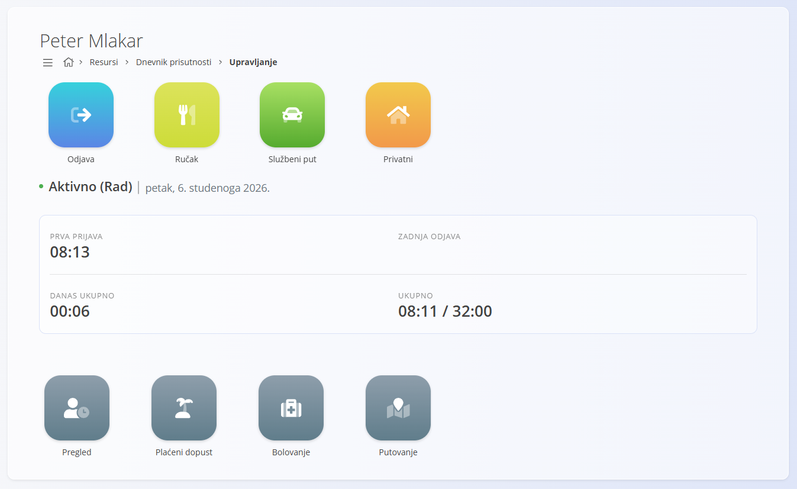
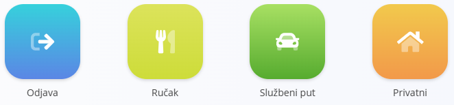
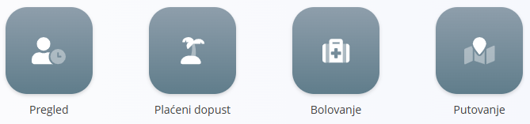
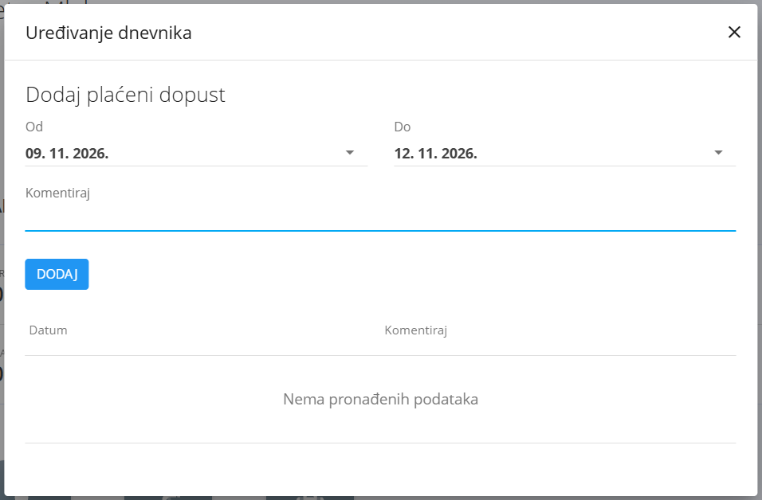
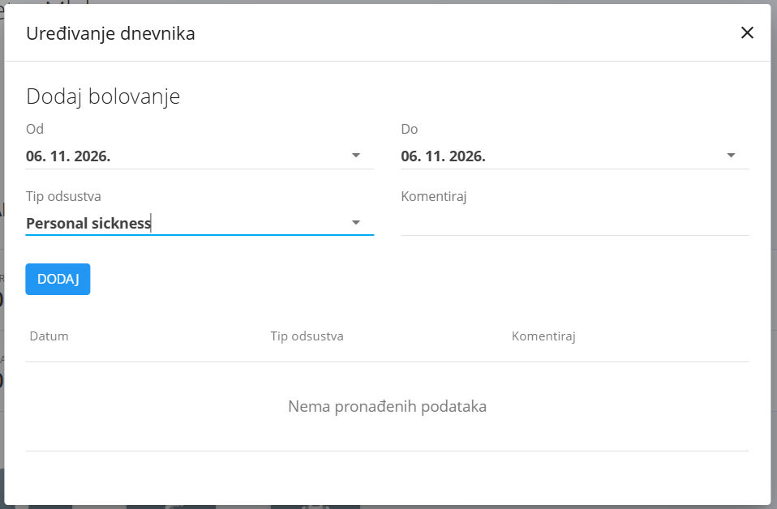

<!-- app_route: /time-logs/management -->
<!-- app_label: Dnevnik prisutnosti – Upravljanje -->
<!-- canonical_source_url: https://github.com/Tom-PIT/Connected.Docs/blob/main/hr/Domene/Resursi/Pogledi/TimeLogsManage.md -->
<!-- canonical_source_title: Dnevnik prisutnosti – Upravljanje -->

# Dnevnik prisutnosti – Upravljanje

Pogled **Upravljanje** koristi se za **praćenje prisutnosti u stvarnom vremenu i dnevno evidentiranje vremena**. Zaposlenicima omogućuje da evidentiraju početak i kraj rada, pauze za ručak, službena putovanja ili privatno vrijeme.

Tipični slučajevi korištenja:

- evidentiranje početka i kraja radnog dana
- evidentiranje pauze za ručak i drugih prekida
- praćenje službenih putovanja i privatnog vremena
- brz pregled prisutnosti za danas
- brzi pristup radnjama vezanima uz odsutnosti ([plaćeni dopust](#plaćeni-dopust), [bolovanje](#bolovanje), [putni nalozi](#putni-nalozi))

Do ovog pogleda dolazite tako da u [navigaciji](../../../Zajednicko/UI/Navigacija.md) odaberete **Resursi / Dnevnik prisutnosti / Upravljanje**.

> **Napomena**  
> Radnje evidentiranja vremena možda nisu dostupne svim korisnicima **s radnih računala**. U mnogim okruženjima zaposlenici prisutnost evidentiraju prvenstveno pomoću **čitača kartica** (na primjer na ulazu).
>
> U nekim postavkama (na primjer rad od kuće) iste radnje mogu biti dostupne i kroz aplikaciju.

## Zaglavlje

Na vrhu ekrana prikazuju se sljedeći podaci:

- **ime zaposlenika**
- **trenutačni status** (na primjer *Aktivno – Rad*)
- **trenutačni datum**
- **vrijeme prve prijave**
- **vrijeme zadnje odjave**
- **ukupno vrijeme za danas**
- **ukupno vrijeme za odabrano razdoblje**

Ovaj odjeljak daje brz pregled prisutnosti i napretka rada.

## Radnje evidentiranja vremena

Gumb **Prijava** pokreće radno razdoblje.

Nakon pritiska na gumb **Prijava** počinje **evidentiranje radnog vremena**, a postaju dostupne i dodatne radnje:

- **Odjava** – završava trenutačnu radnu sesiju
- **Ručak** – evidentira vrijeme ručka ili pauze
- **Službeni put** – evidentira vrijeme provedeno na službenom putu
- **Privatni** – evidentira privatno vrijeme tijekom radnog dana

Odabir radnje odmah mijenja status zaposlenika i evidentira odgovarajući unos vremena.

> [!NOTE]
> Gumb **Prijava** nije dostupan svim korisnicima. U nekim radnim okruženjima zamijenjen je **prijavom karticom** pomoću čitača kartica (na primjer na ulazu).  
> U postavkama u kojima zaposlenici evidentiraju vrijeme izravno sa svojih računala (na primjer rad od kuće ili rad u uredu), ovaj gumb može biti dostupan i u aplikaciji.

### Kako funkcionira

- Pritiskom na **Prijava** počinje evidentiranje **radnog vremena**
- Dodatne radnje (**Ručak**, **Službeni put**, **Privatni**) postaju dostupne
- Odabirom jedne od tih radnji:
  - **zaustavlja se trenutačno radno vrijeme**
  - počinje evidentiranje odabrane aktivnosti (na primjer **Ručak**)
- Ponovnim pritiskom na **Prijava**:
  - završava se trenutačna aktivnost (na primjer ručak)
  - nastavlja se evidentiranje **radnog vremena**

> [!NOTE]
> Radnje koje su dostupne mogu se razlikovati ovisno o konfiguraciji i pravilima organizacije.

#### Primjer

1. Zaposlenik pritisne **Prijava**, radno vrijeme počinje
2. Zaposlenik pritisne **Ručak**, radno vrijeme se zaustavlja i evidentira se vrijeme ručka
3. Nakon ručka zaposlenik ponovno pritisne **Prijava**, ručak završava i radno vrijeme se nastavlja
4. Kada završi dan, zaposlenik pritisne **Odjava**, radno vrijeme se zaustavlja i dan se zatvara

## Radnje za odsutnosti i putovanja

Iz ovog pogleda korisnici mogu otvoriti radnje vezane uz odsutnosti i putovanja. Te radnje omogućuju upravljanje prisutnošću, godišnjim odmorom, bolovanjem i putnim nalozima izravno iz konteksta evidentiranja vremena.

Dostupne su sljedeće radnje:
- **Pregled**
- **Plaćeni dopust**
- **Bolovanje**
- **Putovanje**

### Pregled

Klik na **[Pregled](Pregled.md)** otvara detaljan pregled evidencije vremena za odabrano razdoblje.

### Plaćeni dopust

Klik na **Plaćeni dopust** otvara dijalog u kojem korisnik može poslati zahtjev za godišnji odmor.

#### Stvaranje zahtjeva za plaćeni dopust

Za slanje zahtjeva za plaćeni dopust:

1. kliknite **Plaćeni dopust**
2. u dijalogu:
	- odaberite datume **od** i **do**
	- po želji dodajte **komentar**
3. kliknite **Dodaj** da biste poslali zahtjev

Zahtjev se zatim obrađuje prema radnom tijeku upravljanja dopustima u organizaciji (na primjer može zahtijevati odobrenje nadređenog).

> [!NOTE]
> Povijest zahtjeva za dopust i njihov status mogu se pregledati u istom dijalogu.

### Bolovanje

Klik na **Bolovanje** otvara sličan dijalog za evidentiranje bolovanja.

### Stvaranje zahtjeva za bolovanje

Za slanje zahtjeva za bolovanje:

1. kliknite **Bolovanje**
2. u ovom dijalogu korisnik može obaviti slične radnje kao kod plaćenog dopusta, uz polje **Tip odsustva** za odabir vrste odsustva
3. kliknite **Dodaj** da biste poslali zahtjev za bolovanje

Evidentirani unosi odsutnosti zatim se prikazuju u evidenciji vremena korisnika i u sažecima.

### Putni nalozi

Klik na **Putovanje** otvara ekran **[Putni nalozi](../Dokumenti/PutniNalozi.md)**, na kojem se stvaraju i upravljaju službena putovanja.

## Tipični tijekovi rada na lokaciji

Sljedeći primjeri pokazuju kako se evidentiranje vremena obično provodi u različitim okruženjima.

### Čitač kartica

U mnogim postavkama ovaj se pogled koristi zajedno s **fizičkim čitačem kartica** (na primjer na ulazu u objekt).

Tipični tijek rada na lokaciji izgleda ovako:

1. zaposlenik **prisloni karticu** pri dolasku na posao
2. sustav evidentira **početak radnog dana**
3. kada zaposlenik ponovno prisloni karticu, na zaslonu čitača pojavljuju se **radne tipke za evidentiranje vremena**
4. zaposlenik odabire radnju (na primjer **Ručak**)
5. nakon ručka zaposlenik ponovno prisloni karticu, čime završava ručak i nastavlja se **rad**
6. na kraju dana zaposlenik prisloni karticu i odabere **Odjava**, čime se zatvara radni dan

U ovom slučaju zaposlenik **ne koristi izravno korisničko sučelje aplikacije**, ali se iste radnje prikazuju u pogledu **Dnevnik prisutnosti – Upravljanje**.

### Daljinski rad ili rad za računalom

U drugim postavkama (na primjer **rad od kuće ili za uredskim računalom**) iste radnje za evidentiranje vremena mogu se izvoditi izravno s računala.

U tom slučaju:

- zaposlenik otvara **Dnevnik prisutnosti – Upravljanje**
- koristi dostupne gumbe za:
  - početak rada
  - evidentiranje ručka ili privatnog vremena
  - završetak radnog dana

Tako se ista logika evidentiranja prisutnosti primjenjuje dosljedno, bez obzira na to radi li zaposlenik na lokaciji ili daljinski.
