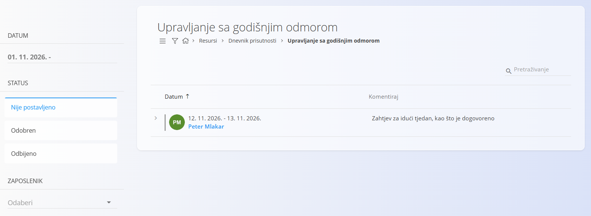
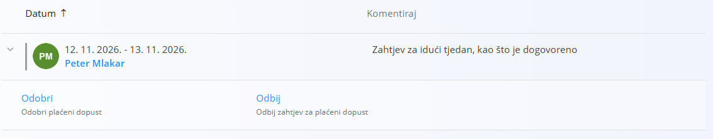

<!-- app_route: /time-logs/paid-leave-management -->
<!-- app_label: Upravljanje sa godišnjim odmorom -->
<!-- canonical_source_url: https://github.com/Tom-PIT/Connected.Docs/blob/main/hr/Domene/Resursi/Pogledi/TimeLogsManagePaidLeave.md -->
<!-- canonical_source_title: Upravljanje sa godišnjim odmorom -->

# Upravljanje sa godišnjim odmorom

Pogled **Upravljanje sa godišnjim odmorom** namijenjen je prvenstveno voditeljima i odgovornim korisnicima za **pregled, odobravanje ili odbijanje zahtjeva za plaćeni dopust** koje podnose zaposlenici.

Do ovog pogleda dolazite tako da u [navigaciji](../../../Zajednicko/UI/Navigacija.md) odaberete **Resursi / Dnevnik prisutnosti / Upravljanje sa godišnjim odmorom**.

## Pregled

Ovaj ekran pruža središnji pregled zahtjeva za plaćeni dopust, uključujući:

- traženo razdoblje datuma
- zaposlenika koji podnosi zahtjev
- neobavezni komentar ili obrazloženje
- trenutačni status zahtjeva

Zahtjevi su poredani kronološki i mogu se filtrirati pomoću bočnog panela s lijeve strane.

## Statusi zahtjeva za dopust

Svaki zahtjev za plaćeni dopust ima status koji odražava njegovo trenutačno stanje:

- **Nije postavljeno** – zahtjev čeka odluku
- **Odobren** – zahtjev je odobren
- **Odbijeno** – zahtjev je odbijen

Filtri s lijeve strane omogućuju brzo prebacivanje između tih stanja i usredotočenje na zahtjeve koji čekaju odluku ili su već riješeni.

## Pregled i upravljanje zahtjevima za plaćeni dopust

Zahtjevi sa statusom **Nije postavljeno** mogu se proširiti izravno u popisu.

Kada se redak proširi, dostupne su sljedeće radnje:

- **Odobri** – potvrđuje plaćeni dopust za odabrane datume (*Odobri plaćeni dopust*)
- **Odbij** – odbija zahtjev (*Odbij zahtjev za plaćeni dopust*)

Nakon donošenja odluke:

- zahtjev se automatski uklanja s popisa *Nije postavljeno*
- prikazuje se pod **Odobren** ili **Odbijeno**, ovisno o radnji

Tako voditelji jasno prate i odluke koje čekaju i one koje su već donesene.

## Filtriranje i pretraživanje zahtjeva za dopust

Bočni panel s lijeve strane nudi filtre koji olakšavaju upravljanje većim brojem zahtjeva:

- **Datum** – filtriranje zahtjeva po razdoblju
- **Status** – Nije postavljeno, Odobren, Odbijeno
- **Zaposlenik** – prikaz zahtjeva za određenog zaposlenika

Polje **Pretraživanje** u gornjem desnom kutu omogućuje brzo pronalaženje određenih zahtjeva.

## Veza s evidencijom vremena

Odobreni zahtjevi za plaćeni dopust prikazuju se u evidenciji vremena zaposlenika i vidljivi su u pregledu **[Dnevnik prisutnosti – Pregled](Pregled.md)**.

Ovaj ekran usmjeren je na **donošenje odluka i tijekove odobravanja**, dok se detaljni sažeci prisutnosti i sati obrađuju drugdje.
