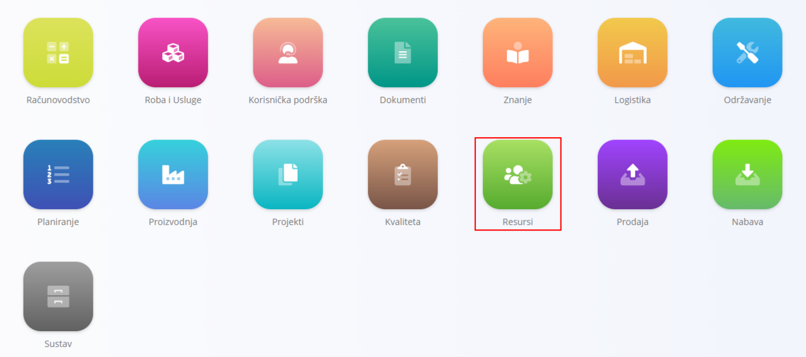
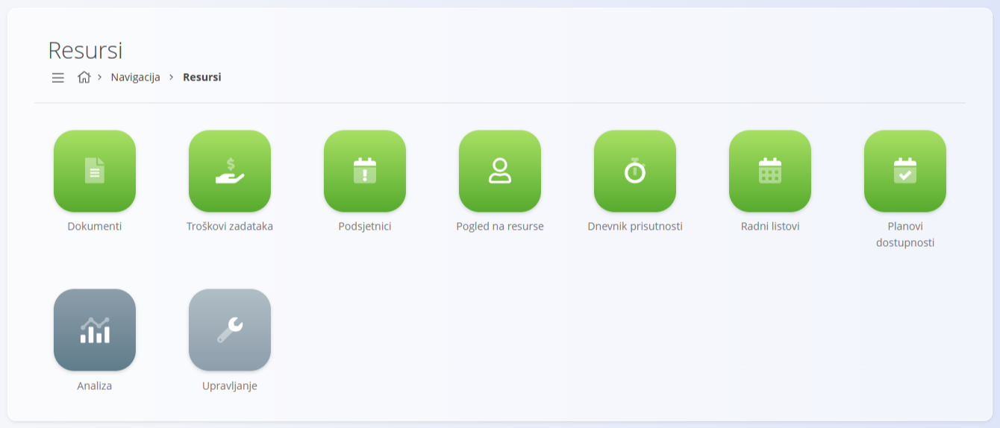
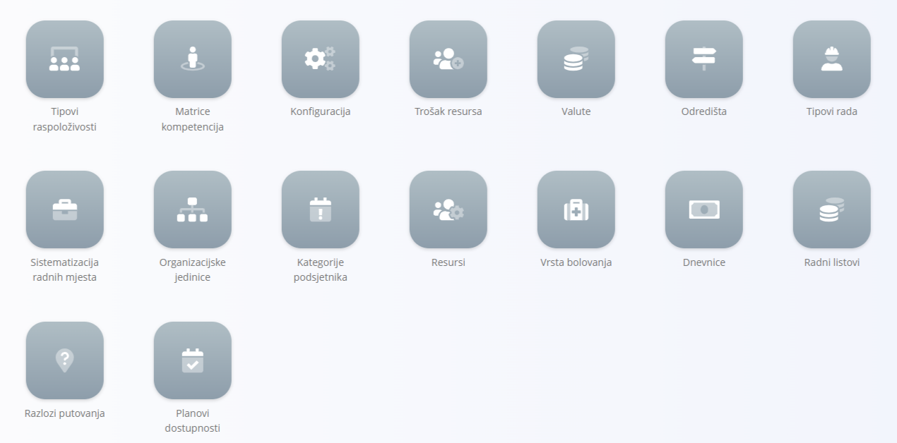
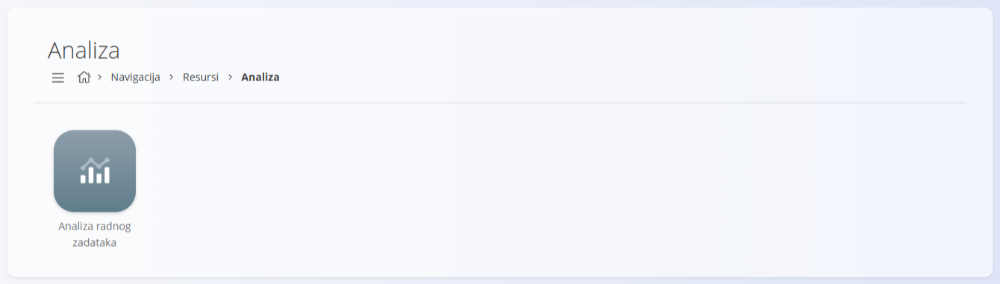

<!-- app_route: /sitemap/resources -->
<!-- app_label: Resources -->
<!-- canonical_source_url: https://github.com/Tom-PIT/Connected.Docs/blob/main/hr/Domene/Resursi/README.md -->
<!-- canonical_source_title: Resursi -->

# Resursi

Domena **Resursi** upravlja svim podacima o ljudima potrebnima za operativni rad u vašoj organizaciji. Pruža alate za planiranje dostupnosti, praćenje vremena i truda, upravljanje glavnim podacima o resursima te analizu radne snage.

Dok druge domene (na primjer **Proizvodnja**, **Održavanje** ili **Projekti**) određuju *koji posao treba obaviti*, domena Resursi određuje *tko obavlja posao*, *kada* i *pod kojim uvjetima*.

Do domene dolazite tako da u [navigaciji](../../Zajednicko/UI/Navigacija.md) odaberete **Resursi**.

> [!NOTE]  
> Dostupne značajke domene Resursi ovise o konfiguraciji tvrtke, uključenim modulima i internim pravilima.

## Što je uključeno u domenu Resursi?

Domena je podijeljena u nekoliko funkcionalnih područja:

- [**Dokumenti**](#dokumenti) – operativni dokumenti vezani uz resurse
- [**Pogledi**](#pogledi) – svakodnevni operativni i osobni pogledi
- [**Upravljanje**](#upravljanje) – konfiguracija i glavni podaci
- [**Analiza**](#analiza) – izvještavanje i analiza radne snage

## Dokumenti

Odjeljak **Dokumenti** sadrži službene dokumente vezane uz resurse, koji služe za administrativne, pravne ili usklađenost s propisima.

Dostupni dokumenti:

- **[Putni nalozi](Dokumenti/TravelOrders.md)** – evidentiranje, odobravanje i praćenje službenih putovanja zaposlenika, uključujući odredišta, datume i dnevnice.

Dokumenti su obično *zapisi*, a ne radni tijekovi izvršavanja.

## Pogledi

Odjeljak **Pogledi** sadrži operativne ekrane koje zaposlenici, voditelji timova i rukovoditelji koriste za praćenje rada, vremena, dostupnosti i podsjetnika.

Ovi ekrani usmjereni su na **izvršavanje, vidljivost i svakodnevno praćenje**, a ne na konfiguraciju.

Dostupni pogledi:

- **[Troškovi zadataka](Pogledi/WorkItemsCosts.md)** – pregled troškovnih podataka povezanih sa zadacima i dodijeljenim resursima.

- **[Podsjetnici](Pogledi/Reminders.md)** – osobni i operativni podsjetnici vezani uz zadatke, rokove ili administrativne radnje.

- **[Pogled na resurse](Pogledi/ResourceView.md)** – pregled resursa, njihovih zaduženja i dostupnosti kroz vrijeme.

- **[Dnevnik prisutnosti](Pogledi/TimeLogs.md)** – pregled i upravljanje unosima vremena koje su evidentirali resursi.

- **[Radni listovi](Pogledi/Worksheets.md)** – strukturirano izvještavanje o vremenu i aktivnostima, često za odobravanje ili obračun plaća.

- **[Planovi dostupnosti](Pogledi/AvailabilityPlans.md)** – vizualni prikaz planirane dostupnosti, odsutnosti i radnih rasporeda.

## Upravljanje

Odjeljak **Upravljanje** sadrži ekrane za konfiguraciju i glavne podatke potrebne za sve procese vezane uz resurse.

> [!TIP]
> Sve stavke upravljanja za sve domene pogledajte u **[kazalu upravljanja](../../IndeksUpravljanja.md)**.

Dostupne konfiguracije i glavni podaci uključuju:

- **[Tipovi raspoloživosti](Upravljanje/AvailabilityPlanTypes.md)**
- **[Planovi dostupnosti](Pogledi/AvailabilityPlans.md)**
- **[Matrice kompetencija](Upravljanje/CompetenceMatrixes.md)**
- **[Konfiguracija](Upravljanje/ResourcesConfiguration.md)**
- **[Trošak resursa](Upravljanje/ResourcesCosts.md)**
- **[Valute](../../Zajednicko/Upravljanje/Valute.md)**
- **[Odredišta](Upravljanje/TravelDestinations.md)**
- **[Razlozi putovanja](Upravljanje/TravelOrderReasons.md)**
- **[Tipovi rada](Upravljanje/EffortTypes.md)**
- **[Sistematizacija radnih mjesta](../Proizvodnja/Upravljanje/SistematizacijaRadnihMjesta.md)**
- **[Organizacijske jedinice](../Proizvodnja/Upravljanje/OrganizacijskeJedinice.md)**
- **[Kategorije podsjetnika](Upravljanje/ReminderCategories.md)**
- **[Resursi](Upravljanje/Resources.md)**
- **[Vrsta bolovanja](Upravljanje/SickLeaveTypes.md)**
- **[Dnevnice](Upravljanje/SubsistenceAllowances.md)**
- **[Radni listovi](Upravljanje/Timesheets.md)**

Ti elementi određuju kako su resursi strukturirani, kategorizirani, troškovno vrednovani i izvještavani u sustavu.

## Analiza

Odjeljak **Analiza** pruža uvid u iskorištenost radne snage i operativnu učinkovitost.

Dostupni analitički pogledi:

- **[Analiza radnog vremena](Analiza/WorkTimeAnalysis.md)** – analiza odrađenih sati, odsutnosti, obrazaca dostupnosti i trendova iskorištenosti.

Ekrani analize su **samo za čitanje** i podržavaju planiranje, optimizaciju i donošenje odluka.

## Resursi i ostale domene

Domena Resursi usko je povezana s drugim operativnim područjima:

| Domena | Povezanost |
|------|------------|
| [**Projekti**](../Projekti/README.md) | Zadaci se dodjeljuju resursima; trud i dostupnost prate se po projektu. |
| [**Proizvodnja**](../Proizvodnja/README.md) | Resursi izvode proizvodne operacije i prijavljuju vrijeme i trud. |
| [**Održavanje**](../Odrzavanje/README.md) | Aktivnosti održavanja troše vrijeme i dostupnost resursa. |
| [**Logistika**](../Logistika/README.md) | Putni nalozi i dostupnost utječu na planiranje logistike. |
| [**Računovodstvo**](../Racunovodstvo/README.md) | Podaci o vremenu, trošku i dnevnicama ulaze u financijske procese i izvještavanje. |
