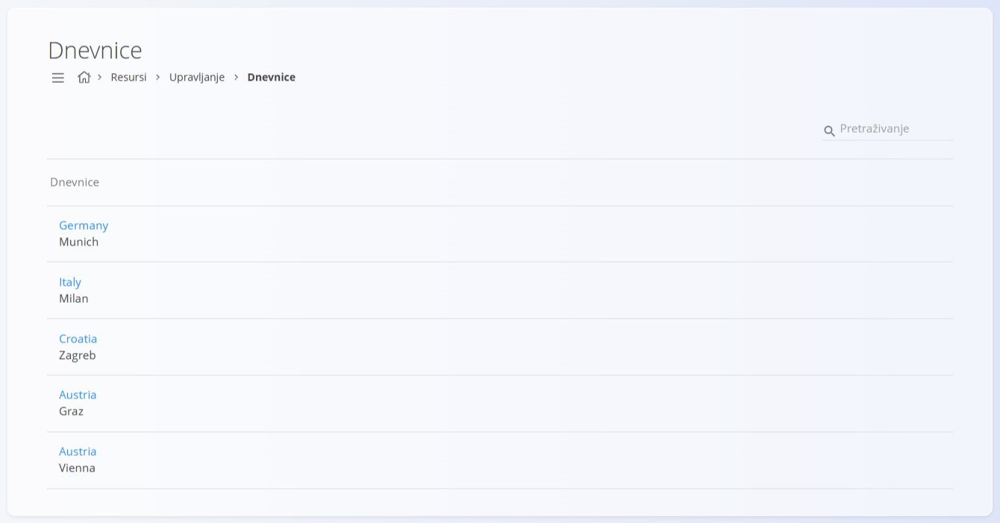
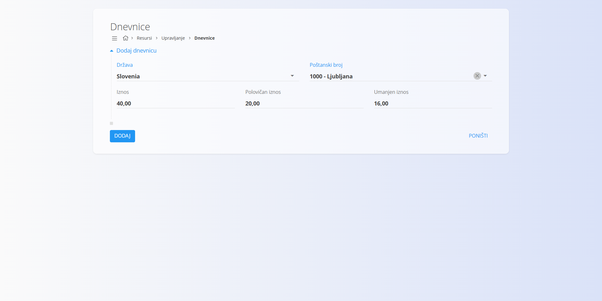

<!-- app_route: /management/resources/subsistence-allowances -->
<!-- app_label: Dnevnice -->
<!-- canonical_source_url: https://github.com/Tom-PIT/Connected.Docs/blob/main/hr/Domene/Resursi/Upravljanje/Dnevnice.md -->
<!-- canonical_source_title: Dnevnice -->

# Dnevnice

**Dnevnice** određuju dnevne iznose koji se zaposlenicima isplaćuju za službena putovanja. Obično se koriste u [**putnim nalozima**](../Dokumenti/PutniNalozi.md) za automatski izračun naknade za obroke i dnevnicu prema odredištu.

Do ovog popisa dolazite tako da u [navigaciji](../../../Zajednicko/UI/Navigacija.md) odaberete **Resursi / Upravljanje / Dnevnice**.

## Upotreba u drugim modulima

Dnevnice se prvenstveno koriste u:

- [**putnim nalozima**](../Dokumenti/PutniNalozi.md) – automatski izračun dnevnih naknada tijekom službenih putovanja

Tako se osigurava dosljedno i centralizirano upravljanje pravilima za naknade za putovanja u cijelom sustavu.

## Shema

| Polje | Opis |
|------|------------|
| **Država** | Država na koju se dnevnica odnosi. |
| **Poštanski broj** | Neobavezni poštanski broj ili referenca grada (na primjer: *1010 – Beč*). |
| **Iznos** | Puni dnevni iznos dnevnice. |
| **Polovičan iznos** | Umanjeni iznos, obično za putovanja koja traju dio dana. |
| **Umanjen iznos** | Dodatno umanjena dnevnica, ovisno o pravilima tvrtke ili zakona. |

## Upravljanje

### Popis

Popis prikazuje sve definirane dnevnice. Svaki unos predstavlja državu (i neobavezno grad ili poštanski broj) s pripadajućim iznosima dnevnice.

Popis podržava pretraživanje i brzu navigaciju.

Klik na unos otvara ga za uređivanje.

## Radnje

### Stvaranje dnevnice

Za stvaranje nove dnevnice:

1. Kliknite [gumb radnji](../../../Zajednicko/UI/AkcijskiGumb.md).
2. Odaberite **Državu**.
3. Po želji unesite **Poštanski broj** ili grad.
4. Unesite **Iznos**, **Polovičan iznos** i **Umanjen iznos**.
5. Kliknite **Dodaj** da biste spremili.

Primjer unosa: Slovenija, Ljubljana (1000), dnevnica 40,00 €, polovična 20,00 €, umanjena 16,00 €. Iznosi su ilustrativni i nisu provjereni prema službenim stopama.

### Uređivanje dnevnice

Klik na postojeću dnevnicu otvara je u načinu uređivanja, gdje se iznosi mogu prilagoditi kada se mijenjaju propisi ili pravila tvrtke.

Promjene stupaju na snagu odmah i koriste se pri izračunu dnevnica u dokumentima vezanima uz putovanja.

### Brisanje dnevnice

Klik na postojeću dnevnicu otvara je u načinu uređivanja, zatim kliknite **Izbriši**.

Nakon potvrde brisanja dnevnica se uklanja s popisa i više nije dostupna za odabir u putnim nalozima.
