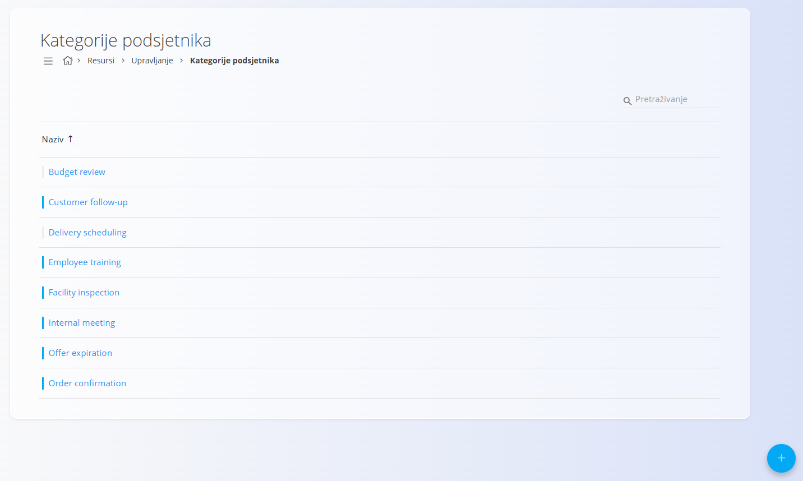
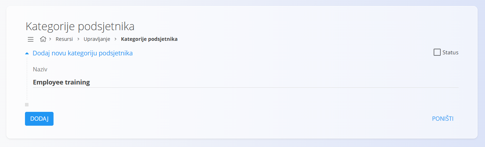

<!-- app_route: /management/resources/reminder-categories -->
<!-- app_label: Kategorije podsjetnika -->
<!-- canonical_source_url: https://github.com/Tom-PIT/Connected.Docs/blob/main/hr/Domene/Resursi/Upravljanje/KategorijePodsjetnika.md -->
<!-- canonical_source_title: Kategorije podsjetnika -->

# Kategorije podsjetnika

**Kategorije podsjetnika** određuju **oznake za razvrstavanje** koje se mogu dodijeliti podsjetnicima u pogledu [**Podsjetnici**](../Pogledi/Podsjetnici.md). Pomažu u organizaciji podsjetnika prema svrsi (na primjer *Budget review* ili *Facility inspection*) i ponovno se koriste u cijelom sustavu gdje se podsjetnici stvaraju.

Do ovog popisa dolazite tako da u [navigaciji](../../../Zajednicko/UI/Navigacija.md) odaberete **Resursi / Upravljanje / Kategorije podsjetnika**.

## Shema

| Polje | Opis |
|------|------------|
| **Naziv** | Naziv kategorije podsjetnika, prikazan pri odabiru kategorije prilikom stvaranja ili uređivanja podsjetnika. |
| **Status** | Određuje je li kategorija aktivna i dostupna za odabir. Onemogućene kategorije ne mogu se koristiti za nove podsjetnike. |

## Upravljanje

### Popis

Popis prikazuje sve definirane kategorije podsjetnika.

Svaki redak predstavlja jednu kategoriju podsjetnika. Klik na kategoriju otvara je za uređivanje.

Aktivne kategorije označene su plavom oznakom statusa, a neaktivne sivom.

## Radnje

### Stvaranje kategorije podsjetnika

1. Kliknite [gumb radnji](../../../Zajednicko/UI/AkcijskiGumb.md).
2. Unesite odgovarajući **Naziv** kategorije.
3. Uključite **Status** ako kategorija treba biti dostupna.
4. Kliknite **Dodaj** da biste spremili.

### Uređivanje kategorije podsjetnika

1. Kliknite kategoriju koju želite urediti.
2. Izmijenite **Naziv** ili **Status** prema potrebi.
3. Kliknite **Spremi** da primijenite promjene.

### Brisanje kategorije podsjetnika

1. Kliknite kategoriju koju želite obrisati.
2. Kliknite **Izbriši**.
3. Potvrdite brisanje.
