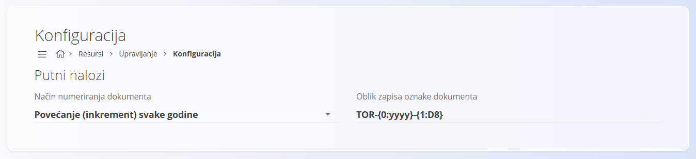

<!-- app_route: /resources/travel/configuration -->
<!-- app_label: Konfiguracija -->
<!-- canonical_source_url: https://github.com/Tom-PIT/Connected.Docs/blob/main/hr/Domene/Resursi/Upravljanje/Konfiguracija.md -->
<!-- canonical_source_title: Konfiguracija -->

# Konfiguracija

Konfigurirajte postavke **Resursa** koje utječu na numeriranje dokumenata i ponašanje dokumenata vezanih uz resurse. Promjene se spremaju automatski.

Do ove stranice dolazite tako da u [navigaciji](../../../Zajednicko/UI/Navigacija.md) odaberete **Resursi / Upravljanje / Konfiguracija**.

## Putni nalozi

Konfigurirajte način numeriranja dokumenata **putnih naloga**.

| Polje | Opis |
|------|-------------|
| **Način numeriranja dokumenta** | Određuje kako se generiraju brojevi dokumenata.   • **Povećanje (inkrement) svake godine:** numeriranje se ponovno pokreće svake kalendarske godine.   • **Povećanje:** numeriranje se nastavlja bez ponovnog pokretanja. |
| **Oblik zapisa oznake dokumenta** | Određuje strukturu generirane oznake dokumenta.   Oznake poput **{0:yyyy}** i **{1:D8}** automatski se zamjenjuju kada se dokument stvori. |

> [!TIP]
>
> Koristite dosljedan oblik zapisa oznake dokumenta kako bi putne naloge bilo lakše prepoznati i sortirati kroz godine.
