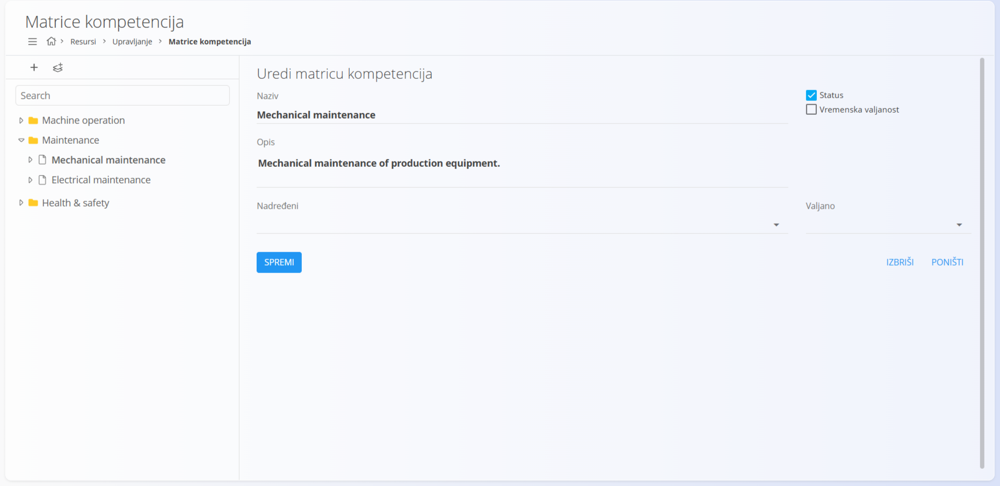
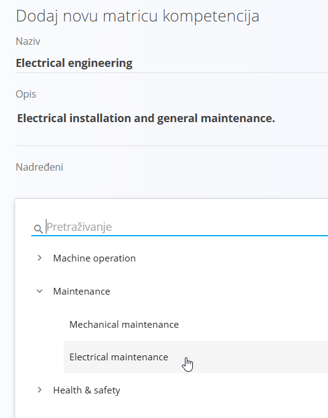
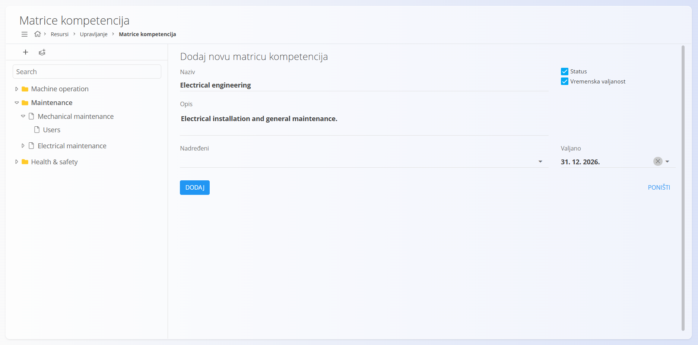
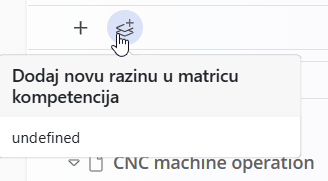
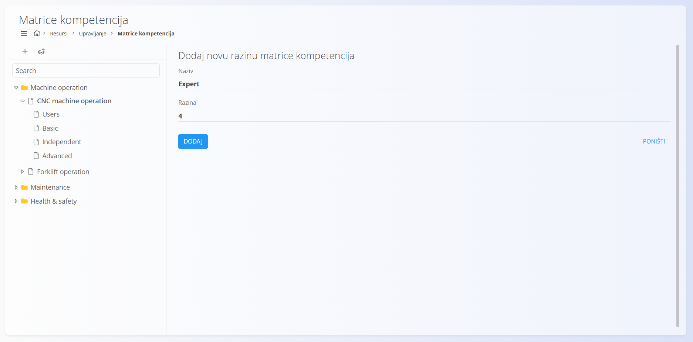
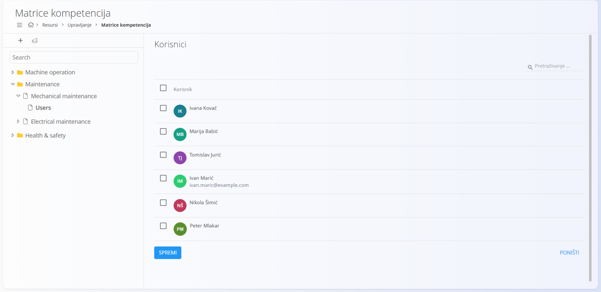

<!-- app_route: /management/resources/competence-matrix -->
<!-- app_label: Matrice kompetencija -->
<!-- canonical_source_url: https://github.com/Tom-PIT/Connected.Docs/blob/main/hr/Domene/Resursi/Upravljanje/MatriceKompetencija.md -->
<!-- canonical_source_title: Matrice kompetencija -->

# Matrice kompetencija

**Matrice kompetencija** služe za definiranje, strukturiranje i praćenje kompetencija zaposlenika u cijeloj organizaciji. Omogućuju hijerarhijsko modeliranje vještina, dodjeljivanje razina stručnosti (slojeva) i povezivanje korisnika s određenim kompetencijama.

Do ovog pogleda dolazite tako da u [navigaciji](../../../Zajednicko/UI/Navigacija.md) odaberete **Resursi / Upravljanje / Matrice kompetencija**.

## Shema

| Polje | Opis |
|------|------------|
| **Naziv** | Naziv kompetencije ili skupine kompetencija (na primjer: *Upravljanje viljuškarom*, *Obuka o sigurnosti na radu*). |
| **Opis** | Neobavezan opis koji objašnjava namjenu ili opseg kompetencije. |
| **Nadređeni** | Neobavezna nadređena kompetencija, koja se koristi za izgradnju hijerarhijske strukture (na primjer grupiranje kompetencija pod *Zaštita na radu*). |
| **Status** | Pokazuje je li kompetencija aktivna i dostupna za korištenje. |
| **Vremenska valjanost** | Kada je uključeno, omogućuje određivanje datuma valjanosti kompetencije (za certifikate ili obuke ograničene vremenom). |
| **Valjano** | Datum isteka kompetencije kada je uključena vremenska valjanost. |

### Sloj matrice kompetencija

| Polje | Opis |
|------|------------|
| **Naziv** | Naziv razine stručnosti (na primjer: *Basic*, *Independent*, *Advanced*, *Certified operator*). |
| **Razina** | Brojčani redoslijed sloja. Niži brojevi obično predstavljaju nižu razinu stručnosti. |

## Upravljanje

### Pregled

Lijeva strana ekrana prikazuje **stablo** svih matrica kompetencija. Kompetencije se mogu organizirati u kategorije i podkompetencije.

Odabirom kompetencije s desne strane prikazuje se pogled **Korisnici**, na kojem se korisnici mogu dodijeliti toj kompetenciji.

## Radnje

### Stvaranje nove matrice kompetencija

Za stvaranje nove matrice kompetencija:

1. Kliknite gumb **+** na alatnoj traci u gornjem lijevom kutu.
2. Unesite **Naziv** kompetencije.
3. Po želji unesite **Opis**.
4. (Neobavezno) Odaberite **Nadređeni** da biste kompetenciju smjestili u hijerarhiju.

   

5. Uključite **Status** ako kompetencija treba biti aktivna.
6. Uključite **Vremenska valjanost** ako kompetencija istječe nakon određenog datuma.
7. Kliknite **Dodaj** da biste spremili.

### Dodavanje slojeva (razina stručnosti) matrici kompetencija

Slojevi predstavljaju **razine stručnosti** unutar kompetencije (na primjer *Basic*, *Independent*, *Advanced*).

Za dodavanje sloja:

1. Odaberite postojeću matricu kompetencija u stablu.
2. Kliknite gumb **Dodaj novu razinu u matricu kompetencija** na alatnoj traci (ikona s dvije strelice i plusom).
3. Unesite **Naziv** sloja.
4. Odredite **Razinu** (brojčani redoslijed).
5. Kliknite **Dodaj** da biste spremili.

> [!NOTE]
> Nisu sve kompetencije potrebne slojeve.
> Slojevi se obično koriste tamo gdje su važne **razine napredovanja ili certifikacije**.

### Dodjela korisnika kompetencijama

Kada je kompetencija odabrana, pogled **Korisnici** prikazuje sve dostupne korisnike.

- Odaberite jednog ili više korisnika da biste ih dodijelili kompetenciji.
- Kliknite **Spremi** da potvrdite dodjele.

Dodijeljeni korisnici smatraju se kompetentnima za to područje, po želji na određenim razinama stručnosti ako su slojevi definirani.

## Hijerarhije i struktura

Matrice kompetencija podržavaju **ugniježđene strukture**, što omogućuje modeliranje stvarnih skupina vještina.

Primjeri:
- *Zaštita na radu*
  - Obuka o sigurnosti na radu
  - Postupci u hitnim slučajevima
- *Upravljanje strojevima*
  - CNC machine operation
    - Basic
    - Independent
    - Advanced
- *Upravljanje viljuškarom*
  - Certified operator

Ta struktura jasno organizira kompetencije i olakšava njihovo upravljanje u većem opsegu.

### Brisanje matrice kompetencija ili sloja

Matrice kompetencija i slojevi mogu se obrisati iz njihovih ekrana za uređivanje. Kliknite naziv matrice ili sloja na popisu da biste otvorili njezine pojedinosti, zatim kliknite **Izbriši** i potvrdite radnju.

Obrisane kompetencije:
- se uklanjaju iz hijerarhije
- više nisu dostupne za dodjelu korisnicima
- ne utječu na povijesne zapise

> [!WARNING]
> Brisanje koristite oprezno, osobito kada su kompetencije već dodijeljene korisnicima.
