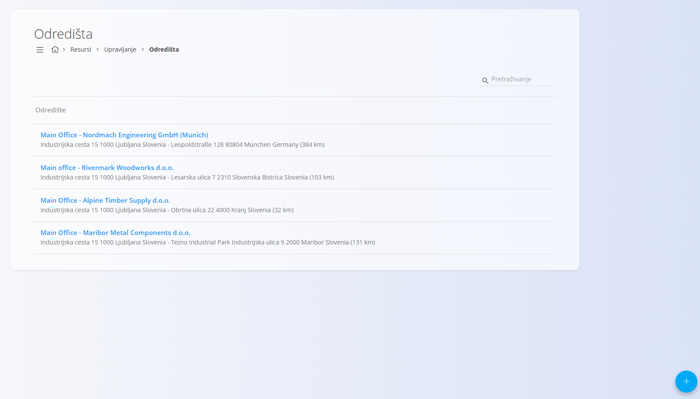
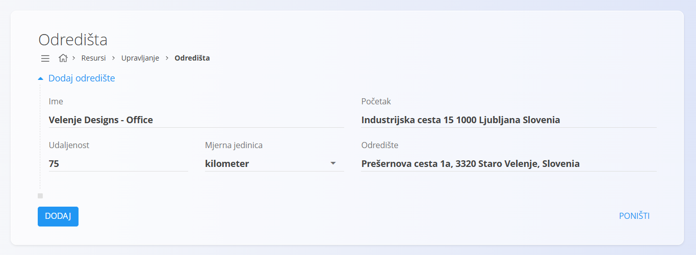

<!-- app_route: /management/resources/destinations -->
<!-- app_label: Odredišta -->
<!-- canonical_source_url: https://github.com/Tom-PIT/Connected.Docs/blob/main/hr/Domene/Resursi/Upravljanje/Odredista.md -->
<!-- canonical_source_title: Odredišta -->

# Odredišta

Definirajte **unaprijed određena odredišta putovanja** koja se koriste pri stvaranju putnih naloga. Odredišta pohranjuju adrese polaska i odredišta zajedno s podacima o udaljenosti, što omogućuje dosljedno i ponovljivo stvaranje putnih naloga.

Do ovog popisa dolazite tako da u [navigaciji](../../../Zajednicko/UI/Navigacija.md) odaberete **Resursi / Upravljanje / Odredišta**.

## Shema

| Polje | Opis |
|------|------|
| **Ime** | Opisni naziv odredišta (na primjer: *Main Office – Alpine Timber Supply d.o.o.*). |
| **Početak** | Početna adresa putovanja, obično glavna lokacija tvrtke. |
| **Odredište** | Ciljna adresa putovanja. |
| **Udaljenost** | Udaljenost između početka i odredišta. |
| [**Mjerna jedinica**](../../../Zajednicko/Upravljanje/MjerneJedinice.md) | Jedinica za udaljenost (na primjer kilometar). |

## Upravljanje

### Popis

Popis prikazuje sve konfigurirane odredište putovanja.

Svaki redak prikazuje:
- naziv odredišta
- adrese polaska i odredišta
- izračunatu udaljenost s jedinicom

Klik na odredište otvara ga za uređivanje.

## Radnje

### Dodavanje novog odredišta

1. Kliknite [gumb radnji](../../../Zajednicko/UI/AkcijskiGumb.md) da biste stvorili novo odredište.
2. Ispunite polja opisana u odjeljku [**Shema**](#shema).
3. Kliknite **Dodaj** da biste spremili.

### Uređivanje odredišta

1. Kliknite odredište na popisu.
2. Izmijenite potrebna polja.
3. Kliknite **Spremi**.

> [!NOTE]
> - Odredišta se mogu ponovno koristiti u više putnih naloga.
> - Promjene odredišta utječu na buduće putne naloge, a ne na već stvorene.

### Brisanje odredišta

1. Kliknite odredište na popisu da biste ga otvorili za uređivanje.
2. Kliknite **Izbriši** i potvrdite radnju.

Obrisana odredišta više nisu dostupna pri stvaranju novih putnih naloga.
