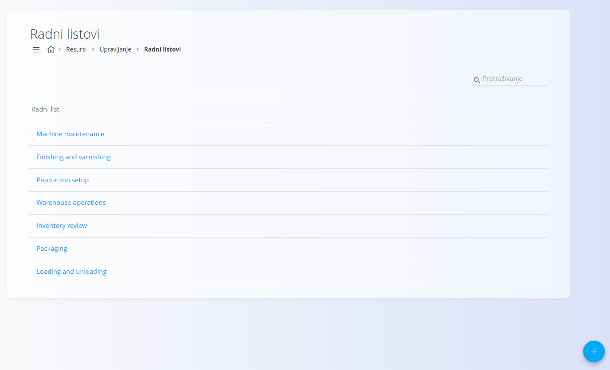
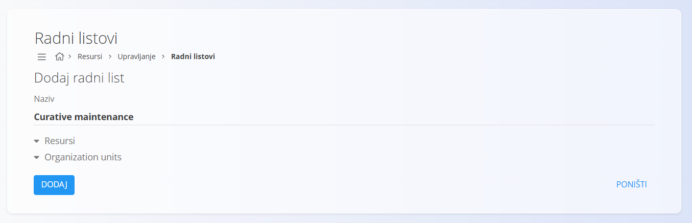

<!-- app_route: /management/resources/timesheets -->
<!-- app_label: Radni listovi -->
<!-- canonical_source_url: https://github.com/Tom-PIT/Connected.Docs/blob/main/hr/Domene/Resursi/Upravljanje/RadniListoviUpravljanje.md -->
<!-- canonical_source_title: Radni listovi -->

# Radni listovi

**Radni listovi** određuju unaprijed definirane kategorije radnih aktivnosti koje se mogu koristiti pri evidentiranju vremena i truda u cijelom sustavu.

Do ovog popisa dolazite tako da u [navigaciji](../../../Zajednicko/UI/Navigacija.md) odaberete **Resursi / Upravljanje / Radni listovi**.

Ti se unosi obično koriste za standardizaciju načina na koji se rad razvrstava pri evidentiranju vremena, što omogućuje dosljedno izvještavanje i analizu.

## Shema

| Polje | Opis |
|------|-------------|
| **Naziv** | Naziv kategorije radnog lista. Korisnicima se prikazuje pri odabiru kategorije u kojoj se evidentira njihovo vrijeme (na primjer: *Machine maintenance*, *Packaging*, *Warehouse operations*). |

## Upravljanje

### Popis

Popis prikazuje sve definirane kategorije radnih listova.

### Korištenje radnih listova

Radni listovi služe kao **referentne kategorije** i koriste se u različitim tokovima evidentiranja vremena i truda, na primjer:

- evidentiranje radnog vremena
- evidentiranje truda na zadacima ili operacijama
- grupiranje i izvještavanje o radnim satima prema vrsti aktivnosti

Definiranjem radnih listova na jednom mjestu osigurava se dosljedno nazivlje i razvrstavanje radnih aktivnosti u svim timovima.

## Radnje

### Stvaranje novog radnog lista

Za stvaranje novog radnog lista:

1. Kliknite [gumb radnji](../../../Zajednicko/UI/AkcijskiGumb.md).
2. Unesite **Naziv** koji jasno opisuje radnu aktivnost.
3. Po potrebi odaberite **Resursi** i **Organization units** kojima radni list vrijedi.
4. Kliknite **Dodaj** da biste spremili.

Novi radni list odmah je dostupan za odabir na ekranima za evidentiranje vremena i truda.

### Uređivanje radnog lista

1. Kliknite radni list na popisu da biste ga otvorili za uređivanje.
2. Izmijenite **Naziv** prema potrebi.
3. Kliknite **Spremi**.

> [!NOTE]
> Radni listovi su konfiguracijski podaci. Mijenjajte ih pažljivo, osobito ako se već koriste u povijesnim zapisima.

### Brisanje radnog lista

1. Kliknite radni list na popisu da biste ga otvorili za uređivanje.
2. Kliknite **Izbriši** i potvrdite radnju.

Obrisani radni listovi više nisu dostupni za odabir na ekranima za evidentiranje vremena i truda.
