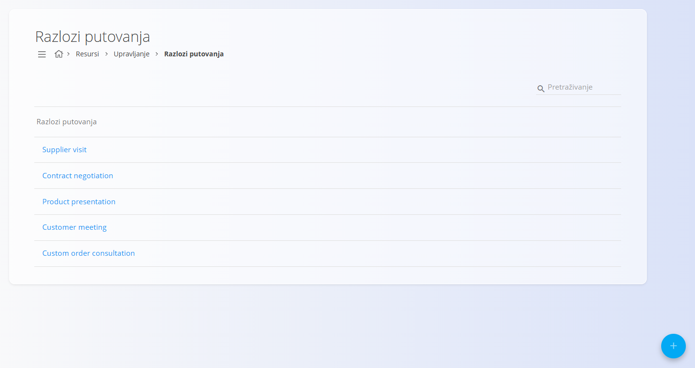
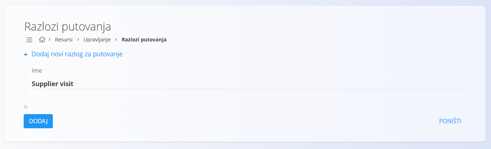

<!-- app_route: /management/resources/travel-order-reasons -->
<!-- app_label: Razlozi putovanja -->
<!-- canonical_source_url: https://github.com/Tom-PIT/Connected.Docs/blob/main/hr/Domene/Resursi/Upravljanje/RazloziPutovanja.md -->
<!-- canonical_source_title: Razlozi putovanja -->

# Razlozi putovanja

**Razlozi putovanja** određuju moguće svrhe službenog putovanja. Koriste se pri stvaranju [putnih naloga](../Dokumenti/PutniNalozi.md), pa korisnici mogu odabrati unaprijed određeni razlog umjesto slobodnog unosa teksta.

Do ovog popisa dolazite tako da u [navigaciji](../../../Zajednicko/UI/Navigacija.md) odaberete **Resursi / Upravljanje / Razlozi putovanja**.

## Shema

| Polje | Opis |
|------|------------|
| **Ime** | Naziv razloga putovanja koji se korisnicima prikazuje pri stvaranju putnog naloga (na primjer: *Supplier visit*, *Customer meeting*). |

## Upravljanje

### Popis razloga putovanja

Popis prikazuje sve konfigurirane razloge putovanja.

- Svaki redak predstavlja jedan razlog.
- Klik na razlog otvara ga za uređivanje.
- Polje za pretraživanje služi za brzo pronalaženje određenih razloga.

## Radnje

### Dodavanje novog razloga putovanja

1. Kliknite [gumb radnji](../../../Zajednicko/UI/AkcijskiGumb.md) da biste stvorili novi unos.
2. Unesite **Ime** razloga.
3. Kliknite **Dodaj** da biste spremili.

### Uređivanje razloga putovanja

1. Kliknite razlog na popisu.
2. Izmijenite **Ime** prema potrebi.
3. Kliknite **Spremi**.

### Brisanje razloga putovanja

1. Kliknite razlog na popisu da biste ga otvorili za uređivanje.
2. Kliknite **Izbriši** i potvrdite radnju.

Obrisani razlozi više nisu dostupni pri stvaranju novih putnih naloga.
