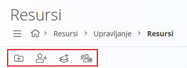
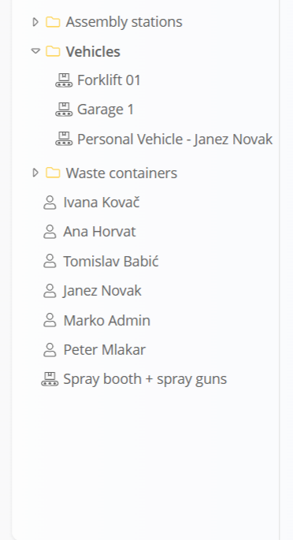
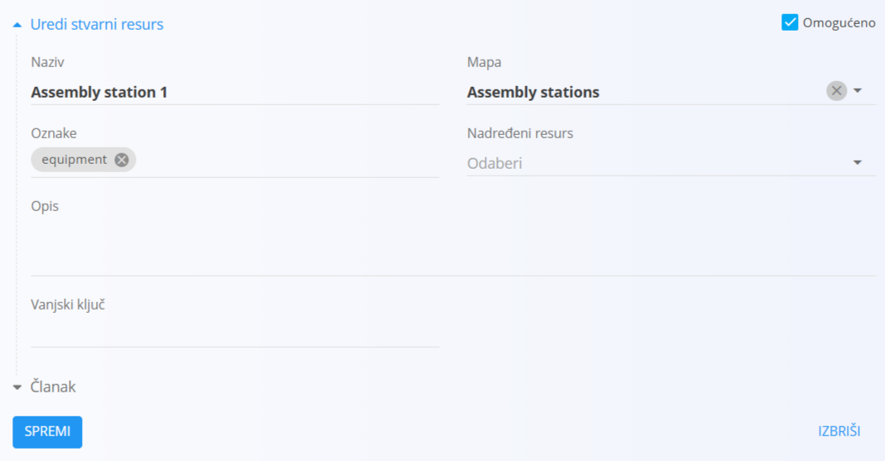
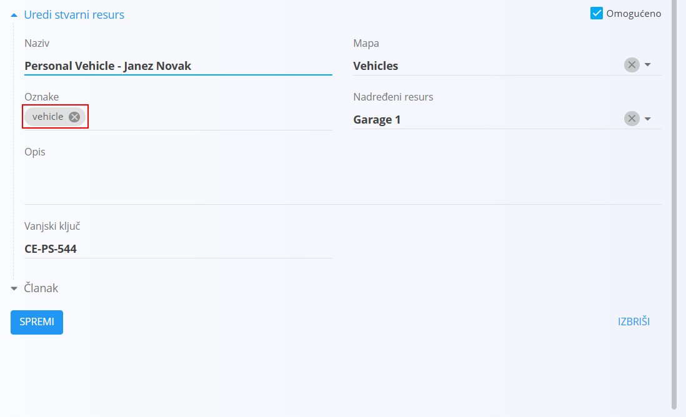

<!-- app_route: /management/resources -->
<!-- app_label: Resursi -->
<!-- canonical_source_url: https://github.com/Tom-PIT/Connected.Docs/blob/main/hr/Domene/Resursi/Upravljanje/Resursi.md -->
<!-- canonical_source_title: Resursi -->

# Resursi

Resursi služe za definiranje i upravljanje svim **ljudskim** i **neljudskim** sredstvima dostupnima u **proizvodnji** i **održavanju**. To uključuje radnike, tehničare, strojeve, radna mjesta, alate, mjernu opremu i ekipe. Resursi stvoreni ovdje kasnije se mogu dodijeliti [**operacijama**](../../Proizvodnja/Upravljanje/Operacije.md), [**procesima**](../../Proizvodnja/Upravljanje/Procesi.md) te dokumentima poput [**proizvodnih naloga**](../../Proizvodnja/Dokumenti/ProizvodniNalozi.md) i [**naloga za održavanje**](../../Odrzavanje/Dokumenti/NaloziZaOdrzavanje.md).

Do ove stranice dolazite tako da u [navigaciji](../../../Zajednicko/UI/Navigacija.md) odaberete **Proizvodnja**, **Resursi** ili **Održavanje**, zatim **Upravljanje / Resursi**.

> [!TIP]
> Za potpunu demonstraciju pogledajte video vodič [**Resursi**](https://www.youtube.com/watch?v=Kr5WkGMQj48).

## Shema

<strong>Opće</strong>

U tablici su navedena sva polja koja se koriste za **ljudske**, **neljudske** i **ekipe** resurse.

| Polje | Opis | LR | NLR | E |
|-------|-------------|:-:|:--:|:-:|
| **Korisnik** | Povezuje resurs s korisnikom sustava (obavezno za ljudske resurse). | ✔️ |  |  |
| **Naziv** | Naziv resursa ili ekipe (obavezno). | ✔️ | ✔️ | ✔️ |
| **Mapa** | Mapa u kojoj se nalazi resurs ili ekipa. | ✔️ | ✔️ | ✔️ |
| **Oznake** | Oznake za razvrstavanje ili filtriranje (na primjer Proizvodnja, Održavanje). | ✔️ | ✔️ | ✔️ |
| **Ekipe** | Ekipe kojima ljudski resurs pripada. | ✔️ |  |  |
| **Nadređeni resurs** | Nadređeni resurs za hijerarhijsko grupiranje. |  | ✔️ |  |
| **Opis** | Slobodno tekstualno polje s dodatnim podacima o resursu. |  | ✔️ |  |
| **Vanjski ključ** | Vanjski identifikator za integracije. |  | ✔️ |  |
| **Members** | Ljudski resursi uključeni u ekipu. |  |  | ✔️ |
| **Članak** | Članak povezan s pojedinim neljudskim resursom. |  | ✔️ |  |
| **Omogućeno** | Pokazuje je li resurs ili ekipa aktivna. | ✔️ | ✔️ | ✔️ |

LR = ljudski resurs, NLR = neljudski resurs (resurs koji nije ljudski), E = ekipa.

<strong>Osnovni podaci</strong>

U tablici su navedena polja u odjeljku **Osnovni podaci** obrasca za uređivanje ljudskog resursa.

| Polje | Opis |
|-------|-------------|
| **Ime** | Ime resursa. |
| **Prezime** | Prezime resursa. |
| **Država** | Država prebivališta. |
| **Poštanski broj** | Poštanski broj mjesta u kojem resurs boravi. |
| **Adresa** | Ulica i kućni broj mjesta u kojem resurs boravi. |
| **Datum rođenja** | Datum rođenja resursa. |
| **OIB** | OIB resursa (obavezno polje za izradu fiskaliziranih [maloprodajnih računa](../../Prodaja/Dokumenti/MaloprodajniRacuni.md)). |

## Radnje na alatnoj traci

- **Dodaj mapu** – stvara mapu za organiziranje resursa.
- **Dodaj ljudski resurs** – stvara pojedinačni ljudski resurs (na primjer operatera ili tehničara za održavanje).
- **Dodaj fizički resurs** – stvara stroj, radno mjesto, opremu ili alat.
- **Dodaj ekipu** – stvara skupinu ljudskih resursa.

## Struktura

Resursi se prikazuju u **stablu**. Stavke mogu, ali ne moraju biti unutar mapa.

Primjeri:
- **Montažna mjesta** (mapa)
  • Montažno mjesto 1 (neljudski resurs)
  • Montažno mjesto 2 (neljudski resurs)
- **Vozila** (mapa)
  • Osobno vozilo – Janez Novak (neljudski resurs)
- **Janez Novak** (ljudski resurs)
- **Peter Mlakar** (ljudski resurs)
- **Kabina za farbanje + pištolji za farbanje** (neljudski resurs koji nije ni u jednoj mapi)
- **Mjerni alati** (neljudski resurs)
- **Održavanje, ekipa A** (ekipa)

> [!NOTE]
> Mape su neobavezne. Samostalni resursi mogu postojati i bez mape.

## Prikaz popisa

Odabirom stavke u stablu prikazuju se njezini podaci i obrazac za uređivanje.

## Stvaranje novog resursa

1. Na alatnoj traci odaberite:
   - **Dodaj mapu**
   - **Dodaj ljudski resurs**
   - **Dodaj fizički resurs**
   - **Dodaj ekipu**
2. Ispunite polja opisana u odgovarajućem odjeljku sheme.
3. Kliknite **Dodaj** ili **Spremi** da potvrdite.

> [!IMPORTANT]
> Da biste vozila koristili u povezanim dokumentima (na primjer [putnim nalozima](../Dokumenti/PutniNalozi.md)), dodajte ih kao **neljudske resurse** i označite ih oznakom **`vehicle`**. Sustav kao vozila prepoznaje samo neljudske resurse s tom oznakom.
>
> 

> [!TIP]
> Neljudski resursi mogu se povezati s [člankom iz baze znanja](../../Znanje/BazaZnanja/BazaZnanja.md) pomoću polja **Članak**.
>
> To se može koristiti za:
>
> - upute za rad
> - postupke održavanja
> - sigurnosne smjernice
> - korisničke priručnike
> - tehničku dokumentaciju

## Uređivanje resursa

1. Kliknite bilo koji resurs u stablu.
2. Izmijenite polja (na primjer **Naziv**, **Mapa**, **Nadređeni resurs**, **Oznake**, **Ekipe** ili **Vanjski ključ**).
3. Kliknite **Spremi**.

## Brisanje resursa

Kliknite bilo koji resurs u stablu da biste otvorili stranicu za uređivanje, zatim odaberite **Izbriši**. Nakon potvrde brisanja resurs se trajno uklanja iz sustava.

Resurs se može obrisati s stranice za uređivanje samo ako se ne upotrebljava u operacijama, procesima ili dokumentima (na primjer proizvodnim ili nalozima za održavanje).
