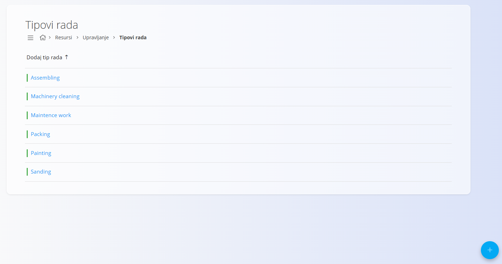
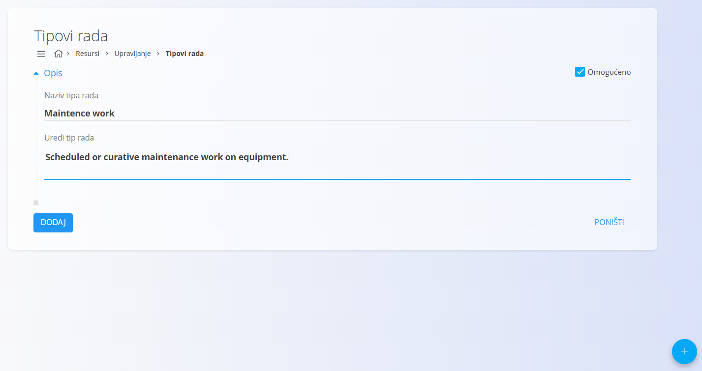
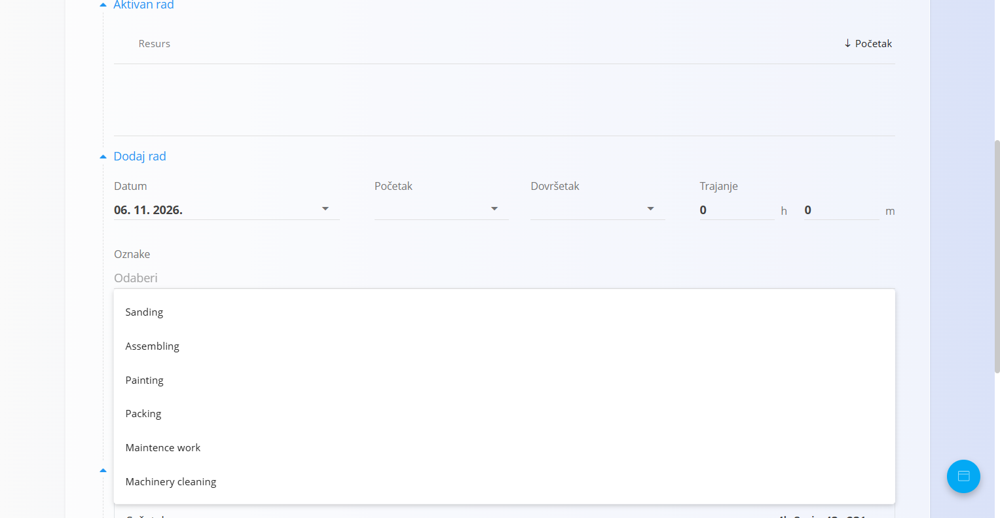

<!-- app_route: /management/resources/effort-types -->
<!-- app_label: Tipovi rada -->
<!-- canonical_source_url: https://github.com/Tom-PIT/Connected.Docs/blob/main/hr/Domene/Resursi/Upravljanje/TipoviRada.md -->
<!-- canonical_source_title: Tipovi rada -->

# Tipovi rada

**Tipovi rada** određuju **kategorije rada** koje se mogu odabrati pri evidentiranju truda na zadacima, izvršenjima proizvodnje ili aktivnostima održavanja. Pomažu u standardizaciji izvještavanja o vremenu i poboljšavaju kasniju analizu načina na koji se vrijeme troši.

Do ovog pogleda dolazite tako da u [navigaciji](../../../Zajednicko/UI/Navigacija.md) odaberete **Resursi / Upravljanje / Tipovi rada**.

## Shema

| Polje | Opis |
|------|------------|
| **Naziv tipa rada** | Naziv tipa rada koji se korisnicima prikazuje pri evidentiranju truda (na primjer: *Assembling*, *Painting*, *Maintenance work*). |
| **Opis** | Neobavezno objašnjenje onoga što tip rada predstavlja. Namijenjeno je uglavnom internom pojašnjenju i administraciji. |
| **Omogućeno** | Određuje je li tip rada aktivan i dostupan za odabir u obrascima za unos truda. |

## Upravljanje

### Popis

Popis prikazuje sve definirane tipove rada u sustavu.

- Omogućeni tipovi rada dostupni su za odabir pri evidentiranju truda.
- Onemogućeni tipovi rada ostaju spremljeni, ali ih nije moguće odabrati.
- Klik na tip rada otvara ga za uređivanje.

## Radnje

### Stvaranje novog tipa rada

Kliknite [gumb radnji](../../../Zajednicko/UI/AkcijskiGumb.md) da biste stvorili novi tip rada.

Pri stvaranju ili uređivanju tipa rada možete:

- postaviti **naziv** koji se prikazuje korisnicima
- dodati neobavezni **opis**
- omogućiti ili onemogućiti tip rada

Kliknite **Dodaj** da biste spremili novi tip rada.

### Uređivanje tipa rada

Kliknite stavku na popisu da biste uredili postojeći tip rada. Možete mijenjati naziv, opis i status omogućenosti.

Promjene spremate klikom na **Spremi**. Ako želite odbaciti promjene, kliknite **Poništi**.

### Korištenje pri evidentiranju truda

Tipovi rada koriste se kada korisnici evidentiraju trud na zadacima i izvršenjima.

Pri dodavanju truda korisnik odabire tip rada iz padajućeg popisa koji se puni iz ove konfiguracije.

Pri unosu rada u odjeljku **Rad** izvedbe polje **Oznake** nudi tipove rada. Aplikacija tu oznaku prikazuje kao „Oznake”, pa je tekst ovdje prenesen onako kako se prikazuje.

Tako se evidentirano vrijeme dosljedno kategorizira u cijelom sustavu, što podupire točno izvještavanje i analizu.

### Brisanje tipa rada

Kliknite stavku na popisu da biste otvorili ekran za uređivanje, zatim kliknite **Izbriši** da biste uklonili tip rada.

> [!NOTE]
> Obrisani tipovi rada više nisu dostupni za nove unose vremena, ali ne utječu na povijesne podatke.
