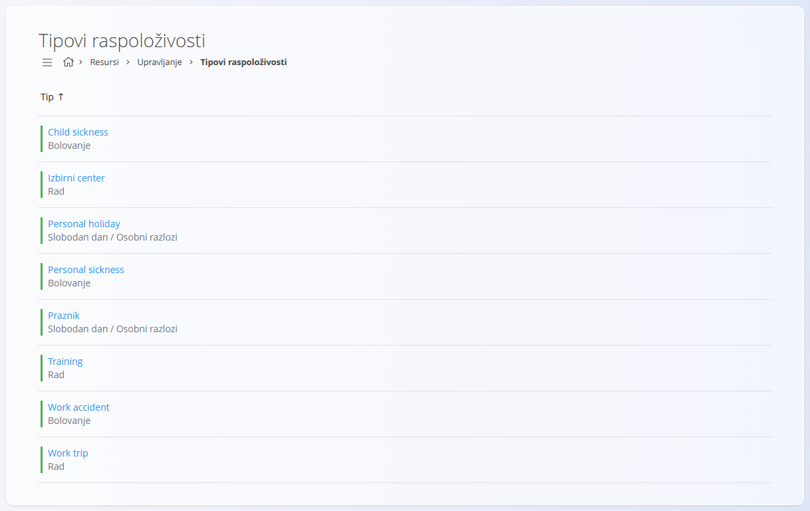
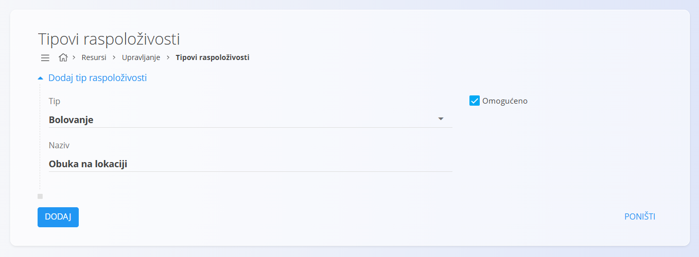
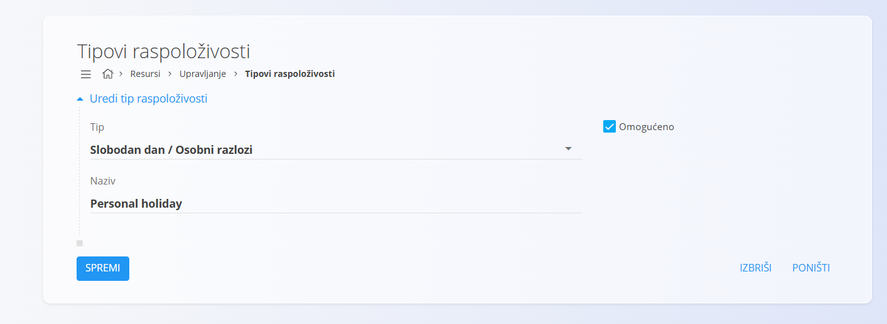

<!-- app_route: /management/resources/worksheet-types -->
<!-- app_label: Tipovi raspoloživosti -->
<!-- canonical_source_url: https://github.com/Tom-PIT/Connected.Docs/blob/main/hr/Domene/Resursi/Upravljanje/TipoviRaspolozivosti.md -->
<!-- canonical_source_title: Tipovi raspoloživosti -->

# Tipovi raspoloživosti

**Tipovi raspoloživosti** određuju **kategorije dostupnosti i odsutnosti** koje se mogu dodijeliti resursima. Koriste se kao osnova za [planove dostupnosti](../Pogledi/PlanoviDostupnosti.md).

Do ovog pogleda dolazite tako da u [navigaciji](../../../Zajednicko/UI/Navigacija.md) odaberete **Resursi / Upravljanje / Tipovi raspoloživosti**.

## Shema

| Polje | Opis |
|------|------|
| **Tip** | Određuje opću kategoriju plana dostupnosti. Uobičajene vrijednosti su **Rad**, **Bolovanje**, **Slobodan dan / Osobni razlozi** i **Praznik**. |
| **Naziv** | Opisni naziv koji se korisnicima prikazuje pri odabiru vrste dostupnosti (na primjer *Child sickness*, *Work accident*). |
| **Omogućeno** | Pokazuje je li tip plana dostupnosti aktivan i može li se odabrati u drugim dijelovima sustava. |

## Upravljanje

### Popis

Popis prikazuje sve konfigurirane tipove planova dostupnosti.

Za svaku stavku vidljivi su:
- **Naziv**
- **Tip**
- **oznaka statusa**

Klik na stavku na popisu otvara njezin **ekran za uređivanje**.

## Radnje

### Stvaranje novog tipa

Kliknite [gumb radnji](../../../Zajednicko/UI/AkcijskiGumb.md) da biste stvorili novi unos.

Unesite **Tip** i **Naziv**, po potrebi isključite **Omogućeno**, zatim kliknite **Dodaj** da biste spremili.

Promjene se primjenjuju odmah nakon spremanja i utječu na sve ekrane na kojima se tipovi dostupnosti mogu odabrati.

### Uređivanje tipa

Kliknite stavku na popisu da biste uredili tip plana. Na ekranu za uređivanje možete mijenjati **Naziv**, **Tip** i status **Omogućeno**.

Kliknite **Spremi** da primijenite promjene ili **Poništi** da ih odbacite.

## Brisanje tipa raspoloživosti

Kliknite tip plana na popisu da biste otvorili ekran za uređivanje. Odatle tip raspoloživosti možete izbrisati pomoću gumba **Izbriši**.

Nakon potvrde brisanja tip raspoloživosti se uklanja iz sustava i više se ne može dodijeliti planovima dostupnosti.

Ako se tip raspoloživosti već koristi u planovima dostupnosti ili zapisima vremena, brisanje može biti ograničeno ovisno o konfiguraciji sustava.
