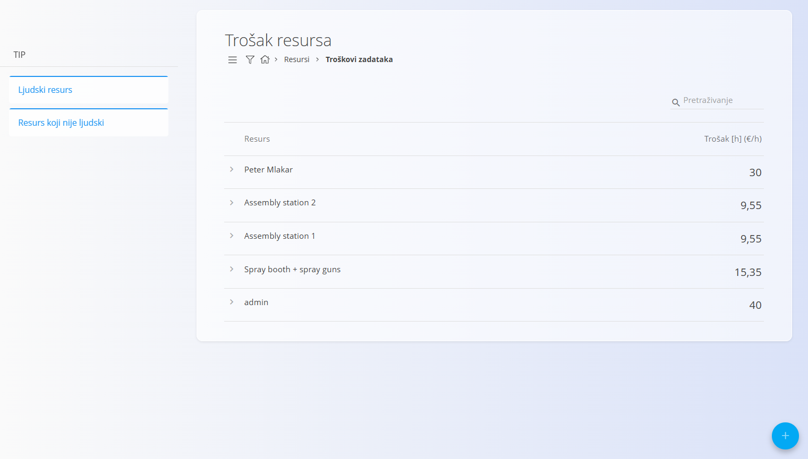
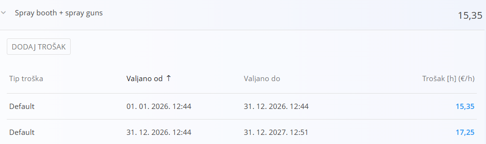
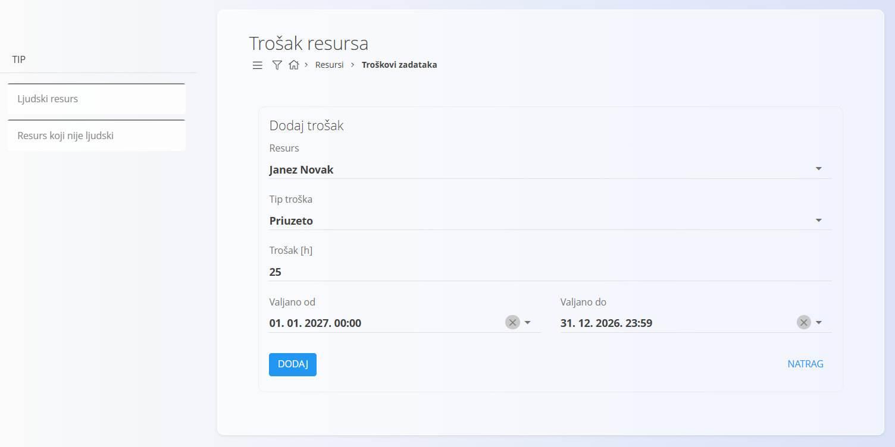
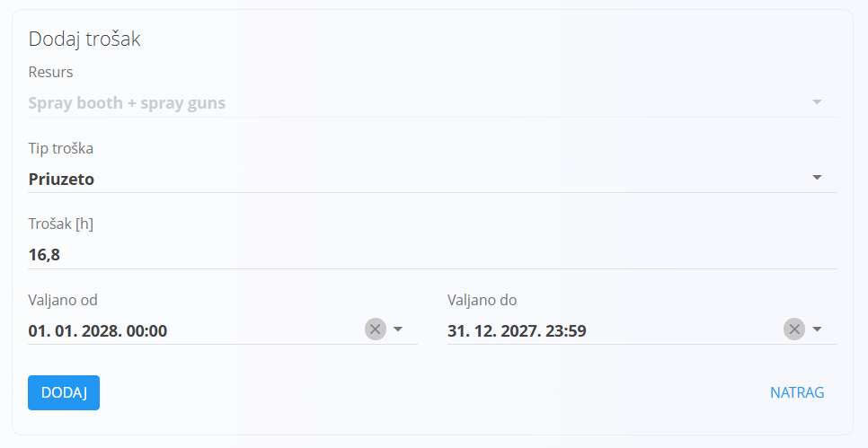

<!-- app_route: /resources/resource-costs -->
<!-- app_label: Trošak resursa -->
<!-- canonical_source_url: https://github.com/Tom-PIT/Connected.Docs/blob/main/hr/Domene/Resursi/Upravljanje/TroskoviResursa.md -->
<!-- canonical_source_title: Trošak resursa -->

# Trošak resursa

Definirajte **satne troškove resursa** (ljudskih i neljudskih). Ti se troškovi koriste za izračun proizvodnih i operativnih troškova te za procjenu troška izvršenog rada.

Do ove stranice dolazite tako da u [navigaciji](../../../Zajednicko/UI/Navigacija.md) odaberete **Resursi / Upravljanje / Trošak resursa**.

## Shema

| Polje | Opis |
|------|-------------|
| **Resurs** | Resurs za koji je trošak definiran. |
| **Trošak (€/h)** | Satni trošak dodijeljen resursu. |
| **Valjano od** | Datum i vrijeme od kojih trošak vrijedi. |
| **Valjano do** | Datum i vrijeme do kojih trošak vrijedi. Ako polje nije popunjeno, trošak vrijedi neograničeno. |

## Upravljanje

### Popis

Popis prikazuje sve resurse koji imaju definirane troškove. Svaki redak predstavlja jedan resurs.

Proširite resurs da biste vidjeli njegovu **povijest troškova** i brze radnje.

### Filteri

Filterima s lijeve strane suzite popis resursa:
- **Tip** – Ljudski resurs / Resurs koji nije ljudski

## Radnje

### Stvaranje novog troška resursa

Pomoću [gumba radnji](../../../Zajednicko/UI/AkcijskiGumb.md) dodajte novi unos troška za resurs. Ispunite polja i kliknite **Dodaj**.

#### Posebna pravila i provjere

- Razdoblja valjanosti za isti resurs **ne smiju se preklapati**.
- Ako polje **Valjano do** nije postavljeno, unos se smatra neograničenim.
- Vrijednosti troškova koriste analitika i pogledi kao što je [**Troškovi zadataka**](../Pogledi/TroskoviZadataka.md).

### Dodavanje novog troška postojećem resursu

1. Proširite resurs koji već postoji i kliknite **Dodaj trošak**.
2. Ispunite polja opisana u odjeljku [**Shema**](#shema).
3. Kliknite **Dodaj** da biste spremili.

### Uređivanje troška resursa

1. Kliknite **iznos troška** u popisu povijesti da biste ga otvorili za uređivanje.
2. Promijenite iznos ili razdoblje valjanosti i kliknite **Spremi**.

### Brisanje troška resursa

Kliknite **iznos troška** na popisu da biste ga otvorili, zatim kliknite **Izbriši**.
