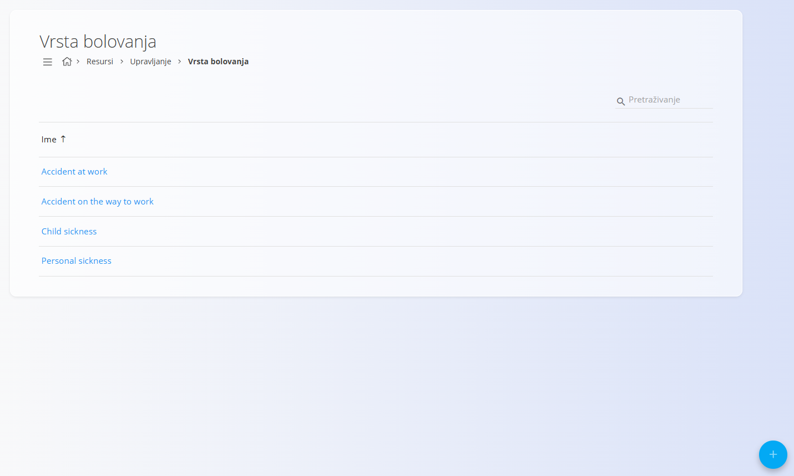
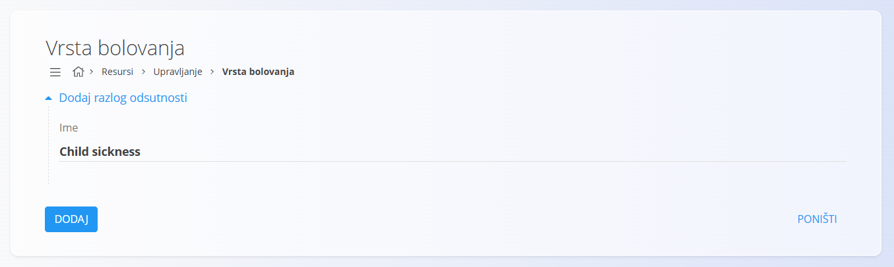

<!-- app_route: /management/resources/sick-leave-types -->
<!-- app_label: Vrsta bolovanja -->
<!-- canonical_source_url: https://github.com/Tom-PIT/Connected.Docs/blob/main/hr/Domene/Resursi/Upravljanje/VrstaBolovanja.md -->
<!-- canonical_source_title: Vrsta bolovanja -->

# Vrsta bolovanja

**Vrste bolovanja** određuju **razloge bolovanja** koje zaposlenici mogu odabrati pri unosu bolovanja. Standardiziraju izvještavanje o bolovanju i osiguravaju dosljednu kategorizaciju u evidenciji vremena, evidenciji prisutnosti i upravljanju odsustvima.

Do ovog popisa dolazite tako da u [navigaciji](../../../Zajednicko/UI/Navigacija.md) odaberete **Resursi / Upravljanje / Vrsta bolovanja**.

## Shema

| Polje | Opis |
|------|------------|
| **Ime** | Naziv razloga bolovanja koji se korisnicima prikazuje pri prijavi bolovanja (na primjer: *Accident at work*, *Flu*, *Child sickness*). |

## Upravljanje

### Popis

Popis prikazuje sve definirane vrste bolovanja.

- Svaki redak predstavlja jedan razlog bolovanja.
- Klik na redak otvara prikaz za uređivanje.
- [Gumb radnji](../../../Zajednicko/UI/AkcijskiGumb.md) omogućuje stvaranje nove vrste bolovanja.

Popis obično održavaju administratori ili voditelji ljudskih resursa.

## Radnje

### Stvaranje nove vrste bolovanja

1. Kliknite [gumb radnji](../../../Zajednicko/UI/AkcijskiGumb.md) da biste stvorili novi unos.
2. Unesite **Ime** vrste bolovanja.
3. Kliknite **Dodaj** da biste spremili vrstu bolovanja.

Promjene stupaju na snagu odmah i primjenjuju se svugdje gdje se bolovanje evidentira.

### Uređivanje vrste bolovanja

Kliknite vrstu bolovanja na popisu da biste je otvorili za uređivanje. Na ekranu za uređivanje možete promijeniti **Ime**.

Kliknite **Spremi** da primijenite promjene. Izmijenjene vrste odmah se prikazuju u svim relevantnim dijelovima sustava.

### Brisanje vrste bolovanja

Kliknite vrstu bolovanja na popisu da biste otvorili prikaz za uređivanje, zatim kliknite **Izbriši** i potvrdite radnju.

> [!NOTE]
> Brisanje može biti ograničeno ako je vrsta bolovanja povezana s postojećim zapisima (na primjer evidencijom vremena, prisutnosti ili odsustava). U tom slučaju umjesto brisanja onemogućite vrstu kako biste sačuvali povijesnu dosljednost.
