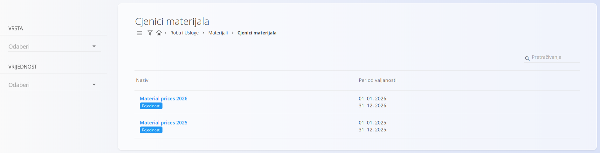
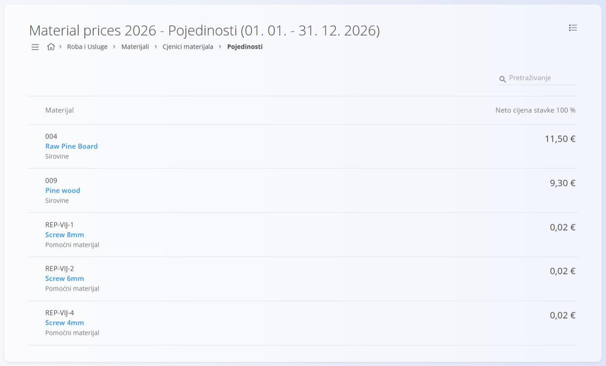
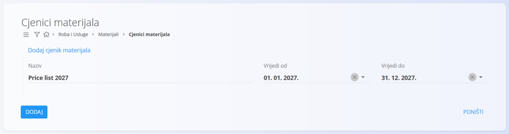
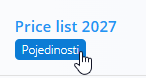
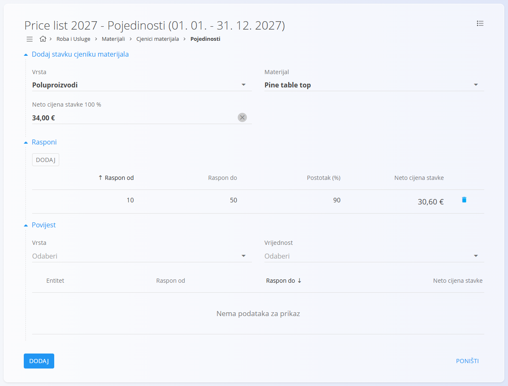
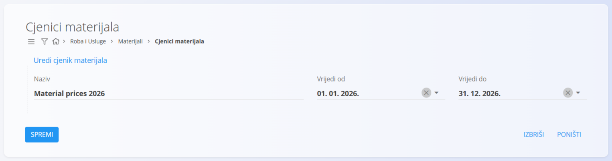

<!-- app_route: /management/materials/material-price-lists -->
<!-- app_label: Material price lists -->
<!-- canonical_source_url: https://github.com/Tom-PIT/Connected.Docs/blob/main/hr/Domene/RobaIUsluge/Materijali/CjeniciMaterijala.md -->
<!-- canonical_source_title: Cjenici materijala -->

# Cjenici materijala

**Cjenici materijala** su središnji izvor istine za neto cijene [materijala](README.md) unutar određenog razdoblja valjanosti. Omogućuju:
- Dosljedno određivanje cijena u svim procesima (nabava, proizvodnja i zalihe)
- Promjene cijena ovisne o vremenu pomoću **Valjano od** / **Valjano do**
- Neobavezne **raspone ovisne o količini** za primjenu postotnih prilagodbi osnovne cijene

Koristite ovaj ekran za izradu i održavanje cjenika po vrsti materijala, za postavljanje osnovne neto cijene (100 %) i za konfiguriranje raspona koji automatski izračunavaju učinkovitu neto cijenu za određene količine narudžbe.

Do ovog ekrana dolazite tako da u [navigaciji](../../../Zajednicko/UI/Navigacija.md) odaberete **Roba i Usluge / Materijali / Cjenici materijala**.

## Shema

<strong>Cjenik</strong>

| Polje | Opis |
|------|------|
| **Naziv** | Naziv cjenika materijala koji se prikazuje (obavezno). |
| **Valjano od** | Početni datum od kojeg cjenik postaje aktivan. |
| **Valjano do** | Završni datum razdoblja valjanosti cjenika. |

<strong>Detalji</strong>

| Polje | Opis |
|------|------|
| **Vrsta** | Klasifikacija materijala (na primjer *Sirovina*, *Poluproizvod*, *Pomoćni proizvod*). |
| [**Materijal**](README.md) | Određeni materijal na koji se cijena odnosi. |
| **Neto cijena (jedinična) 100 %** | Osnovna neto cijena materijala bez popusta. |
| **Rasponi** | Neobavezna pravila cijena ovisna o količini koja definiraju popuste ili prilagodbe. |
| **Od / Do** | Interval količine na koji se pravilo primjenjuje. |
| **Postotak (%)** | Postotak osnovne cijene koji se primjenjuje za raspon. |
| **Neto cijena (jedinična)** | Izračunata neto cijena za određeni raspon. |

## Upravljanje

### Pregled popisa

Do popisa cjenika materijala dolazite na sljedeći način:

**Roba i Usluge / Materijali / Cjenici materijala**

Popis prikazuje:
- Sve postojeće cjenike materijala
- Njihova **razdoblja valjanosti**
- Gumb **Pojedinosti** za upravljanje cijenama materijala

Popis možete filtrirati prema:
- **Vrsta**
- **Vrijednost**

Klikom na gumb **Pojedinosti** otvara se stranica s pojedinostima cijena.

## Radnje

Ovisno o trenutnom ekranu, [gumb radnji](../../../Zajednicko/UI/AkcijskiGumb.md) nudi različite mogućnosti.

### Na stranici Cjenici materijala
- **Novo**
- **Kopiraj**

### Na stranici Detalji
- **Novo**
- **Uvoz**

## Kreiranje novog cjenika materijala

1. Kliknite [gumb radnji](../../../Zajednicko/UI/AkcijskiGumb.md) i na ekranu **Cjenici materijala** odaberite **Novo**.
2. Unesite:
   - **Naziv**
   - **Vrijedi od**
   - **Vrijedi do**
3. Kliknite **Dodaj** da biste spremili zaglavlje cjenika.

   

4. Kliknite gumb **Pojedinosti** da biste upravljali cijenama materijala.

   

5. Dodajte jedan ili više **materijala** pomoću gumba radnji.

   

6. Unesite:
   - **Vrsta**
   - **Materijal**
   - **Neto cijena stavke 100 %**

7. (Neobavezno) Dodajte **Raspone** za definiranje pravila cijena ovisnih o količini.  
   Na primjer, pri naručivanju između *10 i 50 komada* cijena se može smanjiti na *90 %* osnovne cijene.

8. Spremite pojedinosti.  
   Cjenik materijala sada je aktivan za odabrano razdoblje.

## Uređivanje cjenika materijala

Za uređivanje cjenika materijala kliknite naziv cjenika na popisu. Otvara se ekran za uređivanje u kojem možete mijenjati polja **Naziv**, **Valjano od** i **Valjano do**. Nakon promjena kliknite **Spremi** da biste ih primijenili.

> [!NOTE]
> Za uređivanje cijena materijala i raspona kliknite gumb **Pojedinosti** da biste otvorili stranicu s pojedinostima, na kojoj možete mijenjati materijale i raspone prema potrebi.

### Kopiranje cjenika materijala

Stvara kopiju postojećeg cjenika, uključujući njegovo razdoblje valjanosti i sadržaj.

### Uvoz cjenika materijala

Ekran **Uvoz** omogućuje uvoz CSV datoteke s popisom pojedinosti.

## Brisanje cjenika materijala

Cjenik materijala može se obrisati **samo ako ne sadrži nijednu pojedinost o materijalu**.

Ako u odjeljku **Detalji** postoje materijali:

1. Otvorite **Detalji**
2. Kliknite redak materijala
3. Obrišite pojedinost cijene materijala
4. Ponavljajte dok ne ostane nijedna pojedinost

Kada je cjenik prazan, sam cjenik možete obrisati na ekranu za uređivanje.

## Izbornik

Ova stranica sadrži radnje izbornika na dva mjesta.

Radnjama izbornika pristupa se preko gumba **Izbornik** u gornjem desnom kutu popisa ili stranice dokumenta.

### Izbornik popisa

Izbornik popisa nudi radnje za trenutno prikazani popis.

Dostupne radnje:

- **Izvoz u PDF**

### Izbornik dokumenta

Ekran pojedinosti nudi radnje za trenutno otvoreni dokument.

Dostupne radnje:

- **Izvoz u CSV**

Za pojedinosti o radnjama izbornika pogledajte [**Radnje izbornika**](../../../Zajednicko/Koncepti/RadnjeIzbornika.md).
