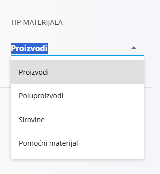
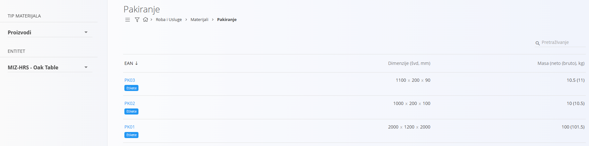
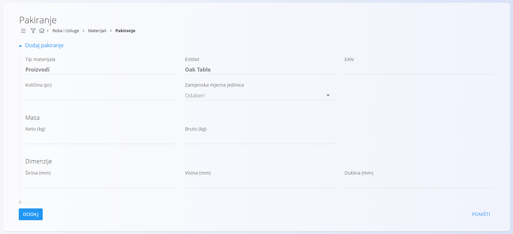
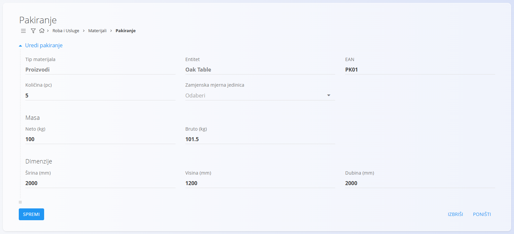
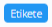
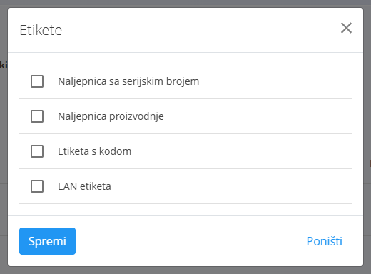

<!-- app_route: /management/materials/packaging -->
<!-- app_label: Packaging -->
<!-- canonical_source_url: https://github.com/Tom-PIT/Connected.Docs/blob/main/hr/Domene/RobaIUsluge/Materijali/Pakiranje.md -->
<!-- canonical_source_title: Pakiranje -->

# Pakiranje

Pakiranje određuje kako se materijal pakira, uključujući količinu, masu, dimenzije i neobavezne zamjenske mjerne jedinice. Podaci o pakiranju ključni su za logistiku, otpremu i upravljanje zalihama. Primjenjuje se na:

- [**Proizvode**](Proizvodi.md)  
- [**Poluproizvode**](Poluproizvodi.md)  
- [**Pomoćne proizvode**](PomocniProizvodi.md)  
- [**Sirovine**](Sirovine.md)

> [!NOTE]
> Pojedinosti o pakiranju za svaku vrstu materijala mogu se definirati i u odjeljcima pojedinih materijala.

> [!TIP]
> Za cjelovitu demonstraciju pogledajte video vodič **[Pakiranje](https://www.youtube.com/watch?v=-0T_l14bg5s)**.

Do konfiguracije pakiranja dolazite tako da u [navigaciji](../../../Zajednicko/UI/Navigacija.md) odaberete **Roba i Usluge / Materijali / Pakiranje**.

## Shema

| Polje | Opis |
|-------|------|
| **Tip materijala** | Kategorija materijala kojoj je pakiranje dodijeljeno (na primjer Proizvodi, Poluproizvodi, Pomoćni proizvodi, Sirovine). |
| **Entitet** | Određeni zapis materijala odabran unutar odabrane vrste materijala. |
| **EAN** | Jedinstveni identifikator pakiranja. Koristi se i za označavanje. |
| **Količina (kom)** | Broj stavki sadržanih u jednom pakiranju. |
| **Zamjenska mjerna jedinica** | (Neobavezno) Zamjenska mjerna jedinica za sadržaj pakiranja. |
| **Neto masa (kg)** | Masa bez pakiranja. |
| **Bruto masa (kg)** | Masa s pakiranjem. |
| **Širina (mm)** | Dimenzija širine u milimetrima. |
| **Visina (mm)** | Dimenzija visine u milimetrima. |
| **Dubina (mm)** | Dimenzija dubine u milimetrima. |

## Upravljanje

Da biste pakiranje dodijelili materijalu, najprije na lijevoj strani ekrana odaberite **Tip materijala** (na primjer Proizvodi, Poluproizvodi), a zatim određeni **Entitet**.

### Pregled popisa

Sučelje prikazuje popis zapisa pakiranja za odabrani **Tip materijala** i **Entitet**.

Popis prikazuje:

- **EAN**
- **Dimenzije (švd, mm)** (širina × visina × dubina)
- **Masa (neto (bruto), kg)**
- gumb **Etikete** za svako pakiranje

U gornjem desnom kutu nalazi se polje za pretraživanje.

## Radnje

### Dodavanje pakiranja

Na ekranu **Pakiranje** kliknite [gumb radnji](../../../Zajednicko/UI/AkcijskiGumb.md) da biste dodali novu stavku pakiranja.

Obrazac sadrži polja poput:

- **EAN**
- **Količina (kom)**
- **Zamjenska mjerna jedinica**
- **Masa** (neto i bruto)
- **Dimenzije** (širina, visina, dubina)

Nakon unosa potrebnih podataka kliknite **Dodaj** da biste spremili ili **Poništi** da biste se vratili.

## Uređivanje pakiranja

Za uređivanje postojećeg zapisa pakiranja kliknite vrijednost **EAN** na popisu.

Na ekranu za uređivanje možete izmijeniti sva polja. Nakon uređivanja kliknite **Spremi** ili **Poništi**.

### Etikete

Svaki zapis pakiranja sadrži oznaku **Etikete**, kojom se određuje koje se vrste etiketa mogu generirati za to pakiranje.

Na popisu kliknite gumb **Etikete** ispod stavke pakiranja:

Otvara se dijalog za odabir etiketa:

Dostupne vrste etiketa:

- **Naljepnica sa serijskim brojem**
- **Naljepnica proizvodnje**
- **Etiketa s kodom**
- **EAN etiketa**

Odaberite željene vrste etiketa i kliknite **Spremi**.

## Brisanje pakiranja

Kliknite **Izbriši** na ekranu za uređivanje da biste otvorili dijalog za potvrdu:

**Jeste li sigurni da želite izbrisati zapis?**  

Ako potvrdite, pakiranje se trajno uklanja; u suprotnom sustav zadržava zapis nepromijenjen.

> [!NOTE]
> Zapis pakiranja može se obrisati samo ako ga ne referenciraju drugi entiteti sustava.
