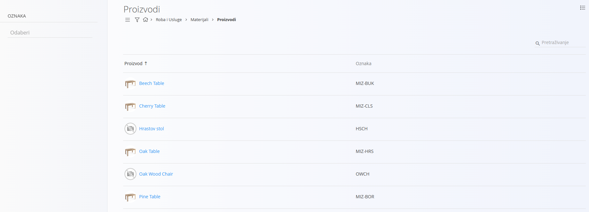
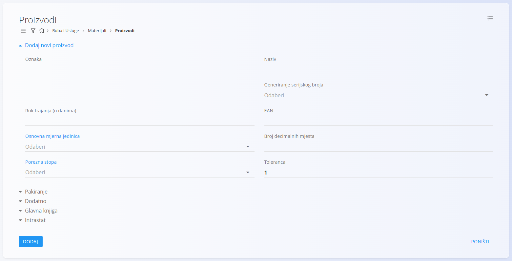
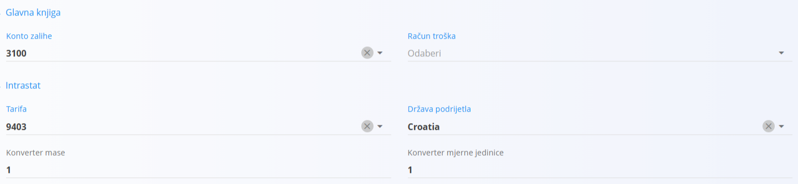
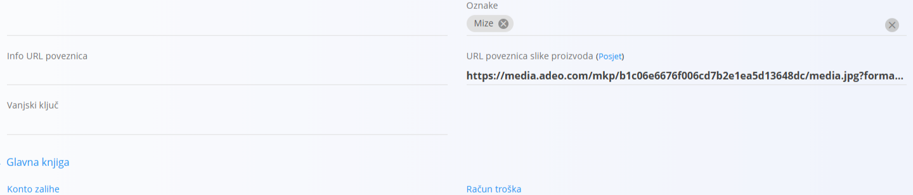
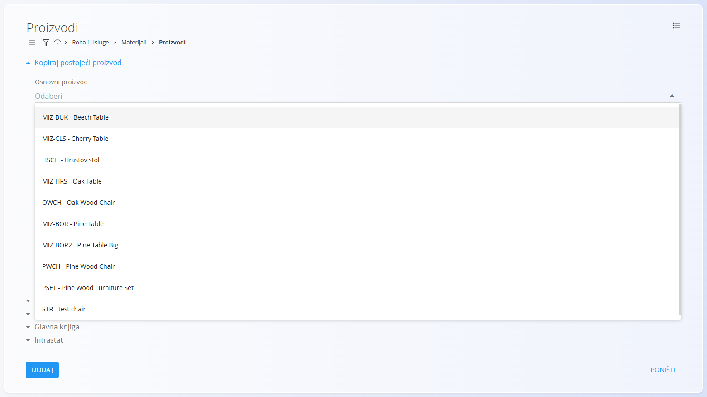
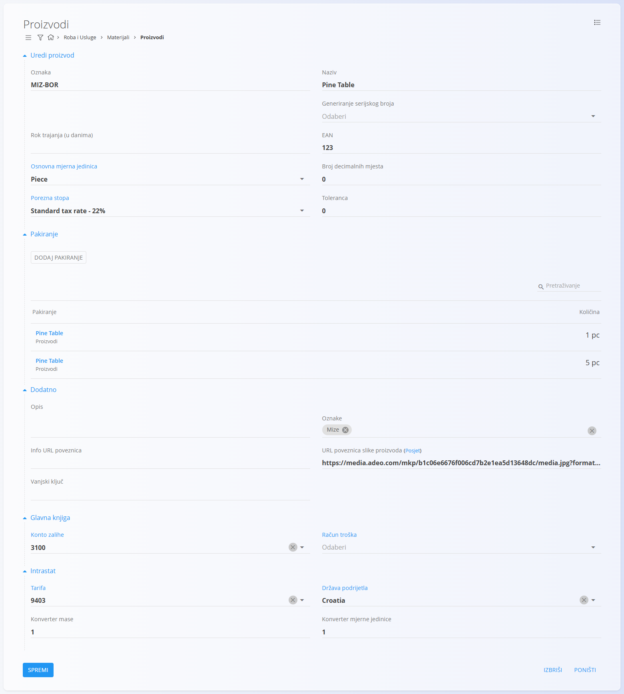

<!-- app_route: /management/materials/products -->
<!-- app_label: Products -->
<!-- canonical_source_url: https://github.com/Tom-PIT/Connected.Docs/blob/main/hr/Domene/RobaIUsluge/Materijali/Proizvodi.md -->
<!-- canonical_source_title: Proizvodi -->

# Proizvodi

**Proizvodi** su gotova roba koju vaša tvrtka proizvodi ili kupuje. Te se stavke mogu prodavati kupcima, skladištiti u skladištu ili koristiti u internim procesima. Primjeri proizvoda su stol od hrasta, uredska stolica, LED svjetiljka ili vrtna klupa.

Svaki proizvod sadrži važne podatke, poput [mjernih jedinica](../../../Zajednicko/Upravljanje/MjerneJedinice.md), [porezne stope](../../../Zajednicko/Upravljanje/PorezneStope.md), roka trajanja ili [pakiranja](Pakiranje.md), koji osiguravaju dosljedno upravljanje u dokumentima zaliha, prodaje i proizvodnje. Ovaj popis šifara predstavlja sve gotove proizvode dostupne u vašem katalogu.

> [!TIP]
> Za cjelovitu demonstraciju pogledajte video vodič **[Materijali: proizvodi](https://www.youtube.com/watch?v=FcrJ_IHQYeA)**.

> [!NOTE]  
> **Preduvjeti**  
> Prije upravljanja proizvodima provjerite jesu li ispravno konfigurirani sljedeći popisi šifara:  
> - [**Mjerne jedinice**](../../../Zajednicko/Upravljanje/MjerneJedinice.md)  
> - [**Porezne stope**](../../../Zajednicko/Upravljanje/PorezneStope.md)

Do popisa šifara **Proizvodi** dolazite tako da u [navigaciji](../../../Zajednicko/UI/Navigacija.md) odaberete **Roba i Usluge / Materijali / Proizvodi**.

## Shema

<strong>Proizvod</strong>

| Polje | Opis |
|-------|------|
| **Oznaka** | Jedinstveni identifikator proizvoda unutar popisa materijala. Na primjer **2625001** ili **MIZ-ČLS**. Oznaka mora biti jedinstvena među svim materijalima. (obavezno) |
| **Naziv** | Naziv proizvoda koji se prikazuje na popisima i u dokumentima. Na primjer **Stol – hrast**. (obavezno) |
| **Generiranje serijskog broja** | Određuje kako se obrađuju serijski brojevi i zapisi materijala: • **Automatski** – svaka stavka dobiva jedinstveni rastući serijski broj. • **Isti** – sve stavke dijele isti serijski broj, ali ostaju zasebni zapisi. • **Identični** – sve stavke dijele isti serijski broj i tretiraju se kao jedan identičan zapis. |
| **Rok trajanja (u danima)** | Broj dana do isteka roka, koristi se za kvarljivu robu. Na primjer **30** ili **365**. |
| **EAN** | Vrijednost barkoda koja se koristi za skeniranje. Na primjer **3831234567890**. |
| [**Osnovna mjerna jedinica**](../../../Zajednicko/Upravljanje/MjerneJedinice.md) | Mjerna jedinica kojom se izražavaju količine, na primjer **komad** ili **metar**. (obavezno) |
| **Broj decimalnih mjesta** | Zadani broj decimalnih mjesta za vrijednosti u ovoj mjernoj jedinici. Na primjer **3** za **1,255** ili **1** za **2,5**. |
| [**Porezna stopa**](../../../Zajednicko/Upravljanje/PorezneStope.md) | Zadana porezna stopa koja se koristi u poslovnim dokumentima. Na primjer **22** ili **9,5**. |
| **Toleranca** | Dopuštena tolerancija za količinu materijala, u postocima. Zadana vrijednost za nove materijale je 1. |

<strong>Pakiranje</strong>

Definicija pakiranja opisuje fizička svojstva materijala i zamjenske jedinice koje se koriste pri rukovanju u skladištu. Može se postaviti i u [**Pakiranju**](Pakiranje.md).

| Polje | Opis |
|-------|------|
| **Tip materijala** | Klasifikacija materijala (na primjer proizvod, poluproizvod) koja se koristi u kontekstu pakiranja. |
| **Proizvodi / Entitet / Stol od bukovine** | Primjer reference na proizvod ili entitet na koji se pakiranje odnosi. |
| **EAN** | Barkod pakiranja. |
| **Količina (kom)** | Količina koju predstavlja jedinica pakiranja (na primjer 6 komada po kutiji). |
| **Zamjenska mjerna jedinica** | Zamjenska jedinica za rukovanje ili izvještavanje (na primjer paket). |
| **Masa** | Unesite neto i bruto masu jedinice pakiranja. |
| **Dimenzije** | Unesite širinu, visinu i dubinu jedinice pakiranja. |

<strong>Dodatno</strong>

| Polje | Opis |
|-------|------|
| **Opis** | Kratki interni opis koji objašnjava namjenu ili specifikacije proizvoda. Na primjer **Puni hrast, impregniran**. |
| **Oznake** | Oznake koje se koriste za kategorizaciju i filtriranje. Na primjer **namještaj**, **premium**. |
| **Info URL poveznica** | URL koji vodi na vanjske informacije o proizvodu ili dokumentaciju. Na primjer *https://example.domain/info*. |
| **URL poveznica slike proizvoda** | Javni URL koji pokazuje na sliku proizvoda. Na primjer *https://example.domain/images/product.jpg*. |
| **Vanjski ključ** | Identifikator u vanjskom sustavu koji se koristi za povezivanje zapisa među sustavima, na primjer **SAP-4711**. |

<strong>Glavna knjiga i Intrastat</strong>

| Polje | Opis |
|-------|------|
| [**Konto zalihe**](../../Racunovodstvo/Upravljanje/GlavnaKnjiga/KontniPlan.md) | Konto bilance na kojem se evidentira vrijednost zaliha ovog materijala. Koristite ga za promjenu zadanog konta zaliha za ovaj materijal. |
| [**Račun troška**](../../Racunovodstvo/Upravljanje/GlavnaKnjiga/KontniPlan.md) | Konto računa dobiti i gubitka koji se koristi kada se materijal potroši, izda iz zaliha ili proda (na primjer nabavna vrijednost prodane robe). Koristite ga za promjenu zadanog konta troška za ovaj materijal. |
| [**Tarifa**](../../Racunovodstvo/Upravljanje/Intrastat/Tarife.md) | Carinska tarifna oznaka koja se koristi za statističko i carinsko izvještavanje. |
| [**Država podrijetla**](../../../Zajednicko/Upravljanje/Drzave.md) | Država podrijetla koja se koristi na trgovinskim i carinskim dokumentima. |
| **Konverter mase** | Faktor za pretvorbu osnovne mjerne jedinice u masu (na primjer u kg). Primjenjuje se u Intrastatu ili analitici kada je potrebna masa. |
| **Konverter mjerne jedinice** | Faktor za pretvorbu osnovne mjerne jedinice materijala u drugu mjernu jedinicu, na primjer iz kilograma u funte, ako se količina u dokumentima ili izvještajima bilježi u drugoj jedinici. |

## Upravljanje

### Popis proizvoda

Korisničko sučelje sadrži popis proizvoda. Ako još nema zapisa, popis je prazan.

Popis prikazuje naziv proizvoda (**Proizvod**) i njegovu **Oznaku**.

S lijeve strane ekrana dostupan je filtar **Oznaka**. U gornjem desnom kutu nalazi se polje za pretraživanje kojim brzo pronalazite određene proizvode.

### Izbornik

Izbornik nudi dodatne radnje dostupne na ekranu popisa.

Dostupne radnje:

- **Preuzmi CSV** – Preuzmite popis materijala kao CSV datoteku. Datoteku možete pregledati, urediti i kasnije uvesti za ažuriranje popisa materijala.

## Radnje

Kliknite [gumb radnji](../../../Zajednicko/UI/AkcijskiGumb.md) da biste prikazali sljedeće radnje:

- [**Uvoz**](#uvoz-proizvoda)
- [**Kopiraj postojeći**](#kopiranje-postojeceg-proizvoda)
- **Novo**

### Dodavanje novog proizvoda

Kliknite [gumb radnji](../../../Zajednicko/UI/AkcijskiGumb.md) i odaberite **Novo** da biste otvorili obrazac za unos novog proizvoda. Obrazac sadrži polja poput **Oznaka**, **Naziv**, **Generiranje serijskog broja**, **Osnovna mjerna jedinica**, **Porezna stopa** i druga, ovisno o konfiguraciji.

Dostupni su dodatni sažimajući odjeljci:

#### Pakiranje

Ovaj odjeljak omogućuje pregled ili dodavanje jedne ili više definicija [pakiranja](Pakiranje.md) specifičnih za materijal. Svaki unos predstavlja jedinicu pakiranja s vlastitom količinom i identifikacijom.  

Ti se zapisi pakiranja kasnije mogu koristiti u skladišnim operacijama, poput [primki](../../Logistika/Dokumenti/Primke.md), [izdatnica](../../Logistika/Dokumenti/Izdatnica.md) i [međuskladišnog prometa](../../Logistika/Dokumenti/MeduskladisniPromet.md).

#### Intrastat i glavna knjiga

Koristite ove odjeljke za unos Intrastat i carinskih podataka koji se koriste za izvještavanje o trgovini unutar EU te za ostale računovodstvene pojedinosti.

> [!WARNING]
> Unesite ispravne konte u odjeljku **Glavna knjiga** (na primjer konte zaliha i troškova). Pogrešne ili nedostajuće vrijednosti uzrokovat će kasnije greške pri knjiženju u računovodstvu.

#### Dodatno

Ovaj odjeljak sadrži neobavezna opisna polja, poput opisa materijala, oznaka, slika, poveznica ili vanjskih identifikatora. Ta polja pružaju dodatni kontekst ili reference, ali ne utječu na izračune zaliha.

Nakon unosa potrebnih podataka kliknite **Dodaj** da biste spremili proizvod ili **Poništi** da biste se vratili na popis.

### Uvoz proizvoda

Kliknite [gumb radnji](../../../Zajednicko/UI/AkcijskiGumb.md) i odaberite **Uvoz** da biste uvezli više materijala proizvoda odjednom pripremom i učitavanjem ispravno strukturirane tablice.  

Pogledajte dokumentaciju [**Uvoz materijala**](UvozMaterijala.md) za sve pojedinosti.

### Kopiranje postojećeg proizvoda

Kliknite [gumb radnji](../../../Zajednicko/UI/AkcijskiGumb.md) i odaberite **Kopiraj postojeći proizvod** da biste stvorili novi proizvod na temelju postojećeg. Pojavljuje se popis dostupnih osnovnih proizvoda.

Nakon odabira osnovnog proizvoda sva su polja unaprijed popunjena i mogu se urediti prije spremanja.

## Uređivanje proizvoda

Za uređivanje postojećeg proizvoda kliknite **Naziv** proizvoda na popisu. Sučelje prelazi u način uređivanja i prikazuje sva polja za izmjenu. Kliknite **Spremi** da biste primijenili promjene ili **Poništi** da biste ih odbacili.

## Brisanje proizvoda

Kliknite **Izbriši** na ekranu za uređivanje da biste otvorili dijalog za potvrdu:

**Jeste li sigurni da želite izbrisati zapis?**  

Ako potvrdite, proizvod se trajno uklanja; u suprotnom sustav zadržava zapis nepromijenjen.

> [!NOTE]
> Proizvod se može obrisati samo ako ga ne referenciraju ovisni zapisi, poput kretanja zaliha, dokumenata ili struktura materijala.
