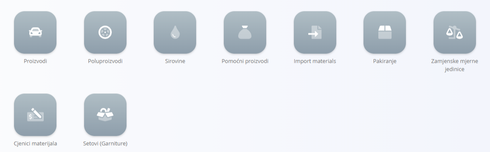

<!-- app_route: /sitemap/assets.materials -->
<!-- app_label: Materials -->
<!-- canonical_source_url: https://github.com/Tom-PIT/Connected.Docs/blob/main/hr/Domene/RobaIUsluge/Materijali/README.md -->
<!-- canonical_source_title: Materijali -->

# Materijali

Materijali predstavljaju operativne stavke koje vaša organizacija koristi u logistici, proizvodnji, upravljanju zalihama ili procesima sastavljanja. Obuhvaćaju gotove proizvode, djelomično izrađene stavke, sirovi input i višekratne komponente. Dodatni popisi šifara pomažu u definiranju pakiranja, mjernih jedinica i funkcija masovnog uvoza.

Do materijala dolazite tako da u [navigaciji](../../../Zajednicko/UI/Navigacija.md) odaberete **Roba i Usluge / Materijali**.

## Kategorije materijala

Odjeljak Materijali sadrži četiri glavna popisa šifara, koji predstavljaju glavne vrste materijala kojima se upravlja u operativnim procesima:

- **[Proizvodi](Proizvodi.md)** – Gotova roba proizvedena interno ili kupljena kao gotove stavke. Proizvodi sudjeluju u tokovima zaliha i logistike.
- **[Poluproizvodi](Poluproizvodi.md)** – Stavke koje predstavljaju djelomično dovršenu robu koja se koristi kao međukomponente u proizvodnji.
- **[Sirovine](Sirovine.md)** – Osnovni ulazni materijali koji se koriste u najranijim fazama proizvodnje, poput drva, metalnih limova ili drugih temeljnih komponenti.
- **[Pomoćni proizvodi](PomocniProizvodi.md)** – Povratne ili pomoćne komponente koje služe za podršku proizvodnji ili internim aktivnostima.

## Dodatni popisi šifara vezani uz materijale

Ovi popisi šifara podržavaju upravljanje i definiranje četiri glavne vrste materijala:

- **[Pakiranje](Pakiranje.md)** – Definira kako se materijal pakira, uključujući količinu, masu, dimenzije i neobavezne zamjenske mjerne jedinice.
- **[Uvoz materijala](UvozMaterijala.md)** – Omogućuje masovni uvoz materijala iz tablice, korisno kada se istodobno stvara ili ažurira više zapisa.
- **[Zamjenske mjerne jedinice](ZamjenskeMjerneJedinice.md)** – Dodatne mjerne jedinice koje proširuju osnovnu jedinicu materijala (na primjer komade, kilograme, kvadratne metre), uključujući postavke pretvorbe.
- **[Cjenici materijala](CjeniciMaterijala.md)** – Definira nabavne cijene koje se koriste za nabavu i interno vrednovanje.
- **[Setovi](Setovi.md)** – Unaprijed definirani skupovi materijala grupirani radi lakšeg odabira u logističkim ili proizvodnim zadacima.
