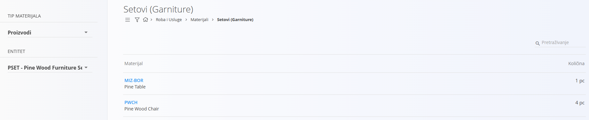
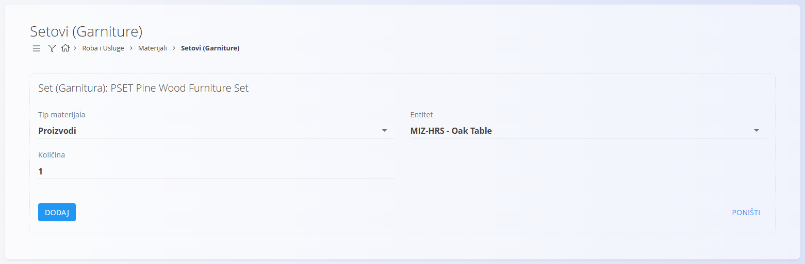

<!-- app_route: /management/materials/sets -->
<!-- app_label: Sets -->
<!-- canonical_source_url: https://github.com/Tom-PIT/Connected.Docs/blob/main/hr/Domene/RobaIUsluge/Materijali/Setovi.md -->
<!-- canonical_source_title: Setovi -->

# Setovi

Setovi omogućuju definiranje složenih stavki sastavljenih od postojećih materijala (proizvoda, poluproizvoda, sirovina ili pomoćnih proizvoda). Set grupira više komponenti s količinama pod jednim nadređenim materijalom, pa ga možete prodavati ili njime upravljati kao jednom cjelinom.

Do ove stranice dolazite tako da u [navigaciji](../../../Zajednicko/UI/Navigacija.md) odaberete **Roba i Usluge / Materijali / Setovi (garniture)**.

## Shema

### Odjeljak dokumenta

| Polje | Opis |
|---|---|
| **Tip materijala** | Kategorija nadređenog seta (na primjer Proizvod, Poluproizvod). |
| **Entitet** | Nadređeni materijal koji predstavlja set (na primjer Garnitura namještaja). |
| **Količina** | Količina svake komponente u setu. |

## Upravljanje

### Preduvjeti
- Najprije stvorite nadređeni materijal u njegovoj kategoriji (na primjer u **Proizvodima** ili **Poluproizvodima**).
- Provjerite je li svaka komponenta koju želite uključiti već definirana u odgovarajućem popisu šifara.

## Popis setova
Lijeva bočna traka prikazuje nadređene materijale grupirane prema [**Tipu materijala**](../README.md) (na primjer [**Proizvodi**](Proizvodi.md), [**Poluproizvodi**](Poluproizvodi.md)). Odaberite nadređeni materijal da biste u glavnom popisu vidjeli njegove komponente. Glavni popis prikazuje komponente odabranog seta s njihovim količinama.

## Radnje

### Stvaranje seta

1. Stvorite nadređeni materijal u njegovoj kategoriji:
   - Idite na **Roba i Usluge / Materijali / Proizvodi** i dodajte novi proizvod (na primjer **Garnitura namještaja od borovine**).
2. Otvorite **Roba i Usluge / Materijali / Setovi (garniture)** i na lijevoj bočnoj traci odaberite nadređeni materijal: **Proizvodi → Garnitura namještaja od borovine**.
3. Kliknite [gumb radnji](../../../Zajednicko/UI/AkcijskiGumb.md) da biste dodali komponente u set (svaka komponenta već mora postojati):
   - Primjeri komponenti: **Stol od borovine** (1), **Stolica od borovine** (4)

   

4. Spremite. Garnitura namještaja od borovine sada referencira sve komponente s njihovim količinama.

   

### Uređivanje seta

Kliknite komponentu na popisu seta da biste izmijenili njezinu količinu ili je zamijenili drugim materijalom.

## Povezane radnje

Setovi su povezani s **[Razdvajanjima](../../Logistika/Dokumenti/Razdvajanja.md)**. Set možete razdvojiti kada, na primjer, zaprimite set i želite pojedine dijelove koristiti ili prodavati zasebno. Razdvajanje stvara logističke dokumente koji izdaju set i unose njegove komponente u zalihe prema definiranim količinama.

## Brisanje komponente iz seta

Pojedine komponente mogu se ukloniti iz seta tako da ih odaberete i kliknete **Izbriši**. Ako potvrdite, komponenta se uklanja iz nadređenog seta.
