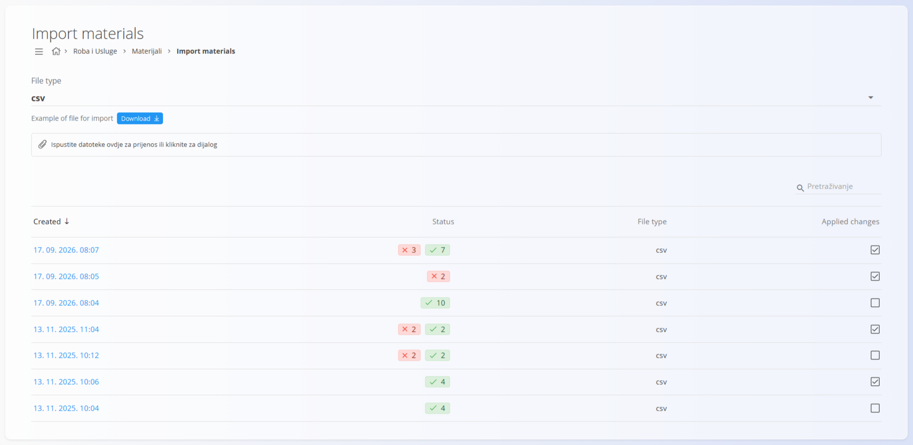
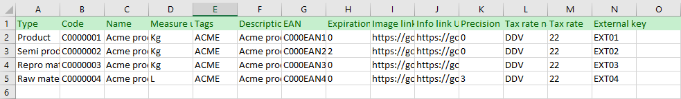
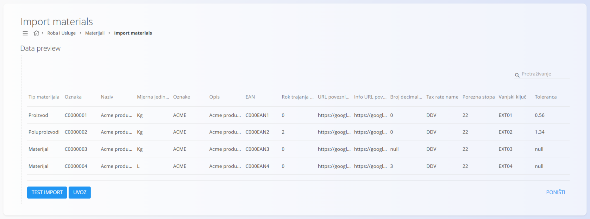
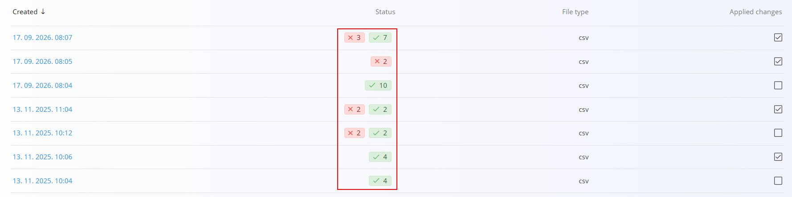
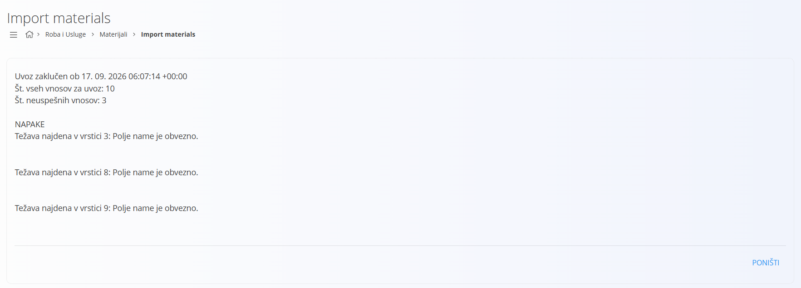

<!-- app_route: /management/materials/import -->
<!-- app_label: Import materials -->
<!-- canonical_source_url: https://github.com/Tom-PIT/Connected.Docs/blob/main/hr/Domene/RobaIUsluge/Materijali/UvozMaterijala.md -->
<!-- canonical_source_title: Uvoz materijala -->

# Uvoz materijala

Ovaj dokument opisuje kako istodobno uvesti više materijala u sustav pomoću tablične datoteke. To omogućuje brzo masovno stvaranje ili ažuriranje zapisa materijala.

Uvoz podržava sljedeće vrste materijala:

- [Proizvodi](Proizvodi.md)  
- [Poluproizvodi](Poluproizvodi.md)  
- [Pomoćni proizvodi](PomocniProizvodi.md)  
- [Sirovine](Sirovine.md)

Na ekranu je dostupna i datoteka s primjerom koju možete preuzeti; ona prikazuje potrebnu strukturu tablice. Prije uvoza možete pokrenuti **Test import**, koji provjerava podatke i prijavljuje greške bez primjene promjena.

> [!NOTE]  
> **Preduvjeti**  
> Prije uvoza materijala provjerite sljedeće popise šifara:  
> - [**Mjerne jedinice**](../../../Zajednicko/Upravljanje/MjerneJedinice.md)  
> - [**Porezne stope**](../../../Zajednicko/Upravljanje/PorezneStope.md)  
> Ako nedostaje referencirana mjerna jedinica ili porezna stopa, ona će se tijekom uvoza automatski stvoriti. Pregled ovih popisa unaprijed pomaže osigurati ispravne nazive i povezivanja.

Do popisa šifara **Uvoz materijala** dolazite tako da u [navigaciji](../../../Zajednicko/UI/Navigacija.md) odaberete **Roba i Usluge / Materijali / Uvoz materijala**.

## Shema

| Polje | Opis |
|--------|------|
| **Created** | Datum i vrijeme kada je tablična datoteka učitana. |
| **Status** | Pokazuje rezultat provjere ili uvoza, uz broj ispravnih redaka i redaka s greškama. |
| **File type** | Format učitane datoteke, CSV ili XLSX. |
| **Applied changes** | Pokazuje jesu li promjene stvarno uvezene (označeno) ili je riječ samo o probnom uvozu (nije označeno). |

## Vrsta datoteke

Sustav prihvaća uvoze u formatu **CSV** ili **XLSX**. Padajućim izbornikom odabire se format **datoteke s primjerom** koju možete preuzeti. Kliknite gumb **Download** da biste preuzeli primjer datoteke za odabrani format. Ova datoteka s primjerom sadrži sve obavezne stupce ispravnim redoslijedom.



## Struktura tablice

Datoteka za uvoz mora u prvom retku imati zaglavlje s nazivima stupaca navedenima u nastavku, ovim redoslijedom. Svaki sljedeći redak predstavlja jedan materijal koji će se uvesti.

> [!IMPORTANT]
> - Nemojte mijenjati redoslijed stupaca niti nazive stupaca u zaglavlju. Primjer datoteke koristite kao referencu.
> - Materijali moraju imati jedinstvene vrijednosti u stupcu **Code** kako ne bi nastali sukobi.
> - Prazna neobavezna polja uvoze se kao prazne vrijednosti.
> - URL-ovi (**ImageUrl**, **InfoUrl**) moraju biti ispravni ili ostati prazni.
> - U datoteci primjera vrijednosti su odvojene točka-zarezom (`;`), a decimalni brojevi pišu se sa zarezom (na primjer `0,56`).

| Stupac | Opis |
|--------|------|
| **Type** | Vrsta materijala, na primjer **Proizvod**, **Poluproizvodi** ili **Materijal**. Vrijednosti upisujte onako kako su u datoteci primjera. |
| **Code** | Jedinstveni identifikator materijala. Ako materijal s istom oznakom već postoji, uvoz ga ažurira. |
| **Name** | Puni naziv materijala. |
| **MeasureUnitAbbreviation** | Kratica mjerne jedinice za količine. Mora odgovarati postojećoj [mjernoj jedinici](../../../Zajednicko/Upravljanje/MjerneJedinice.md). |
| **Tags** | Neobavezne oznake za kategorizaciju. Više oznaka odvojite zarezima. |
| **Description** | Neobavezni tekst koji opisuje materijal. |
| **Ean** | Vrijednost barkoda materijala. |
| **DefaultExpirationInDays** | Broj dana do isteka materijala. |
| **ImageUrl** | URL koji pokazuje na sliku materijala. |
| **InfoUrl** | URL koji pokazuje na vanjsku informacijsku stranicu o materijalu. |
| **Precision** | Broj decimalnih mjesta koji se koristi pri prikazu vrijednosti. |
| **TaxRateName** | Naziv porezne stope. Mora odgovarati postojećoj [poreznoj stopi](../../../Zajednicko/Upravljanje/PorezneStope.md). |
| **TaxRateValue** | Postotak poreza koji se primjenjuje na materijal. |
| **ExternalKey** | Identifikator vanjskog sustava. |
| **Tolerance** | Dopuštena tolerancija za količinu materijala, u postocima. Zadana vrijednost za nove materijale je 1. |

## Primjer retka

Zaglavlje i prvi redak primjera datoteke:

```
Type;Code;Name;MeasureUnitAbbreviation;Tags;Description;Ean;DefaultExpirationInDays;ImageUrl;InfoUrl;Precision;TaxRateName;TaxRateValue;ExternalKey;Tolerance
Proizvod;C0000001;Acme product 1;Kg;ACME;Acme product 1;C000EAN1;0;https://google.com;https://google.com;0;DDV;22;EXT01;0,56
```

## Uređivanje datoteke

Tablicu možete pripremiti ili izmijeniti u uređivaču tablica:



## Učitavanje datoteke

1. Za početak uvoza povucite datoteku **CSV** ili **XLSX** u područje za učitavanje ili kliknite na njega da biste otvorili dijalog za odabir datoteke.

2. Nakon učitavanja datoteke pojavljuje se **pregled podataka** sa svim obrađenim zapisima. Dostupne su sljedeće radnje:

    - **Test import** – provodi probni uvoz bez stvarnog spremanja podataka, tako da se greške mogu otkriti prije uvoza  
    - **Uvoz** – uvozi i sprema podatke te primjenjuje sve ispravne promjene u sustavu  


    
   
   Preporučuje se da prvo izvedete **Test import** kako biste osigurali da je struktura podataka ispravna i da biste spriječili probleme prije primjene uvoza. Ispod područja za učitavanje nalazi se popis svih prethodno učitanih datoteka. Retci s greškama označeni su **crvenom** bojom, a ispravni retci **zelenom** bojom u stupcu **Status**.

   

3. Da biste dovršili cijeli uvoz nakon provjere podataka s **Test import**, ponovno učitajte tablicu i odaberite **Uvoz**.

Tijekom uvoza:

- Stvaraju se novi materijali.  
- Postojeći materijali (podudaranje prema **Code**) se ažuriraju.  
- Ovisnosti (oznake, mjerne jedinice, porezne stope) povezuju se automatski.  
- Vrsta materijala dodjeljuje se prema stupcu **Type**.

Nakon dovršetka uvoza status se ažurira u tablici i pokazuje koji su retci uspješno obrađeni.

## Popis rezultata

Kliknite bilo koji uvoz u stupcu **Created** na popisu uvoza da biste pregledali rezultate i moguće greške. U stupcu **Status** vidi se broj ispravnih redaka (zeleno) i redaka s greškama (crveno).


