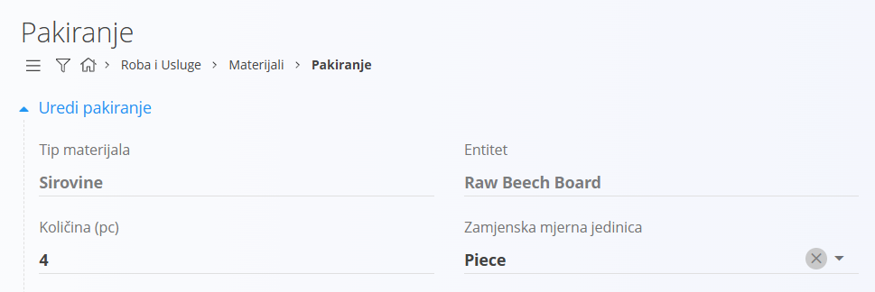
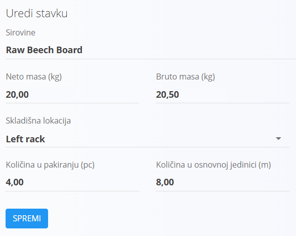

<!-- app_route: /management/materials/alternative-measure-units -->
<!-- app_label: Alternative measure units -->
<!-- canonical_source_url: https://github.com/Tom-PIT/Connected.Docs/blob/main/hr/Domene/RobaIUsluge/Materijali/ZamjenskeMjerneJedinice.md -->
<!-- canonical_source_title: Zamjenske mjerne jedinice -->

# Zamjenske mjerne jedinice

**Zamjenske mjerne jedinice** omogućuju rukovanje materijalom pomoću jedinice koja se razlikuje od osnovne jedinice materijala.  
To je korisno kada se materijali skladište, pakiraju ili primaju u praktičnim jedinicama (na primjer komadima), dok se zalihe prate u fizičkoj jedinici (na primjer metrima).

Do ove stranice dolazite tako da u navigaciji odaberete **Roba i Usluge / Materijali / Zamjenske mjerne jedinice**.

> [!TIP]
> Za cjelovitu demonstraciju pogledajte video vodič **[Zamjenske mjerne jedinice](https://www.youtube.com/watch?v=wPmLquFm8fY)**.

## Shema

| Polje | Opis |
|------|------|
| **Tip materijala** | Vrsta materijala (na primjer sirovina ili gotov proizvod). |
| **Entitet** | Određeni materijal za koji je definirana zamjenska mjerna jedinica. |
| **Osnovna jedinica** | Zadana mjerna jedinica definirana na materijalu (samo za čitanje). |
| **Mjerna jedinica** | Zamjenska mjerna jedinica (na primjer komad). |
| **Djelitelj** | Količina izražena u **osnovnoj jedinici**. |
| **Množitelj** | Količina izražena u **zamjenskoj mjernoj jedinici**. |

## Upravljanje

Zamjenske mjerne jedinice definiraju se **po materijalu**.

Lijevom bočnom trakom odaberite:
- **Tip materijala**
- **Entitet**

Prikazuju se samo zamjenske mjerne jedinice za odabrani materijal.

### Pregled popisa

Popis prikazuje:
- **Naziv** (zamjenska mjerna jedinica)
- **Djelitelj**
- **Množitelj**

## Radnje

### Dodavanje nove zamjenske mjerne jedinice

1. Odaberite **Tip materijala** i **Entitet**.
2. Kliknite [gumb radnji](../../../Zajednicko/UI/AkcijskiGumb.md).
3. Odaberite zamjensku **Mjernu jedinicu**.
4. Unesite **Djelitelj** i **Množitelj**.
5. Kliknite **Spremi**.

#### Kako rade zamjenske mjerne jedinice

Svaka zamjenska mjerna jedinica definira fiksnu pretvorbu u osnovnu jedinicu materijala.
Pretvorba se definira pomoću dvije obavezne vrijednosti:

Množitelj zamjenskih jedinica = Djelitelj osnovnih jedinica

**Primjer:**

Imamo materijal s osnovnom jedinicom **metar**, ali se on skladišti i njime se rukuje u komadima, pri čemu je svaki komad jednak 2 metra.

Ako je **1 komad = 2 metra**, unesite:
- **Djelitelj**: `2`
- **Množitelj**: `1`

### Uređivanje zamjenske mjerne jedinice

Kliknite postojeći unos na popisu da biste ga uredili, primijenite promjene i kliknite **Spremi**. Ili kliknite **Poništi** da biste odbacili promjene i vratili se na popis.

### Brisanje zamjenske mjerne jedinice

Na popisu odaberite zamjensku mjernu jedinicu i koristite **Izbriši** da je uklonite. Nakon potvrde zamjenska mjerna jedinica briše se iz sustava.

## Korištenje u drugim funkcijama

### Pakiranje

Zamjenske mjerne jedinice koriste se u **Pakiranju** za definiranje količina pakiranja u zamjenskoj jedinici, dok sustav automatski izračunava odgovarajuću količinu u osnovnoj jedinici.

### Dokumenti primke

U dokumentima **Primka** količine unesene u zamjenskoj mjernoj jedinici automatski se pretvaraju u osnovnu jedinicu pri ažuriranju zaliha.

> [!IMPORTANT]
>
> - Zamjenske mjerne jedinice vezane su uz određeni materijal
> - Osnovna jedinica ne može se mijenjati s ovog ekrana
> - Omjeri pretvorbe primjenjuju se dosljedno u cijelom sustavu
> - Promjena ili uklanjanje zamjenske mjerne jedinice može utjecati na tijekove pakiranja i primanja
