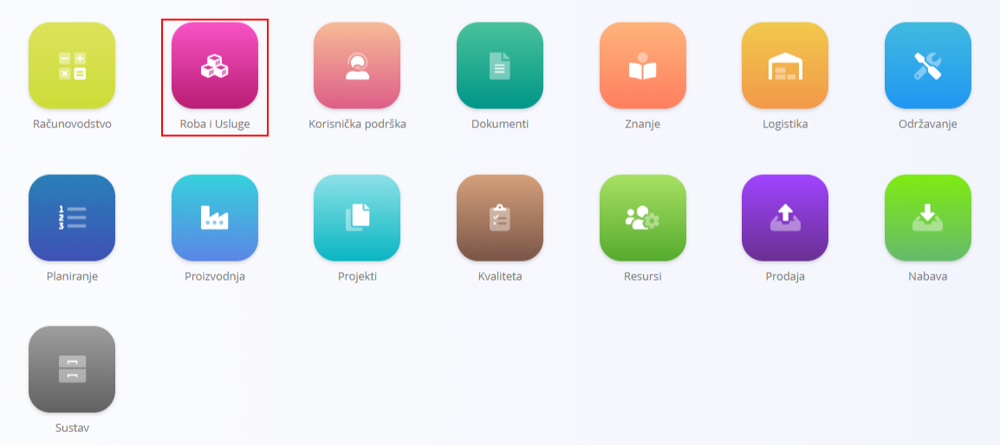
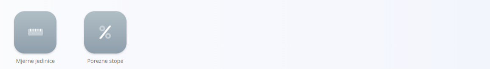

<!-- app_route: /sitemap/assets -->
<!-- app_label: Assets domain -->
<!-- canonical_source_url: https://github.com/Tom-PIT/Connected.Docs/blob/main/hr/Domene/RobaIUsluge/README.md -->
<!-- canonical_source_title: Roba i usluge -->

# Roba i usluge

Domena **Roba i usluge** sadrži sve zapise o robi i uslugama koje vaša tvrtka nudi i cijenama za njih, kao i o operativnim stavkama koje se koriste za izradu, isporuku ili podršku. Obuhvaća i **robu ili usluge** (komercijalne stavke koje prodajete) i **materijale** (operativne stavke koje se interno koriste u proizvodnji i logistici).

- **Roba ili usluge** su komercijalne stavke vidljive kupcima (na primjer, gotovi proizvodi, stavke usluga, stavke kataloga). Određuju kako se ponude cijene, oporezuju i prikazuju u prodajnim dokumentima.
- **Materijali** su operativne stavke koje se koriste interno (na primjer, sirovine, komponente, poluproizvodi, pakiranje, pomoćni materijali). Određuju što postoji na zalihama i kako se roba kreće kroz logistiku i proizvodnju.

Na primjer, **roba ili usluga** može biti *kompletni set prijenosnog računala* koji se prodaje kao paket i sadrži prijenosno računalo, torbu i miš. Pojedini dijelovi tog seta, poput **miša**, **prijenosnog računala** ili čak internih **čipova** unutar prijenosnog računala, smatrali bi se **materijalima**, jer su komponente koje se koriste za izradu, sastavljanje ili podršku konačnog komercijalnog proizvoda. Za usporedbu pogledajte [Roba i usluge naspram materijala](#roba-i-usluge-naspram-materijala).

Ova domena objedinjuje sve elemente potrebne za definiranje, određivanje cijena, organiziranje i vođenje vašeg kataloga u prodaji i logistici.

Do domene Roba i usluge dolazite tako da u [navigaciji](../../Zajednicko/UI/Navigacija.md) odaberete **Roba i Usluge**.

> [!NOTE]  
> Dostupne domene ovise o konfiguraciji i poslovnom modelu svake tvrtke.

## Što je uključeno u domenu Roba i usluge?

Domena je podijeljena u nekoliko funkcionalnih područja:

- **[Roba ili usluge](RobaIUsluge/RobaIUsluge.md)** – Definira robu i usluge koje nudite kupcima. Svaka stavka sadrži cijene, porezne postavke, opisna polja i neobavezne pojedinosti o komponentama.

- **[Cjenici stavki](RobaIUsluge/CjeniciStavki.md)** – Koriste se za pripremu prodajnih cijena prilagođenih kupcima za odabrane stavke. Cjenici podržavaju razdoblja valjanosti, cijene specifične za tvrtku i popuste po količini.

- **[Materijali](Materijali/README.md)** – Materijali se koriste za *izradu* robe ili usluga ili predstavljaju stavke kojima se rukuje u logističkim procesima (zalihe, primke, izdatnice itd.). Za razliku od robe ili usluga, materijali su operativne interne jedinice.

    - **[Proizvodi](Materijali/Proizvodi.md)**
    - **[Sirovine](Materijali/Sirovine.md)**
    - **[Pomoćni proizvodi](Materijali/PomocniProizvodi.md)**
    - **[Poluproizvodi](Materijali/Poluproizvodi.md)**

- **Upravljanje** – Sadrži dodatne konfigurabilne elemente, poput [**Poreznih stopa**](../../Zajednicko/Upravljanje/PorezneStope.md) i [**Mjernih jedinica**](../../Zajednicko/Upravljanje/MjerneJedinice.md). Oni određuju strukturu i ponašanje robe ili usluga te cijena.

## Roba i usluge naspram materijala

Razumijevanje razlike između ova dva pojma je ključno. Iako oba predstavljaju stavke kojima se upravlja unutar vaše organizacije, služe vrlo različitim svrhama.

- **[Roba ili usluge](RobaIUsluge/RobaIUsluge.md)** definiraju ono što *prodajete* kupcima.
- **[Materijali](Materijali/README.md)** definiraju ono što *koristite* interno u proizvodnji i logistici.

Tablica u nastavku sažima ključne razlike i pomaže odrediti gdje pripada svaka vrsta stavke.

| Aspekt | [**Roba ili usluge**](RobaIUsluge/RobaIUsluge.md) | [**Materijali**](Materijali/README.md) |
|--------|--------------------------------------|-------------------------------------------|
| **Svrha** | Komercijalne stavke koje se nude ili prodaju kupcima. | Operativne stavke koje se koriste interno u proizvodnji ili logistici. |
| **Uloga u sustavu** | Pojavljuju se u cjenicima, katalozima, ponudama, računima itd. | Pojavljuju se u zalihama, primkama, izdatnicama, proizvodnji i skladišnim operacijama. |
| **Primjeri** | Gotovi proizvodi, stavke usluga, stavke kataloga. | Sirovine, komponente, poluproizvodi, pakiranje, pomoćni materijali. |
| **Koristi se u** | Prodajnim procesima (ponudama, računima, ugovorima). | Logističkim procesima (rukovanje zalihama, proizvodnja, sastavnice). |
| **Cijene** | Koriste *cjenike stavki* za cijene specifične za kupca. | Koriste *cjenike materijala* za nabavu i kalkulaciju troškova. |
| **Sastav** | Mogu sadržavati komponente materijala preko detalja stavke. | Mogu biti dio sastavnica ili struktura robe ili usluga. |
| **Vidljivost izvana** | Vidljivo kupcima. | Samo interno; kupci nikada ne vide zapise o materijalima. |
| **Životni ciklus** | Orijentiran na tržište (vođen komercijalnom strategijom). | Orijentiran na proizvodnju (vođen operativnim potrebama). |
