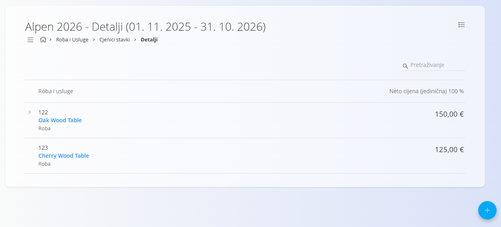
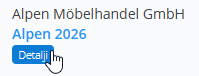
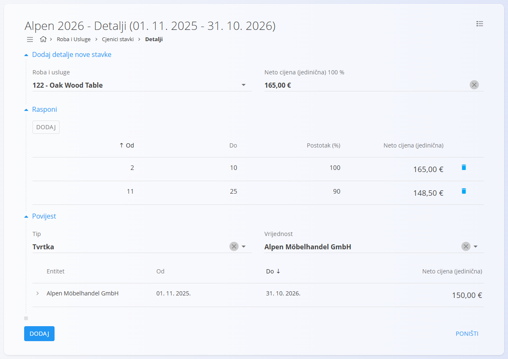
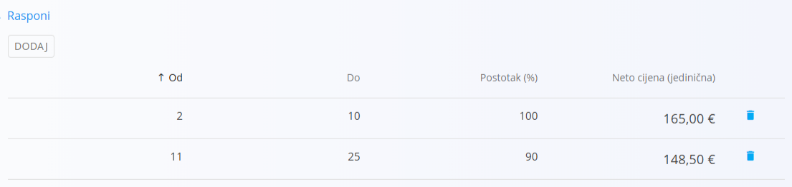
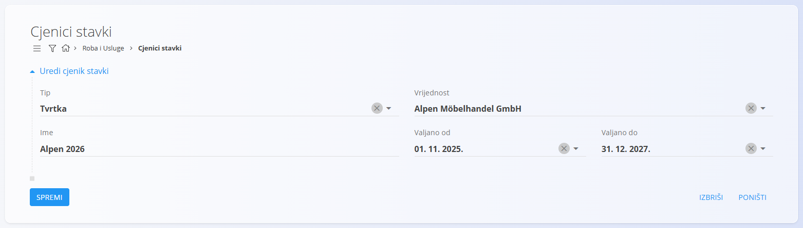
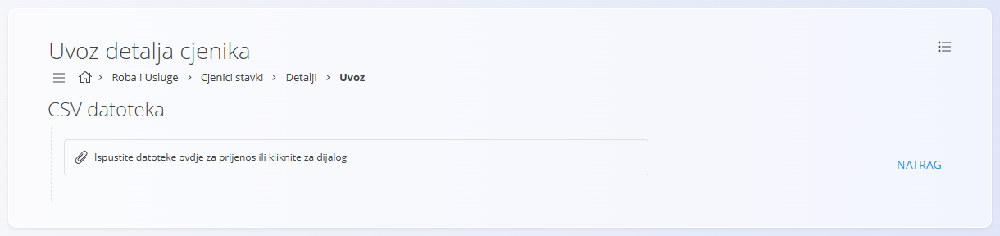

<!-- app_route: /assets/management/asset-price-lists -->
<!-- app_label: Asset price lists -->
<!-- canonical_source_url: https://github.com/Tom-PIT/Connected.Docs/blob/main/hr/Domene/RobaIUsluge/RobaIUsluge/CjeniciStavki.md -->
<!-- canonical_source_title: Cjenici stavki -->

# Cjenici stavki

**Cjenici stavki** određuju koliko određeni kupac (ili drugi poslovni subjekt) plaća za vašu [robu ili usluge](RobaIUsluge.md). Omogućuju **cijene prilagođene kupcu**, vrijede za određeno razdoblje i mogu uključivati **popuste ovisno o količini** (rasponi cijena).

Do ovog ekrana dolazite tako da u [navigaciji](../../../Zajednicko/UI/Navigacija.md) odaberete **Roba i Usluge / Cjenici stavki**.

## Shema

| Polje | Opis |
|-------|------|
| **Tip** | Klasifikacija cjenika (na primjer *Tvrtka*). |
| [**Vrijednost**](../../../Zajednicko/Upravljanje/PoslovniImenik.md) | Kupac ili drugi partner na kojeg se cjenik odnosi. |
| **Ime** | Ime cjenika koje se prikazuje (obavezno). |
| **Valjano od** | Početni datum od kojeg cjenik postaje aktivan. |
| **Valjano do** | Završni datum razdoblja valjanosti cjenika. |
| [**Roba ili usluga**](RobaIUsluge.md) | Odabrana roba ili usluga za koju se u cjeniku definira cijena. |
| **Neto cijena (jedinična) 100 %** | Osnovna neto cijena robe ili usluge prije popusta. |
| **Rasponi** | Neobavezna pravila ovisna o količini koja prilagođavaju neto cijenu prema količini. Uključuju **Od**, **Do**, **Postotak (%)** i **Neto cijena (jedinična)**. |

## Upravljanje

## Pregled popisa

Do popisa cjenika dolazite tako da u navigaciji odaberete **Roba i Usluge / Cjenici stavki**.

Popis prikazuje:
- Sve postojeće cjenike  
- Njihova razdoblja valjanosti  
- Gumb **Detalji** za otvaranje sadržaja cjenika  

Popis možete filtrirati prema:
- **Tip** (na primjer Tvrtka)
- **Vrijednost**

Klikom na gumb **Detalji** otvara se stranica na kojoj se upravlja robom ili uslugama i rasponima popusta.

## Radnje

Ovisno o tome na kojoj ste stranici, [gumb radnji](../../../Zajednicko/UI/AkcijskiGumb.md) prikazuje različite radnje:

Na stranici **Cjenici stavki**:
- **Novo**
- [**Kopiraj**](#kopiranje-cjenika)

Na stranici **Detalji**:
- [**Uvoz**](#uvoz-cjenika)
- **Novo**

### Kreiranje novog cjenika

Slijedite ove korake za izradu funkcionalnog cjenika:

1. Kliknite [gumb radnji](../../../Zajednicko/UI/AkcijskiGumb.md) i odaberite **Novo**.
2. Unesite polja prema potrebi: **Tip**, **Vrijednost**, **Ime**, **Valjano od**, **Valjano do**.
3. Kliknite **Dodaj** da biste spremili zaglavlje cjenika.
4. Kliknite gumb **Detalji** da biste otvorili stranicu s cijenama.
   
   

5. Kliknite gumb radnji i odaberite **Novo** da biste dodali robu ili uslugu u cjenik.
  
   

6. Odaberite robu ili uslugu. Polje **Neto cijena (jedinična) 100 %** popunit će se automatski.

7. (Neobavezno) Dodajte **Rasponi** za definiranje popusta ovisnih o količini. U primjeru u nastavku, ako kupac kupi između 11 i 25 komada robe ili usluga, postotak cijene bit će 90% (popust od 10%).

   

8. Spremite pojedinosti. Ponovite od koraka 5 da biste u cjenik dodali još robe ili usluga.

Cjenik je sada aktivan za odabranog kupca u navedenom razdoblju.

### Uređivanje cjenika

Klikom na **naziv cjenika** otvara se ekran za **uređivanje**. Ovdje možete mijenjati zaglavlje cjenika, ali ne i robu ili usluge ni raspone. Za uređivanje robe ili usluga i raspona kliknite gumb **Detalji**, kako je opisano u prethodnom odjeljku.

### Kopiranje cjenika

Stvara kopiju postojećeg cjenika, uključujući njegovo razdoblje valjanosti i sadržaj.

### Uvoz cjenika

Ekran **Uvoz** omogućuje uvoz CSV datoteke s popisom pojedinosti.

### Brisanje cjenika

Cjenici stavki mogu se obrisati na ekranu za uređivanje, ali samo ako ne sadrže **nijednu robu ili uslugu**.

Ako nacrt i dalje sadrži robu ili usluge u odjeljku **Detalji**:

1. Kliknite **Detalji** da otvorite odjeljak.
2. Kliknite na robu ili uslugu da otvorite njezin ekran s pojedinostima.  
3. Kliknite **Izbriši** na ekranu pojedinosti da biste uklonili robu ili uslugu.  
4. Ponovite za sve preostale stavke.

Kada dokument više ne sadrži robu ili usluge, možete kliknuti **Izbriši** da biste uklonili cjenik.

## Izbornik

Izbornik nudi dodatne radnje dostupne na ovoj stranici.

Dostupne radnje:

- **Izvoz u CSV**

Za pojedinosti o radnjama izbornika pogledajte [**Radnje izbornika**](../../../Zajednicko/Koncepti/RadnjeIzbornika.md).
