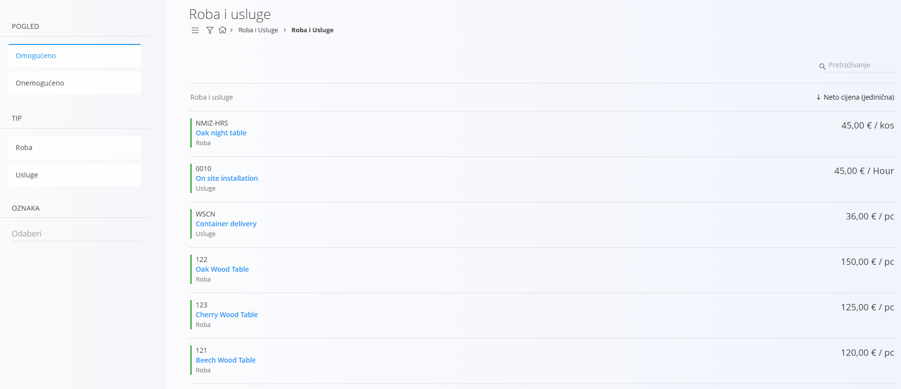
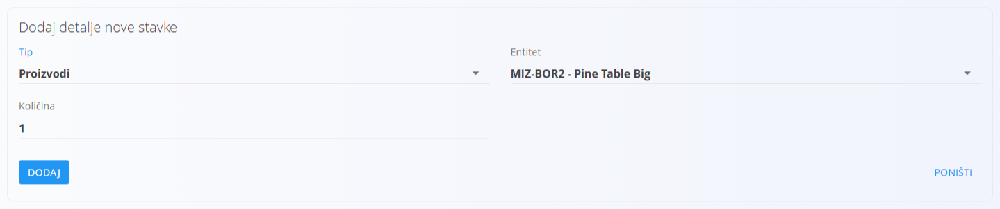
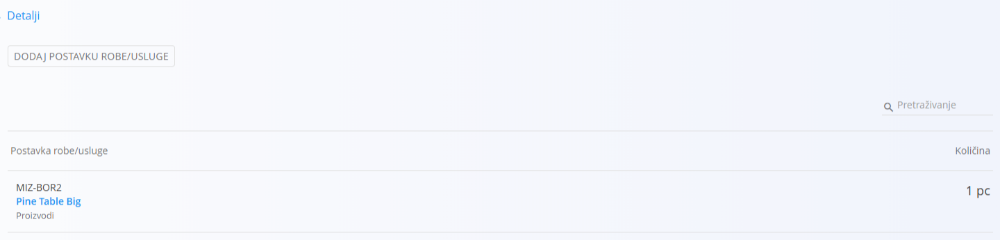
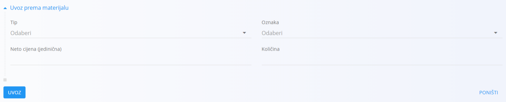

<!-- app_route: /assets/management/assets -->
<!-- app_label: Assets -->
<!-- canonical_source_url: https://github.com/Tom-PIT/Connected.Docs/blob/main/hr/Domene/RobaIUsluge/RobaIUsluge/RobaIUsluge.md -->
<!-- canonical_source_title: Roba ili usluga -->

# Roba ili usluga

**Roba ili usluga** predstavlja stavku ili uslugu koja se u sustavu može *prodati* ili *fakturirati*. Za razliku od **materijala**, koji se koriste za praćenje zaliha, logistiku ili proizvodnju, **roba ili usluge su komercijalne stavke** namijenjene određivanju cijena, ponudi i fakturiranju.

Roba ili usluga može predstavljati:

- **Robu** (na primjer, gotov proizvod ponuđen kupcima)  
- **Uslugu** (na primjer, instalaciju, prijevoz, savjetovanje)

Roba ili usluge **ne** sudjeluju u kretanjima zaliha. Umjesto toga, one definiraju stavke spremne za prodaju s vlastitom cijenom, poreznom stopom i svojstvima. Roba ili usluga može neobavezno upućivati na materijale kada se prodani proizvod također prati na zalihama.

Do ovog ekrana dolazite tako da u [navigaciji](../../../Zajednicko/UI/Navigacija.md) odaberete **Roba i Usluge / Roba ili usluge**.

## Shema

<strong>Roba ili usluga</strong>

| Polje | Opis |
|-------|------|
| **Oznaka** | Jedinstveni identifikator robe ili usluge (obavezno). |
| **Ime** | Ime robe ili usluge koje se prikazuje (obavezno). |
| **Tip** | Je li stavka *Roba* ili *Usluga* (obavezno). |
| [**Porezna stopa**](../../../Zajednicko/Upravljanje/PorezneStope.md) | Primjenjiva porezna stopa (neobavezno). |
| [**Mjerna jedinica**](../../../Zajednicko/Upravljanje/MjerneJedinice.md) | Jedinica kojom se stavka prikazuje i cijeni (obavezno). |
| **Neto cijena (jedinična)** | Neto jedinična cijena robe ili usluge. |
| **Neto masa (kg)** | Masa stavke, ako je primjenjivo (zadano = 0). |
| **EAN** | Broj barkoda (neobavezno). |
| **Oznaka** | Neobavezne oznake za klasifikaciju. |

<strong>Intrastat i glavna knjiga</strong>

| Polje | Opis |
|-------|------|
| [**Tarifa**](../../Racunovodstvo/Upravljanje/Intrastat/Tarife.md) | Carinska tarifna oznaka koja se koristi za statističko i carinsko izvještavanje. |
| [**Država podrijetla**](../../../Zajednicko/Upravljanje/Drzave.md) | Država podrijetla koja se koristi na trgovinskim i carinskim dokumentima. |
| **Konverter mase** | Faktor za pretvorbu osnovne mjerne jedinice u masu (na primjer u kg). Primjenjuje se u Intrastatu ili analitici kada je potrebna masa. |
| **Konto prihoda na domaćem tržištu** | Konto prihoda koji se koristi za prodaju na domaćem tržištu. |
| **Konto prihoda na tržištima Europe** | Konto prihoda koji se koristi za prodaju na tržištima EU. |
| **Konto prihoda na tržištima izvan Europe** | Konto prihoda koji se koristi za prodaju izvan EU. |
| [**Konto zalihe**](../../Racunovodstvo/Upravljanje/GlavnaKnjiga/KontniPlan.md) | Konto bilance za vrijednost zaliha kada se roba ili usluge povezuju s materijalima kojima se prati stanje na zalihama. |

<strong>Dodatno i pojedinosti</strong>

| Polje | Opis |
|-------|------|
| **Opis** | Dodatni tekst koji objašnjava robu ili uslugu. |
| **Postavke** | Popis komponenti robe ili usluge (na primjer povezani materijali ili količine). |
| **Dodaj postavku robe/usluge** | Radnja za dodavanje nove postavke robe ili usluge. |
| **Tip** | Vrsta [materijala](../Materijali/README.md) za postavku (na primjer Proizvodi). |
| **Entitet** | Odabrani materijal ili stavka koja se povezuje kao dio robe ili usluge. |
| **Količina** | Količina povezanog entiteta. |

## Upravljanje

### Popis robe ili usluga

Popis **Roba ili usluge** prikazuje sve postojeće stavke, zajedno s njihovom vrstom (usluga ili roba), neto cijenom i mjernom jedinicom.

Popis robe ili usluga možete filtrirati pomoću:

- **Pogled**: Omogućeno / Onemogućeno  
- **Tip**: Roba / Usluga  
- **Oznaka**  

Ovi filtri olakšavaju pronalaženje određenih stavki i pojednostavljuju upravljanje velikim katalozima robe i usluga.

## Radnje

### Dodavanje nove robe ili usluge

Kliknite [gumb radnji](../../../Zajednicko/UI/AkcijskiGumb.md) za stvaranje nove robe ili usluge. Prije spremanja morate unijeti sljedeća polja:

- **Oznaka**  
- **Ime**  
- **Tip**  
- **Mjerna jedinica**

Neobavezna polja, poput **Porezna stopa**, **Neto cijena (jedinična)**, **EAN**, **Oznaka** i **Dodatno**, također možete ispuniti.

#### Intrastat i glavna knjiga
Koristite ove odjeljke za unos Intrastat i carinskih podataka koji se koriste za izvještavanje o trgovini unutar EU te za ostale računovodstvene pojedinosti.

> [!WARNING]
> Unesite ispravne konte u odjeljku **Glavna knjiga** (na primjer konte zaliha i troškova). Pogrešne ili nedostajuće vrijednosti uzrokovat će kasnije greške pri knjiženju u računovodstvu.

#### Odjeljak Postavke

Nakon spremanja robe ili usluge možete dodati **postavke robe ili usluge**. Njima se roba ili usluga povezuje s drugim entitetima, poput materijala (na primjer kada prodani proizvod odgovara stavki kojom se prati stanje na zalihama).

Kliknite gumb **Dodaj postavku robe/usluge** da biste otvorili obrazac za dodavanje nove postavke. Svaka postavka sadrži:

- **Tip** (na primjer Proizvodi)  
- **Entitet** (odabrani materijal ili stavka)  
- **Količina**

  

Kliknite **Dodaj** da biste spremili postavku ili **Poništi** da biste izašli bez promjena.

### Uvoz robe ili usluga iz materijala

Radnja **Uvoz** otvara obrazac **Uvoz prema materijalu**, koji omogućuje brzo stvaranje robe ili usluga na temelju postojećih materijala.

Možete odabrati:

- **Tip**  
- **Oznaka** (materijala)  
- **Neto cijena (jedinična)**  
- **Količina**

Kliknite **Uvoz** da biste stvorili stavke robe ili usluga ili **Poništi** da biste izašli bez promjena.

## Brisanje robe ili usluge

Kliknite stavku na popisu da biste otvorili ekran za uređivanje, zatim kliknite **Izbriši** da biste uklonili odabranu stavku. Ako potvrdite, stavka se trajno uklanja.

> [!NOTE]
> Ako se roba ili usluga spominje u drugim dokumentima ili zapisima, brisanje može biti blokirano dok se ne riješe ovisnosti.
