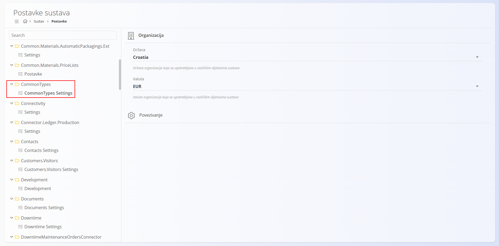
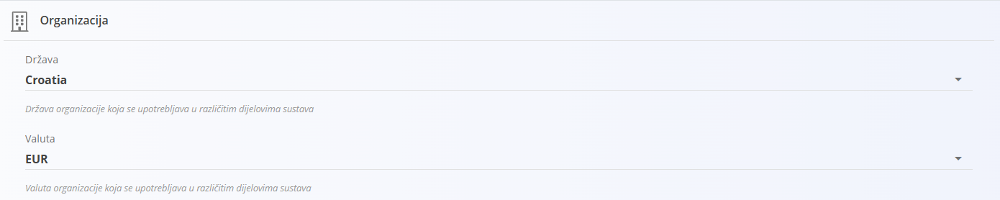
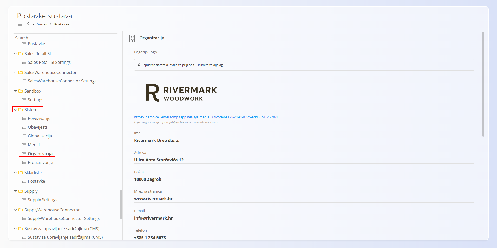
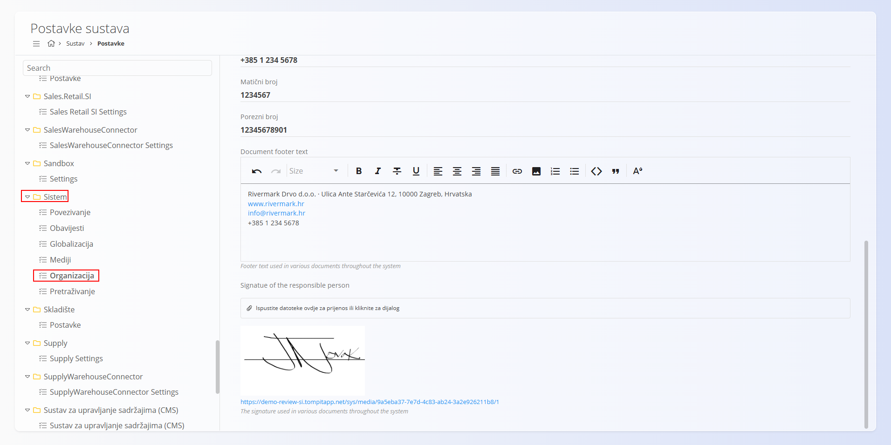

<!-- app_route: /management/configuration -->
<!-- app_label: Postavke sustava -->
<!-- canonical_source_url: https://github.com/Tom-PIT/Connected.Docs/blob/main/hr/Domene/Sustav/Postavke/Configuration.md -->
<!-- canonical_source_title: Postavke sustava -->

# Postavke sustava

Stranica **Postavke sustava**, koja se otvara pod **Sustav / Postavke**, sadrži globalne postavke sustava koje određuju osnovno ponašanje organizacije i lokalizacije.

> [!IMPORTANT]
>
> Ove postavke koriste gotovo svi moduli ([Prodaja](../../Prodaja/README.md), [Nabava](../../Nabava/README.md), [Logistika](../../Logistika/README.md), [Projekti](../../Projekti/README.md) i drugi) i moraju biti konfigurirane prije početka operativnog rada.

Iako se na stranici **Sustav / Postavke** nalaze brojne tehničke postavke koje utječu na ukupno ponašanje sustava, ovaj dokument usredotočuje se na dvije ključne skupine koje je potrebno konfigurirati pri početnom postavljanju:

- **CommonTypes → CommonTypes Settings** (zadana država i valuta)
- **Sistem → Organizacija** (podaci o tvrtki)

Te dvije skupine konfiguracije moraju se postaviti pri početnom postavljanju sustava jer utječu na sve module na platformi.

> [!WARNING]
> Ove postavke utječu na sve domene. Mijenjati ih smiju samo administratori sustava.

## CommonTypes Settings

Odjeljak **Organizacija** unutar **CommonTypes Settings** određuje **zadanu državu** i **zadanu valutu** koje se koriste na cijeloj platformi. Mnogi moduli oslanjaju se na te vrijednosti za ispravno oblikovanje, oporezivanje, pravnu strukturu i ispis dokumenata.

Ovim postavkama pristupate na način da idete na **Sustav / Postavke** i u popisu s lijeve strane odaberete **CommonTypes → CommonTypes Settings**. Odjeljak **Organizacija** prikazuje državu i valutu.

### Država

Odaberite državu u kojoj organizacija posluje. Ova postavka određuje lokalizaciju i zakonske zadane vrijednosti u svim dokumentima i modulima.

> [!IMPORTANT]
> Odabrana država **mora već postojati** u šifrarniku **[Države](../../../Zajednicko/Upravljanje/Drzave.md)**. Ako prethodno nije unesena tamo, neće se pojaviti u padajućem izborniku.

### Valuta

Odaberite zadanu valutu organizacije. Ova postavka određuje oblikovanje novčanih iznosa i zadanu valutu dokumenata u svim modulima i izvješćima.

> [!IMPORTANT]
> Odabrana valuta **mora već postojati** u šifrarniku **[Valute](../../../Zajednicko/Upravljanje/Valute.md)**.

Te dvije postavke čine temelj svih financijskih i komercijalnih operacija na platformi.

## Organizacija

Odjeljak **Organizacija** određuje identitet vaše tvrtke i poslovne podatke koje zakon zahtijeva. Ti se podaci pojavljuju na ispisanim dokumentima, kao što su računi, otpremnice, narudžbe kupaca i narudžbenice.

Tim postavkama pristupate na način da idete na **Sustav / Postavke** i u popisu s lijeve strane odaberete **Sistem → Organizacija**.

### Shema

| Polje | Opis |
|---|---|
| **Logotip** | Učitajte logotip tvrtke koji se koristi na službenim dokumentima. Podržani formati: PNG, JPG. Učitavanje je moguće povlačenjem datoteke ili preko dijaloškog okvira. |
| **Naziv** | Puni pravni naziv tvrtke. |
| **Adresa** | Naziv ulice i broj, uključujući grad ili općinu. |
| **Pošta** | Poštanski broj registrirane poslovne adrese. |
| **Web-stranica** | Prikazuje se na raznim dokumentima prodaje i nabave. |
| **E-mail** | Glavna kontakt adresa za komunikaciju s kupcima ili dobavljačima. |
| **Telefonski broj** | Opći kontaktni broj koji se prikazuje na dokumentima. |
| **Matični broj** | Službeni registracijski broj tvrtke. |
| **Porezni broj** | Porezni identifikacijski broj (npr. OIB ili PDV ID). |
| **Tekst podnožja dokumenta** | Oblikovano podnožje koje se pojavljuje na dokumentima u cijelom sustavu. Tipičan sadržaj: naziv tvrtke, puna adresa, web-stranica, e-mail, telefonski broj, pravne napomene ili odricanja od odgovornosti. Podržava višeredno oblikovanje. |
| **Potpis odgovorne osobe** | Učitajte sliku potpisa koja se koristi na odabranim službenim dokumentima. Podržani formati: PNG, JPG. Prikazuje se na računima, potvrdama i sličnim ispisima. |

