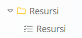
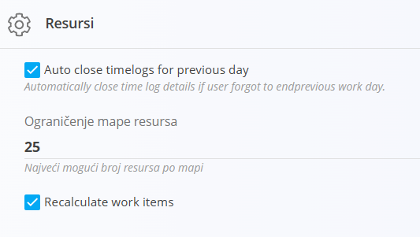

<!-- app_route: /management/configuration -->
<!-- app_label: Konfiguracija -->
<!-- canonical_source_url: https://tom-pit.github.io/Connected.Docs/hr/Domene/Sustav/Postavke/PostavkeResursa/ -->
<!-- canonical_source_title: Postavke resursa -->

# Postavke resursa

Odjeljak **Resursi** u konfiguraciji određuje kako su organizirane mape resursa, kako sustav zatvara radno vrijeme koje je ostalo otvoreno na kraju dana, kako se bilježi plaćeno vrijeme za ručak i tko prima zahtjeve za godišnji odmor.

Tim postavkama pristupate tako da idete na **Sustav / Konfiguracija** i pronađete odjeljak **Resursi**. Postavke **Dnevnik prisutnosti** nalaze se u istom području.

> [!WARNING]
> Ove postavke utječu na procese dnevnika vremena i odsustava za sve radnike. Mijenjati ih smiju samo administratori sustava.

## Resursi

### Auto close timelogs for previous day

Kada je ova postavka odabrana, sustav zatvara otvoreno radno vrijeme na kraju prethodnog dana, kada se korisnik sljedeći dan prijavi. Zatim počinje novo radno vrijeme.

<!-- TODO: Potvrdite točno vrijeme zatvaranja s razvojnim timom. Test 18. studenoga 2026. zatvorio je radno vrijeme u 22:59. -->

Za tvrtke koje rade u 24-satnim smjenama odznačite ovu postavku. Radnik se, na primjer, može prijaviti u 22:00 i otići na ručak u 00:31. Kada je postavka odznačena, sustav ne zatvara radno vrijeme prethodnog dana kada se korisnik sljedeći dan prijavi.

### Ograničenje mape resursa

Unesite najveći mogući broj resursa po mapi.

## Dnevnik prisutnosti

### Primatelji zahtjeva za godišnji

Odaberite korisnike koji primaju e-poruku kada se pošalje obrazac zahtjeva za godišnji odmor, kako bi mogli odobriti zahtjev.

### Plaćeno vrijeme za ručak

Unesite najdulje plaćeno vrijeme za ručak u minutama koje sustav bilježi kao plaćeno za radnike. Ručak duži od te vrijednosti bilježi se kao privatno vrijeme i ne ubraja se u radne sate.

Primjer, uz **Plaćeno vrijeme za ručak** postavljeno na 30 minuta:

1. Radnik se odjavi na ručak u 12:00. Radno vrijeme se zaustavlja, a ručak počinje.
2. Radnik se ponovno prijavi u 12:35.
3. Sustav ručak od 12:00 do 12:30 bilježi kao plaćeni ručak.
4. Preostalih 5 minuta, od 12:30 do 12:35, bilježi se kao privatno vrijeme i ne ubraja se u radne sate.
