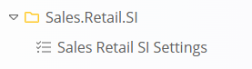
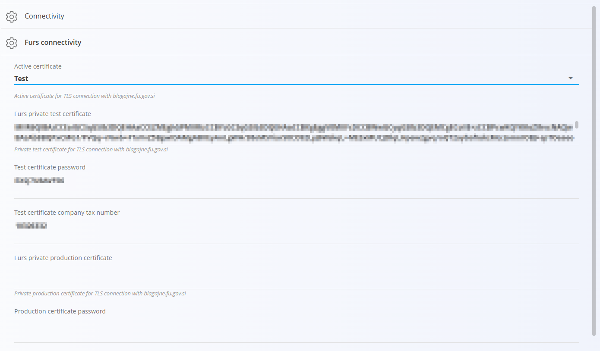

<!-- app_route: /management/configuration -->
<!-- app_label: Konfiguracija -->
<!-- app_navigation_hint: Otvorite **Konfiguracija** u glavnoj navigaciji, zatim **Postavke Sales Retail SI**. -->
<!-- canonical_source_url: https://github.com/Tom-PIT/Connected.Docs/blob/main/hr/Domene/Sustav/Postavke/SalesRetailsSISettings.md -->
<!-- canonical_source_title: Postavke Sales Retail SI -->

# Postavke Sales Retail SI

**Postavke Sales Retail SI** služe za konfiguriranje veze s **FURS-om (Financijska uprava Republike Slovenije)** radi fiskalizacije računa u maloprodaji.

Ove postavke omogućuju sustavu slanje podataka relevantnih za porez za [maloprodajne izdane račune](../../Prodaja/Dokumenti/MaloprodajniRacuni.md) u FURS.

Ovim postavkama pristupate na način da idete na **Sustav / Konfiguracija / Sales.Retail.SI / Postavke Sales Retail SI**.

> [!NOTE]
> Oznaka **SI** znači da se ove postavke odnose na **Sloveniju**.
> Ako je odabrana druga država (npr. Hrvatska), dostupne postavke mogu se razlikovati prema lokalnim zahtjevima za fiskalizaciju.

## Pregled

Fiskalizacija zahtijeva siguran spoj s FURS-om pomoću **digitalnih certifikata**. Te certifikate izdaje FURS, a potrebni su za autentifikaciju tvrtke pri slanju podataka o računima.

Više informacija o certifikatima i tehničkim specifikacijama dostupno je na službenom [FURS portalu](https://edavki.durs.si/EdavkiPortal/OpenPortal/CommonPages/Opdynp/PageD.aspx?category=dpr_teh_spec).

## Certifikati

Konfiguracija obuhvaća dvije vrste certifikata:

- **Test** – šalje podatke na FURS testni sustav
- **Produkcija** – šalje podatke na živi FURS sustav

Promjenom ove opcije mijenja se mjesto na koje se šalju fiskalni podaci.

## Shema

| Polje | Opis |
|------|-------------|
| **Aktivni certifikat** | Određuje koje se okruženje koristi za vezu s FURS-om:  • **Test** – šalje podatke na testni sustav  • **Produkcija** – šalje podatke na živi sustav |
| **FURS privatni testni certifikat** | Digitalni certifikat za vezu s FURS testnim okruženjem |
| **Lozinka testnog certifikata** | Lozinka za pristup testnom certifikatu |
| **Porezni broj tvrtke za testni certifikat** | Porezni broj tvrtke koji se koristi u testnom okruženju |
| **FURS privatni produkcijski certifikat** | Digitalni certifikat za vezu s FURS produkcijskim okruženjem |
| **Lozinka produkcijskog certifikata** | Lozinka za pristup produkcijskom certifikatu |
| **Automatska potvrda FURS-a** | Ako je uključeno, računi se automatski šalju FURS-u kad se izdaju |
