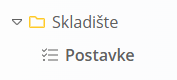
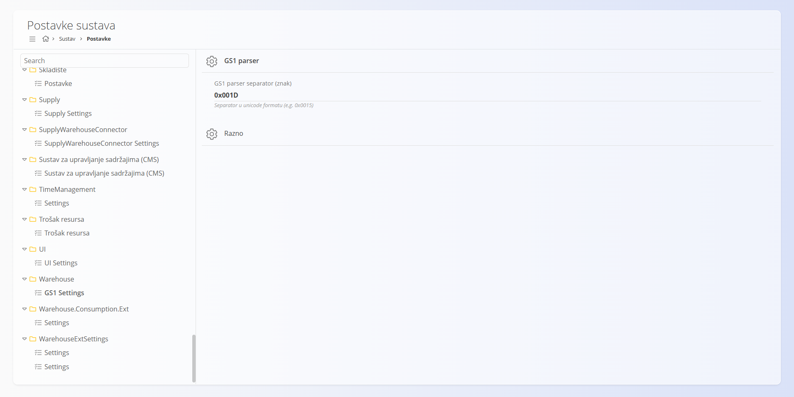
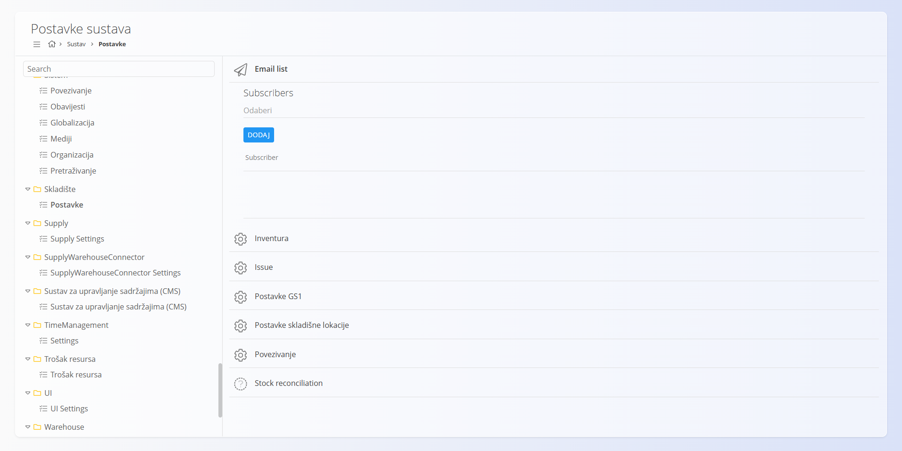

<!-- app_route: /management/configuration -->
<!-- app_label: Konfiguracija -->
<!-- canonical_source_url: https://github.com/Tom-PIT/Connected.Docs/blob/main/hr/Domene/Sustav/Postavke/WarehouseConfiguration.md -->
<!-- canonical_source_title: Konfiguracija skladišta -->

# Konfiguracija skladišta

Postavke konfiguracije skladišta omogućuju prilagodbu načina na koji sustav obrađuje različite skladišne radnje, kao što su upravljanje inventurom i GS1 postavke. Tim postavkama pristupate i mijenjate ih tako da idete na **Sustav / Postavke** i u popisu s lijeve strane odaberete **Skladište → Postavke**.

## GS1 postavke

Konfiguracija GS1 parsera određuje kako sustav tumači GS1 barkodove pri skeniranju artikala u procesima kao što su primanje ili proizvodnja.

### Znak separatora GS1 parsera

Određuje znak separatora koji se koristi za razdvajanje GS1 elemenata podataka (identifikatora primjene) u skeniranom barkodu. Taj se znak koristi za prepoznavanje kraja polja promjenjive duljine, kao što je broj serije ili lota.

> [!IMPORTANT]
> Vrijednost se mora unijeti u Unicode (heksadecimalnom) obliku (npr. **0x001D**).

Pojedinosti o GS1 identifikaciji unosite na način da idete na **Sustav / Postavke** i u popisu s lijeve strane odaberete **Warehouse → GS1 Settings**.

## Postavke

Postavke skladišta omogućuju konfiguriranje ključnih parametara aplikacije, uključujući povezivost s bazom podataka, GS1 identifikaciju, ponašanje inventure i pravila skladišta.

### Email list

Ovaj odjeljak služi za definiranje konfiguracija povezanih s e-poštom (npr. primatelji obavijesti ili sustavnih poruka).

### Postavke GS1

Konfigurira GS1 identifikaciju koja se koristi za izradu i tumačenje barkodova.

- **GS1 identitet** – GS1 prefiks tvrtke koji dodjeljuje GS1 tijelo.
  Ta se vrijednost koristi pri izradi GS1 usklađenih kodova, kao što su:
	- GTIN (šifre proizvoda)
	- SSCC (logističke jedinice)

### Inventura

- **Prikaži stupac knjigovodstvenog stanja** – kad je uključeno, prikazuje stupac knjigovodstvenog stanja dok je dokument u statusu nacrta.

### Postavke skladišne lokacije

- **Zabrani lokaciju iz drugog skladišta u međuskladišnim dokumentima** – sprječava odabir lokacija koje pripadaju drugom skladištu pri izradi [međuskladišnih](../../Logistika/Dokumenti/MeduskladisniPromet.md) dokumenata kretanja.
