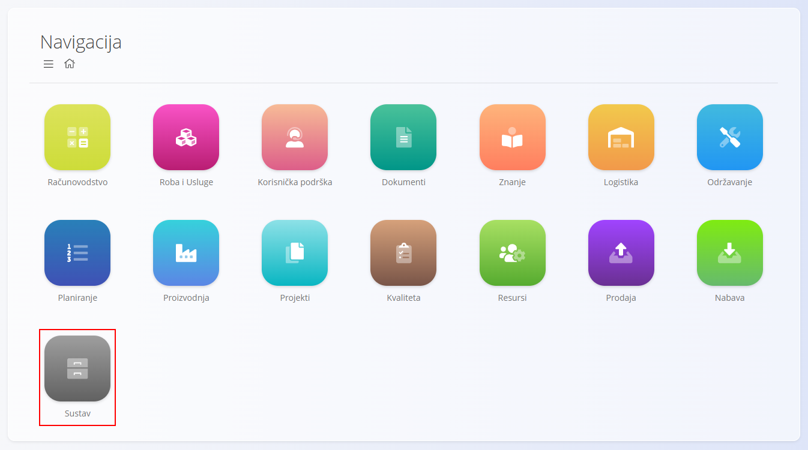
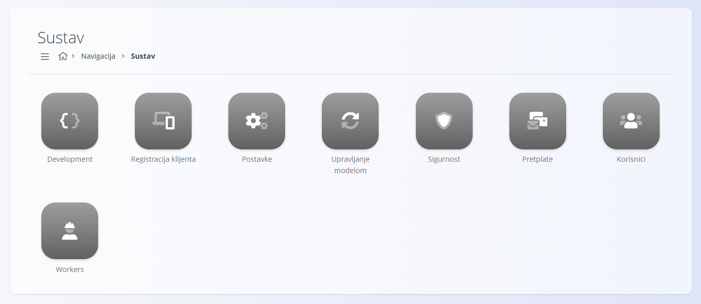

<!-- app_route: /sitemap/system -->
<!-- app_label: Domena Sustav -->
<!-- canonical_source_url: https://github.com/Tom-PIT/Connected.Docs/blob/main/hr/Domene/Sustav/README.md -->
<!-- canonical_source_title: Domena Sustav -->

# Sustav

Domena **Sustav** sadrži administrativne alate za konfiguriranje, zaštitu i održavanje platforme.

Za razliku od operativnih domena, kao što su **Prodaja**, **Nabava** ili **Proizvodnja**, domena Sustav namijenjena je prvenstveno administratorima i naprednim korisnicima zaduženima za postavljanje sustava, upravljanje korisnicima, integracije i globalnu konfiguraciju.

Za pristup ovoj domeni u karti sustava odaberite **Sustav**.

> [!NOTE]
> Dostupne mogućnosti ovise o uključenim modulima, instaliranim proširenjima i ovlastima korisnika.

## Što sadrži domena Sustav?

Domena Sustav podijeljena je na nekoliko administrativnih područja:

* **[Postavke](#postavke)** – globalne postavke sustava i organizacije
* **[Korisnici](#korisnici)** – korisnički računi i upravljanje pristupom
* **[Sigurnost](#sigurnost)** – autentifikacija i kontrola pristupa
* **[Pretplate](#pretplate)** – upravljanje licencama i pretplatama
* **[Registracija klijenta](#registracija-klijenta)** – postavke registracije i identifikacije
* **[Development](#development)** – tehnički alati namijenjeni razvojnim inženjerima
* **[Workers](#workers)** – obrada u pozadini i sustavne usluge

## Postavke

Odjeljak **Postavke** sadrži postavke koje utječu na ponašanje cijele platforme.

Primjeri uključuju:

* podatke o organizaciji
* zadanu državu i valutu
* postavke skladišta
* postavke fiskalizacije
* postavke povezivosti i integracija
* mogućnosti lokalizacije

Dostupni unosi konfiguracije mogu se razlikovati ovisno o instaliranim modulima i zahtjevima specifičnim za pojedinu državu.

Pogledajte:

* [**Postavke sustava**](Postavke/PostavkeSustava.md)
* [**Skladište**](Postavke/KonfiguracijaSkladista.md)
* [**Postavke Sales Retail SI**](Postavke/SalesRetailsSISettings.md)

## Korisnici

Odjeljak [**Korisnici**](Upravljanje/Korisnici.md) upravlja pristupom platformi.

Administratori mogu:

* stvarati korisničke račune
* dodjeljivati uloge i ovlasti
* upravljati statusom korisnika
* konfigurirati postavke lokalizacije

## Sigurnost

Odjeljak **Sigurnost** sadrži postavke autentifikacije i autorizacije kojima se štiti pristup platformi i njezinim podacima.

Dostupne mogućnosti ovise o modelu implementacije i uključenim sigurnosnim značajkama.

## Pretplate

Odjeljak **Pretplate** sadrži podatke o licencama i pretplatama koji se koriste za upravljanje pristupom značajkama i uslugama platforme.

## Registracija klijenta

Registracija klijenta sadrži postavke i podatke vezane uz registraciju i identifikaciju sustava.

Dostupne mogućnosti mogu se razlikovati ovisno o implementaciji i zahtjevima licenciranja.

## Development

Odjeljak **Development** sadrži tehničke alate namijenjene razvojnim inženjerima, konzultantima i naprednim administratorima.

Ti se alati obično koriste tijekom implementacije, prilagodbe, rješavanja problema i integracijskih aktivnosti.

## Workers

Odjeljak **Workers** pruža podatke o uslugama i automatiziranim procesima koje platforma izvodi u pozadini.

Ovisno o konfiguraciji, te usluge mogu biti zadužene za:

* planirane zadatke
* obavijesti
* sinkronizacijske poslove
* obradu integracija
* ostale automatizirane radnje

## Sustav i ostale domene

Domena Sustav podržava sve ostale domene na platformi.

| Područje | Interakcija |
| --- | --- |
| [**Prodaja**](../Prodaja/README.md) | Osigurava postavke fiskalizacije, organizacije i korisnika. |
| [**Nabava**](../Nabava/README.md) | Pruža postavke skladišta i integracija. |
| [**Proizvodnja**](../Proizvodnja/README.md) | Osigurava korisnike, lokalizaciju i konfiguraciju na razini sustava. |
| [**Održavanje**](../Odrzavanje/README.md) | Pruža kontrolu pristupa i zajedničku konfiguraciju. |
| [**Resursi**](../Resursi/README.md) | Koristi korisnike, uloge i postavke lokalizacije. |

Domena Sustav služi kao administrativna osnova platforme i podržava rad svih poslovnih procesa.
