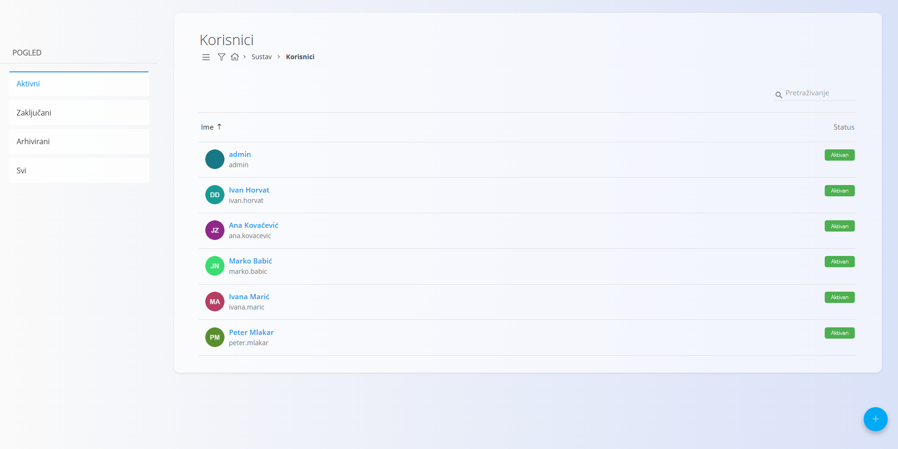
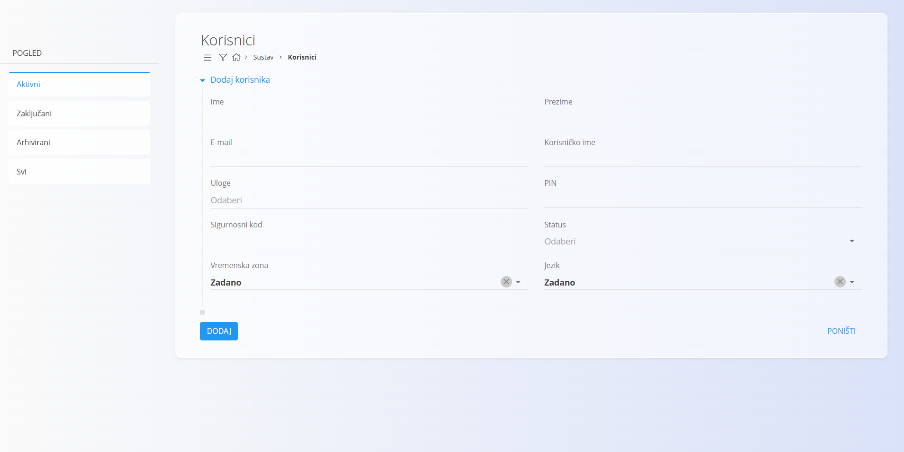
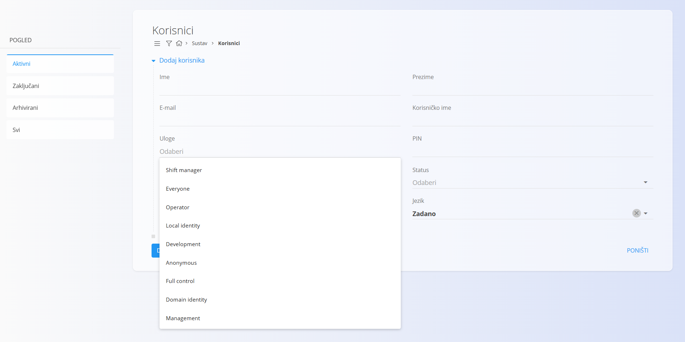

<!-- app_route: /management/users -->
<!-- app_label: Korisnici -->
<!-- canonical_source_url: https://github.com/Tom-PIT/Connected.Docs/blob/main/hr/Domene/Sustav/Upravljanje/Korisnici.md -->
<!-- canonical_source_title: Korisnici -->

# Korisnici

Šifrarnik **Korisnici** sadrži sve korisničke račune registrirane u sustavu. Korisnički računi određuju podatke za prijavu, prava pristupa temeljena na ulogama, osobne podatke profila (ime, e-pošta, vremenska zona, jezik) i to smije li korisnik pristupiti određenim područjima sustava (pravila za skladišta i domene još se provjeravaju). Te postavke osiguravaju da svaki korisnik ima ovlasti primjerene svojim zaduženjima.

Stranici Korisnici pristupate na način da idete na **Sustav / Korisnici** u [navigaciji](../../../Zajednicko/UI/Navigacija.md).

## Shema

| Polje | Opis |
|-------|-------------|
| **Ime** | Korisnikovo ime. |
| **Prezime** | Korisnikovo prezime. |
| **E-mail** | Adresa e-pošte koja se koristi za identifikaciju računa i komunikaciju. |
| **Korisničko ime** | Naziv za prijavu koji se koristi pri ulasku u sustav. |
| **Uloge** | Jedna ili više sustavskih uloga koje određuju prava pristupa. |
| **PIN** | Neobavezna numerička šifra za pojednostavljenu autentifikaciju. |
| **Sigurnosni kod** | Neobavezni dodatni kod za autentifikaciju (pravila korištenja mogu se razlikovati ovisno o sustavu). |
| **Status** | Status korisnika: *Aktivan*, *Neaktivan* ili *Zaključan*. |
| **Vremenska zona** | Određuje zadanu vremensku zonu korisnika za sve operacije vezane uz datum i vrijeme. |
| **Jezik** | Jezik korisničkog sučelja (zadani, slovenski, engleski). |

## Upravljanje

Šifrarniku **Korisnici** pristupate na način da idete na **Sustav / Korisnici** u [navigaciji](../../../Zajednicko/UI/Navigacija.md). Popis prikazuje sve korisnike sustava s pokazateljima statusa:

- **Zeleno** — Aktivan
- **Sivo** — Neaktivan ili Zaključan

Možete **pretraživati**, **sortirati** ili otvoriti korisnika radi uređivanja pojedinosti.

## Radnje

### Izrada novog korisnika

Kliknite [akcijski gumb](../../../Zajednicko/UI/AkcijskiGumb.md) da stvorite novog korisnika.

Obrazac uključuje osobne podatke, podatke za prijavu, dodijeljene uloge i postavke lokalizacije.

Dostupne uloge možete odabrati iz padajućeg izbornika. Nazivi uloga su postavke svake instalacije, pa se prikazuju onako kako su uneseni (često na engleskom):

Kliknite **Dodaj** da biste stvorili korisnika ili **Poništi** za povratak na popis.

> [!NOTE]
> Uloge određuju prava pristupa korisnika u sustavu. Strukture uloga konfiguriraju se pojedinačno, prema vašem poslovnom modelu i operativnim potrebama. Zbog toga se točno značenje i opseg svake uloge mogu razlikovati među implementacijama.

## Uređivanje korisnika

Za izmjenu postojećeg korisnika kliknite njegovo **Ime** na popisu. Zaslon za uređivanje omogućuje ažuriranje svih polja, uključujući uloge i status.

Kliknite **Spremi** za potvrdu promjena ili **Poništi** za njihovo odbacivanje.
