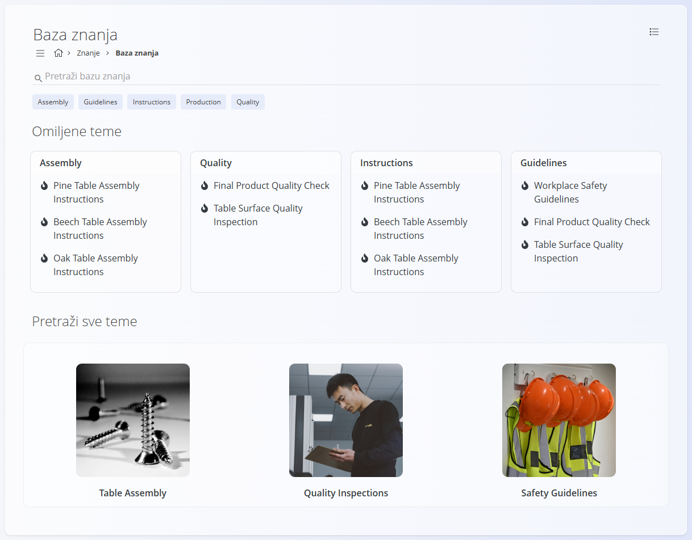
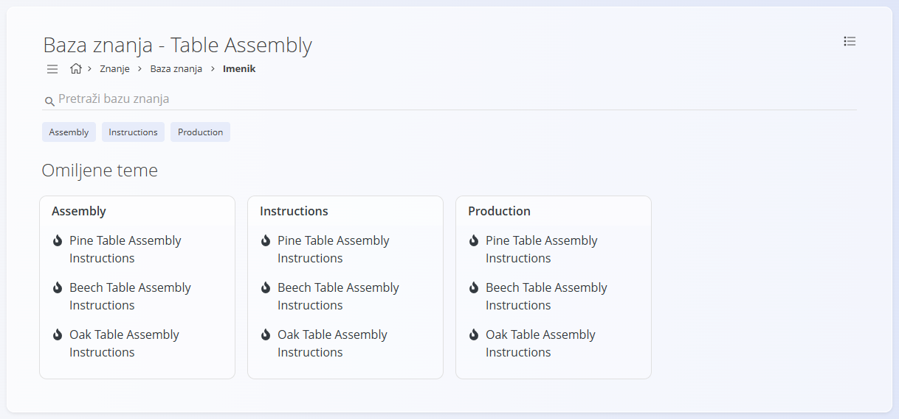
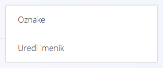
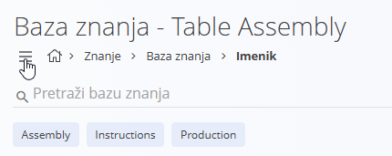
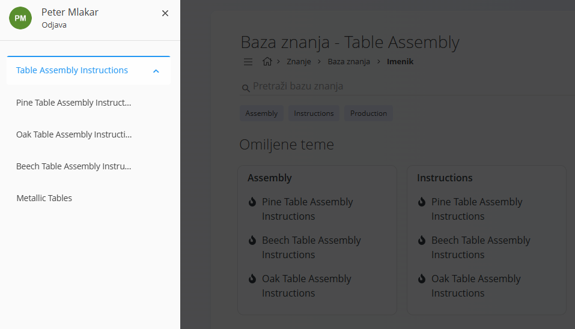
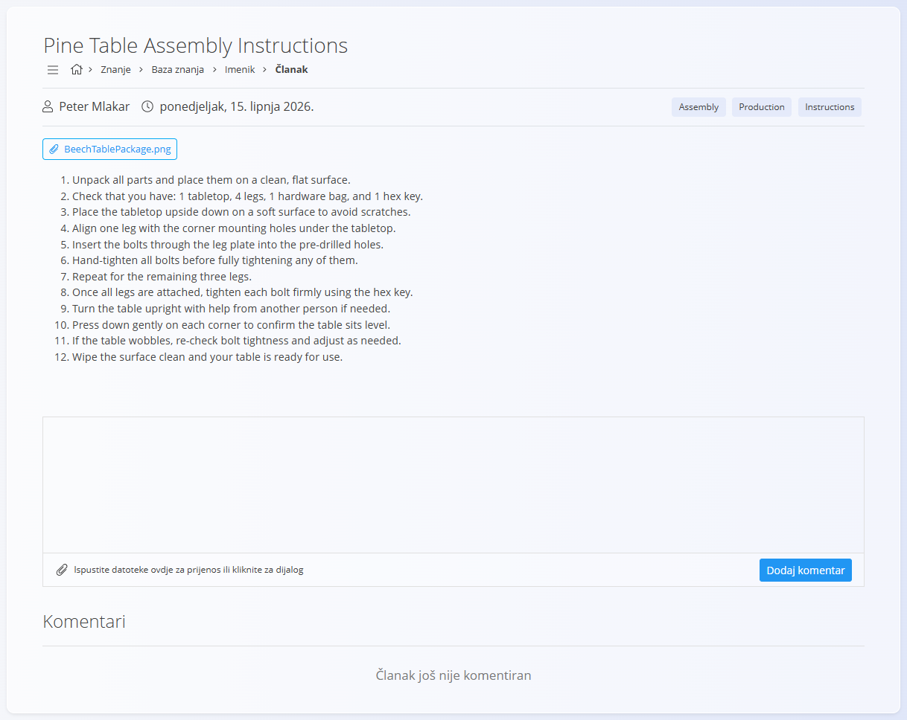
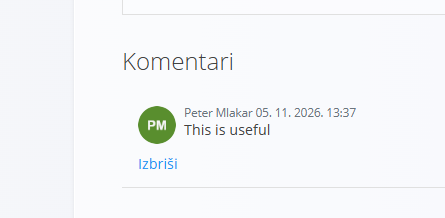

<!-- app_route: /knowledge/ -->
<!-- app_label: Knowledge base -->
<!-- canonical_source_url: https://github.com/Tom-PIT/Connected.Docs/blob/main/hr/Domene/Znanje/BazaZnanja/BazaZnanja.md -->
<!-- canonical_source_title: Baza znanja -->

# Baza znanja

**Baza znanja** je glavni ekran na kojem se prikazuje sav **objavljeni sadržaj** domene Znanje. Korisnicima pruža središnje mjesto za pregledavanje, pretraživanje i čitanje interne dokumentacije, kao što su upute, smjernice, postupci i referentni članci.

**Baza znanja** se prvenstveno koristi kao **biblioteka interne dokumentacije** i podržava svakodnevni operativni rad u više domena.

Do ovog ekrana dolazite tako da u [navigaciji](../../../Zajednicko/UI/Navigacija.md) odaberete **Znanje / Baza znanja**.

## Pregled

Početna stranica **Baze znanja** pomaže korisnicima da brzo pronađu relevantan sadržaj. Kombinira **pretraživanje**, **filtriranje po oznakama** i **vizualnu navigaciju** kako bi istaknula često korištene ili važne članke.

Ekran je samo za čitanje, osim **komentara** na člancima gdje je komentiranje omogućeno.

## Pretraživanje i filtri

Na vrhu stranice polje **Pretraži bazu znanja** omogućuje pretraživanje po:

- naslovu članka
- sadržaju članka
- oznakama

Ispod polja za pretraživanje prikazane su **oznake** koje se mogu koristiti kao brzi filtri. Klik na oznaku filtrira prikaz na članke povezane s tom oznakom.

Oznake se definiraju u **[Oznakama imenika](../Upravljanje/OznakeImenika.md)**.

## Omiljene teme

Odjeljak **Omiljene teme** grupira često korištene ili istaknute članke po oznakama.

Svaka kartica predstavlja jednu oznaku (na primjer *Assembly*, *Quality*, *Instructions*) i sadrži popis povezanih članaka. Klik na članak otvara ga izravno.

Ovaj odjeljak omogućuje brzi pristup često korištenim uputama i smjernicama bez pregledavanja cijele strukture imenika.

## Pretraži sve teme

Odjeljak **Pretraži sve teme** pruža vizualni pregled sadržaja znanja, obično prikazan kroz imenike ili odabrane teme.

Svaka pločica vodi do skupine povezanih članaka, pa korisnici mogu istraživati **bazu znanja** po temi, a ne po oznaci ili pretraživanju.

Ovo je korisno pri uvođenju novih zaposlenika, obuci i općem upoznavanju s dostupnom dokumentacijom.

Klik na pločicu imenika otvara **prikaz imenika**, u kojem korisnici pregledavaju članke i otvaraju kazalo.

## Prikaz imenika

Klik na imenik u odjeljku **Pretraži sve teme** otvara **prikaz imenika** s člancima dostupnima unutar tog imenika.

Prikaz imenika sadrži:

- **polje za pretraživanje** – pretražuje unutar **baze znanja**
- **oznake** – filtriraju sadržaj po oznakama
- **Omiljene teme** – brzi pristup člancima grupiranima po oznakama

U prikazu imenika izbornik nudi sljedeće mogućnosti:
- uređivanje oznaka (**Oznake**)
- uređivanje imenika (**Uredi imenik**)

### Kazalo

Za pregled svih članaka u imeniku otvorite **kazalo** klikom na **ikonu izbornika** u gornjem lijevom kutu.

Kazalo prikazuje strukturu imenika i dostupne članke. Klik na članak otvara ga u [prikazu članka](#prikaz-clanka).

Strukturu imenika i kazalo konfigurirate u **[Imenicima](../Upravljanje/Imenici.md)** i **[Kazalu](../Upravljanje/Kazalo.md)**.

## Prikaz članka

Klik na članak otvara **prikaz članka** s punim sadržajem.

Prikaz članka sadrži:

- **naslov članka**
- **autora**
- **datum objave**
- **oznake** povezane s člankom
- **glavni sadržaj** (oblikovani tekst, popise, upute)
- **priloge** (ako su uključeni)
- **odjeljak komentara** (ako je omogućen)

### Komentari

Ako je komentiranje omogućeno za članak, korisnici mogu:

- dodavati komentare
- učitavati datoteke kao dio komentara
- pregledavati komentare drugih korisnika

Odjeljak za komentare, s poljem za unos i gumbom **Dodaj komentar**, prikazan je na slici prikaza članka.

Komentare se može ukloniti klikom na **Izbriši**.

## Upotreba

**Baza znanja** se obično koristi za:

- čitanje radnih uputa i postupaka
- pristup internim smjernicama i pravilima
- podršku proizvodnji, logistici, kvaliteti i održavanju
- uvođenje novih zaposlenika
- dijeljenje internog znanja i najboljih praksi

> [!NOTE]
> - **Baza znanja** prikazuje samo **objavljen** i **omogućen** sadržaj.  
> - Vidljivost članaka ovisi o statusu imenika i postavkama objave.
