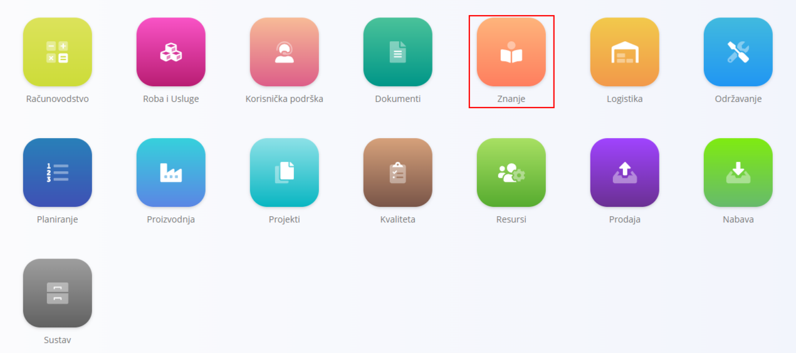

<!-- app_route: /sitemap/knowledge -->
<!-- app_label: Knowledge domain -->
<!-- canonical_source_url: https://github.com/Tom-PIT/Connected.Docs/blob/main/hr/Domene/Znanje/README.md -->
<!-- canonical_source_title: Znanje -->

# Znanje

Domena **Znanje** pruža centralizirano **knjižnicu baze znanja** koja služi za interne dokumente, kao što su upute, smjernice, postupci i obavijesti. Omogućuje organizaciji da strukturira, objavljuje i održava pisani sadržaj koji podržava svakodnevni rad i razmjenu znanja.

Ova domena se obično koristi za **interne dokumente**, materijale za uvođenje novih zaposlenika, operativne upute i referentne sadržaje.

Do ove domene dolazite tako da u [navigaciji](../../Zajednicko/UI/Navigacija.md) odaberete **Znanje**.

> [!NOTE]  
> Dostupne domene ovise o konfiguraciji i poslovnom modelu svake tvrtke.

## Što je uključeno u domenu Znanje?

Domena je podijeljena u dva glavna funkcionalna područja:

- **[Baza znanja](BazaZnanja/BazaZnanja.md)** – pristup krajnjih korisnika objavljenim člancima i dokumentaciji  
- **[Upravljanje](#upravljanje)** – postavljanje konfiguracije i strukture sadržaja  

## Baza znanja

**Baza znanja** je glavno područje domene Znanje namijenjeno korisnicima. Pruža pristup svim **objavljenim člancima i datotekama**, organiziranim prema imenicima i oznakama.

Namijenjena je za:

- operativne radnike i zaposlenike
- nadzornike i voditelje timova
- internu podršku i administraciju
- razmjenu znanja između odjela

Uobičajena upotreba uključuje:

- čitanje internih postupaka i radnih uputa
- pregledavanje smjernica i najboljih praksi
- pretraživanje dokumentacije prema ključnoj riječi ili oznaci
- pregled obavijesti ili referentnih materijala

Članci u **bazi znanja** mogu sadržavati:

- tekstualni sadržaj
- priloge (dokumente, slike, datoteke)
- komentare (ako su omogućeni)

**Baza znanja** je **za većinu korisnika samo za čitanje**, osim komentiranja tamo gdje je to dopušteno.

## Upravljanje

Odjeljak **Upravljanje** služi za konfiguraciju i održavanje strukture domene Znanje. Određuje **kako je sadržaj organiziran**, a ne sam sadržaj.

Upravljanje obuhvaća sljedeća područja konfiguracije:
- [**Imenici**](Upravljanje/Imenici.md)
- [**Oznake imenika**](Upravljanje/OznakeImenika.md)

> [!TIP]
> Sve stavke upravljanja pogledajte u **[kazalu upravljanja](../../IndeksUpravljanja.md)**.

### Imenici

**Imenici** određuju glavnu strukturu **baze znanja**. Svaki imenik predstavlja **temu ili kategoriju** i može sadržavati:

- [Članke](Upravljanje/Clanci.md)
- [Kazalo](Upravljanje/Kazalo.md) (strukturirane skupine)
- priloge

Imenici omogućuju organizaciji da logički grupira povezani sadržaj (na primjer smjernice za ljudske resurse, upute za proizvodnju, IT dokumentaciju).

Uobičajena konfiguracija uključuje:

- naslov i opis
- status (omogućen / onemogućen)
- članke i kazala unutar imenika

### Oznake imenika

**Oznake imenika** služe za razvrstavanje i filtriranje sadržaja domene Znanje. Pružaju dodatan način organizacije i pretraživanja članaka u svim imenicima.

Oznake se obično koriste za:

- razvrstavanje članaka po temi
- filtriranje u **bazi znanja**
- isticanje povezanog sadržaja u različitim imenicima

Oznake imenika zajedničke su cijeloj domeni Znanje i koriste ih više imenika i članaka. Pogledajte [Oznake imenika](Upravljanje/OznakeImenika.md).

## Tijek rada u domeni Znanje

Domena Znanje obično slijedi ovaj životni ciklus:

### **1. Postavljanje strukture**
Imenici i oznake imenika definiraju se u **Upravljanju**.

### **2. Izrada sadržaja**
[Članci](Upravljanje/Clanci.md) se izrađuju i dodjeljuju imenicima, po potrebi se označavaju i obogaćuju prilozima.

### **3. Objavljivanje**
Članci se objavljuju i postaju vidljivi u **bazi znanja** prema svom statusu i postavkama valjanosti.

### **4. Korištenje**
Korisnici pregledavaju, pretražuju, čitaju i komentiraju članke u **bazi znanja**.

### **5. Održavanje**
Sadržaj se ažurira, onemogućuje ili arhivira kako se postupci i dokumentacija mijenjaju.

## Sažetak

**Baza znanja** služi kao **središnje čvorište dokumentacije** sustava.  
Osigurava da:

- je interno znanje strukturirano i dostupno
- se postupci i smjernice lako pronalaze
- se dokumentacija održava na kontroliran i centraliziran način
- zaposlenici imaju jedan pouzdan izvor za interne upute

Nadopunjuje operativne domene tako što ih podupire **jasnom i dostupnom dokumentacijom**.

## Povezano

- **[Baza znanja](BazaZnanja/BazaZnanja.md)** – pregled objavljene dokumentacije
- **[Imenici](Upravljanje/Imenici.md)** – upravljanje spremnicima i navigacijom
- **[Članci](Upravljanje/Clanci.md)** – izrada i održavanje sadržaja
- **[Oznake imenika](Upravljanje/OznakeImenika.md)** – definiranje oznaka za filtriranje
- **[Kazalo](Upravljanje/Kazalo.md)** – konfiguracija navigacije imenika
