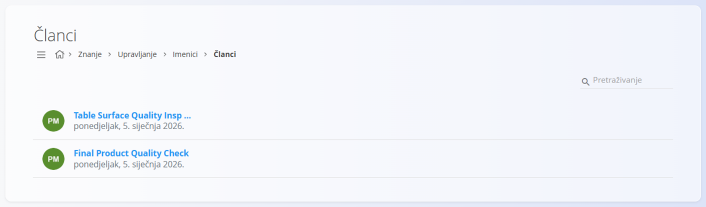
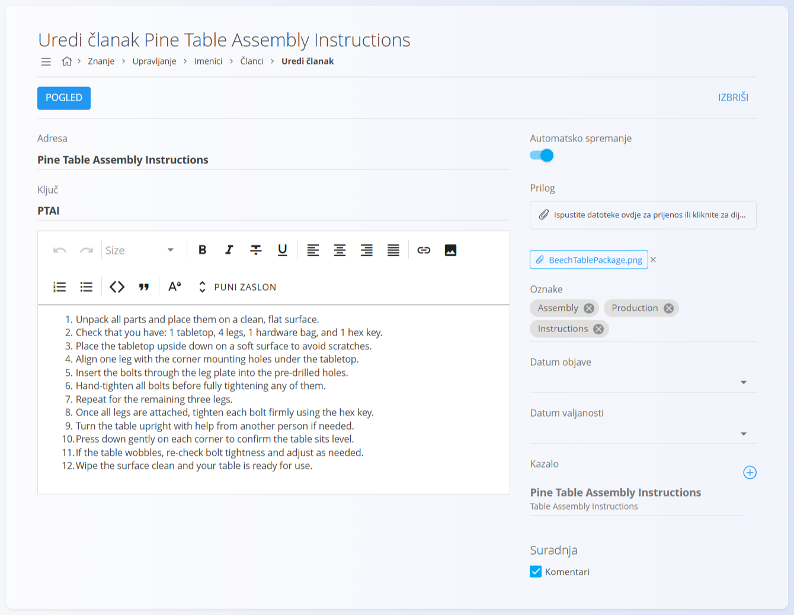
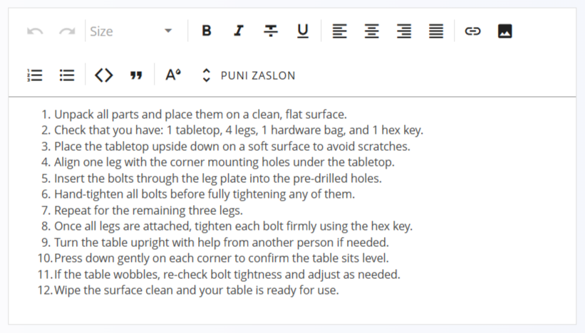

<!-- app_route: /management/knowledge/directories -->
<!-- app_label: Directories -->
<!-- canonical_source_url: https://github.com/Tom-PIT/Connected.Docs/blob/main/hr/Domene/Znanje/Upravljanje/Articles.md -->
<!-- canonical_source_title: Članci -->

# Članci

**Članci** su glavne jedinice sadržaja u [**bazi znanja**](../BazaZnanja/BazaZnanja.md). Sadrže pisanu dokumentaciju, kao što su upute, smjernice, postupci i referentne informacije.

Članci pripadaju **imeniku** i mogu se organizirati i pregledavati pomoću [kazala](TableOfContents.md) imenika.

Za upravljanje člancima idite na **Znanje / Upravljanje / Imenici** u [navigaciji](../../../Zajednicko/UI/Navigacija.md) i kliknite **Članci** kod željenog imenika (vidi [**Imenici**](Directories.md)).

## Shema

| Polje | Opis |
|------|------|
| **Adresa** | Prikazani naslov članka (obavezno). |
| **Ključ** | Kratki jedinstveni identifikator članka (obavezno). |
| **Sadržaj** | Glavni tekst članka, uređuje se u uređivaču teksta. |
| **Prilog** | Neobavezne datoteke priložene članku. |
| **Oznake** | Oznake kojima se članak kategorizira i filtrira. |
| **Datum objave** | Datum od kojeg je članak vidljiv. |
| **Datum valjanosti** | Datum nakon kojeg članak više nije vidljiv. |
| **Suradnja** | Omogućuje ili onemogućuje komentare na članku. |
| **Automatsko spremanje** | Automatski sprema promjene dok uređujete. |

## Upravljanje

### Popis članaka

Popis prikazuje sve članke koji pripadaju odabranom imeniku.

Svaki redak prikazuje:
- **naslov članka**
- **datum zadnje izmjene**

Članci se mogu pretraživati pomoću polja **Pretraživanje** u gornjem desnom kutu.

Klik na članak otvara ga za uređivanje.

## Radnje

Kliknite gumb radnji da biste stvorili novi članak.

### Dodavanje novog članka

Pri stvaranju ili uređivanju članka dostupna su polja opisana u odjeljku [Shema](#shema) iznad.

Dok uređujete članak, kliknite **Pogled** u gornjem lijevom kutu da biste pregledali kako će se članak prikazati u [**bazi znanja**](../BazaZnanja/BazaZnanja.md).

Promjene se spremaju automatski ako je uključeno **Automatsko spremanje**.

## Uređivač teksta

Sadržaj članka piše se u ugrađenom **uređivaču teksta**.

Uređivač nudi uobičajene mogućnosti oblikovanja kao i većina uređivača teksta, uključujući:

- oblikovanje teksta (naslove, podebljano, kurziv, popise)
- poravnanje teksta
- poveznice i slike
- uređivanje preko cijelog zaslona (**Puni zaslon**)

Uređivač je osmišljen za jasnu i strukturiranu dokumentaciju bez potrebe za tehničkim znanjem.

## Prilozi

Članci mogu sadržavati **priloge**, poput dokumenata ili slika.

Prilozi se učitavaju pomoću područja **Prilog** na ekranu za uređivanje članka i prikazuju se uz sadržaj članka u [**bazi znanja**](../BazaZnanja/BazaZnanja.md).

## Oznake

Oznake se koriste za kategorizaciju članaka i lakše pronalaženje u sustavu.

Oznake se biraju iz [**Oznaka imenika**](DirectoryTags.md) i mogu se ponovno koristiti u više članaka.

## Objava i zakazivanje članaka

Članci se mogu zakazati pomoću:

- **Datum objave** – određuje kada članak postaje vidljiv
- **Datum valjanosti** – određuje kada članak više nije vidljiv

Ako datumi nisu postavljeni, članak je vidljiv odmah i bez vremenskog ograničenja.

## Suradnja

Kada je **Suradnja** uključena, korisnici mogu dodavati komentare na članak.

Tako se povratne informacije, pojašnjenja i rasprave vode izravno uz dokumentaciju.

## Brisanje članka

Kliknite **Izbriši** na ekranu za uređivanje članka da biste otvorili dijalog za potvrdu:

**Jeste li sigurni da želite izbrisati zapis?**

Ako potvrdite, članak se trajno uklanja.

> [!NOTE]
> Brisanje članka uklanja ga i iz kazala imenika.
