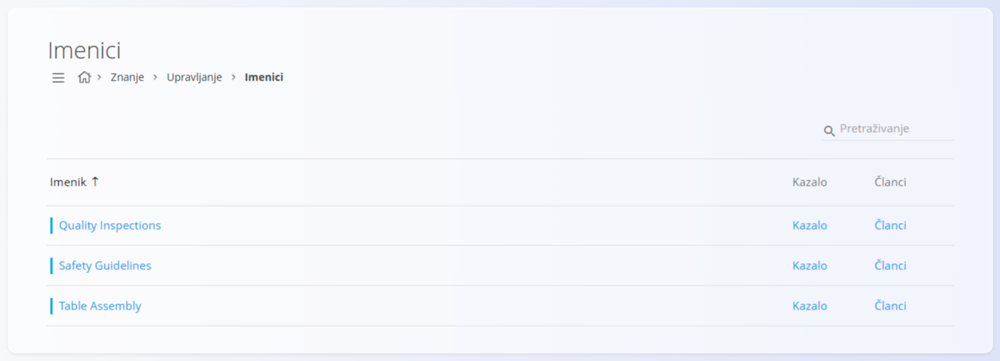
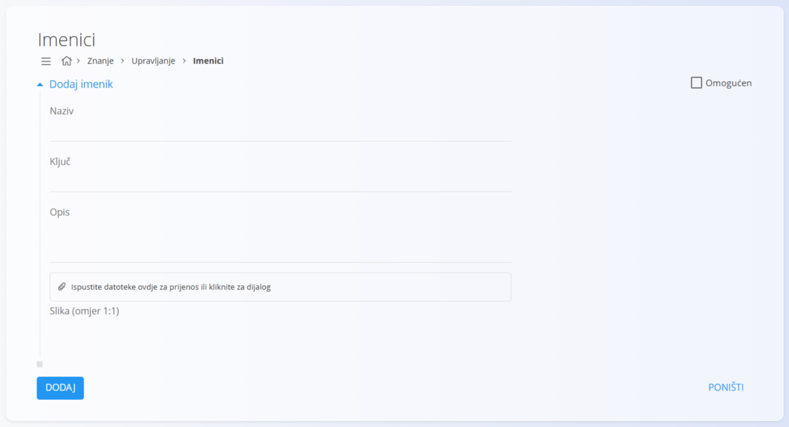

<!-- app_route: /management/knowledge/directories -->
<!-- app_label: Directories -->
<!-- canonical_source_url: https://github.com/Tom-PIT/Connected.Docs/blob/main/hr/Domene/Znanje/Upravljanje/Directories.md -->
<!-- canonical_source_title: Imenici -->

# Imenici

Popis šifara **Imenici** određuje glavne **spremnike sadržaja** koji se koriste u **bazi znanja**. Svaki imenik predstavlja temu ili kategoriju (na primjer *Table Assembly*, *Safety Guidelines*, *Quality Inspections*) i sadrži članke i strukturu kazala.

Imenici se koriste za organiziranje sadržaja znanja i određuju kako se članci grupiraju i kako se kroz njih navigira u [**bazi znanja**](../BazaZnanja/BazaZnanja.md).

Do ovog ekrana dolazite tako da u [navigaciji](../../../Zajednicko/UI/Navigacija.md) odaberete **Znanje / Upravljanje / Imenici**.

## Shema

| Polje | Opis |
|------|------|
| **Naziv** | Prikazani naziv imenika (obavezno). |
| **Ključ** | Kratki jedinstveni identifikator imenika (obavezno). |
| **Opis** | Neobavezan opis koji objašnjava namjenu imenika. |
| **Slika** | Neobavezna slika kojom se imenik vizualno predstavlja (preporučeni omjer 1:1). |
| **Omogućen** | Pokazuje je li imenik vidljiv i dostupan u [**bazi znanja**](../BazaZnanja/BazaZnanja.md). |

## Upravljanje

### Popis imenika

Popis prikazuje sve konfigurirane imenike.

Svaki redak prikazuje:
- **Imenik** – naziv imenika
- **poveznice** za upravljanje:
  - **[Kazalo](TableOfContents.md)**
  - **[Članci](Articles.md)**

S lijeve strane naziva svakog imenika prikazuje se oznaka statusa:
- **plava** – omogućen (aktivan) imenik
- **siva** – onemogućen (neaktivan) imenik

Imenici se mogu pretraživati pomoću polja **Pretraživanje** u gornjem desnom kutu.

Klik na naziv imenika otvara ga za uređivanje.

## Radnje

### Dodavanje novog imenika

Kliknite [gumb radnji](../../../Zajednicko/UI/AkcijskiGumb.md) da biste dodali novi imenik. Ispunite sljedeća polja:

- **Naziv**
- **Ključ**
- **Opis** (neobavezno)
- **Slika** (neobavezno)
- **Omogućen** – određuje je li imenik vidljiv u [**bazi znanja**](../BazaZnanja/BazaZnanja.md)

Kliknite **Dodaj** da biste spremili novi imenik.

Nakon stvaranja imenik postaje dostupan u [**bazi znanja**](../BazaZnanja/BazaZnanja.md) i može se popuniti sadržajem.

## Upravljanje sadržajem imenika

Nakon što se imenik stvori, u popisu su dostupne dodatne mogućnosti konfiguracije:

- **[Članci](Articles.md)** – upravljanje člancima koji pripadaju imeniku
- **[Kazalo](TableOfContents.md)** – definiranje strukture navigacije unutar imenika

Do tih mogućnosti dolazite preko poveznica prikazanih ispod svakog imenika u popisu.

> [!NOTE]
> Imenici određuju **samo strukturu**. Članci i kazalo upravljaju se zasebno.

## Uređivanje imenika

Kliknite naziv imenika da biste otvorili ekran za uređivanje.

Na ekranu za uređivanje možete:
- mijenjati podatke imenika (naziv, ključ, opis)
- omogućiti ili onemogućiti imenik
- promijeniti sliku imenika

Kliknite **Spremi** da potvrdite promjene.

## Brisanje imenika

Kliknite **Izbriši** na ekranu za uređivanje da biste otvorili dijalog za potvrdu:

**Jeste li sigurni da želite izbrisati zapis?**

Ako potvrdite, imenik se trajno uklanja.

> [!NOTE]
> Imenik se može obrisati samo ako ne sadrži članke niti stavke kazala.
