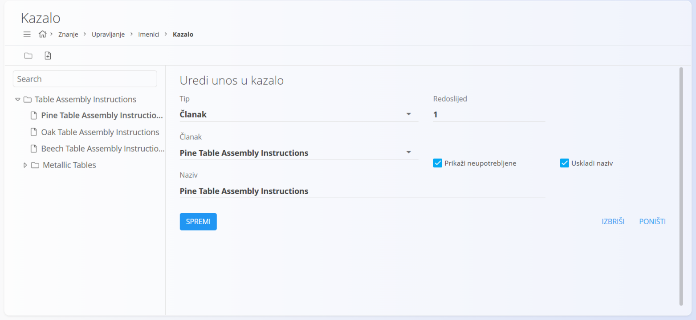
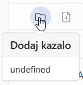
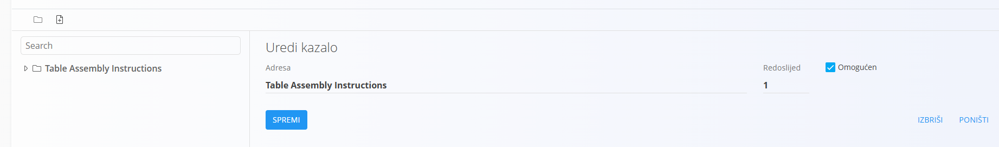
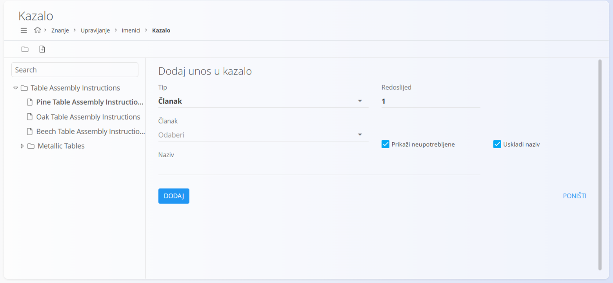
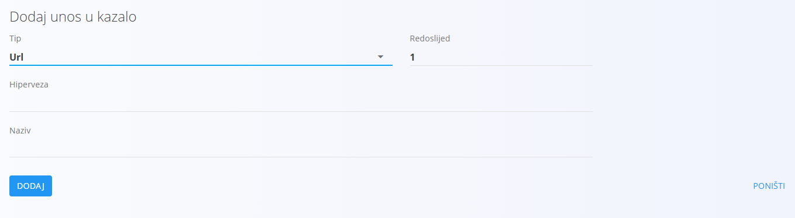
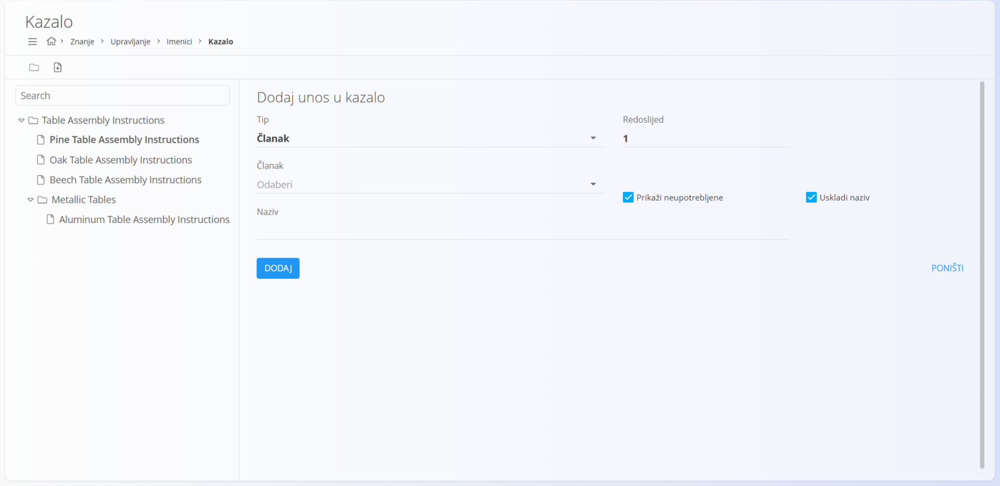
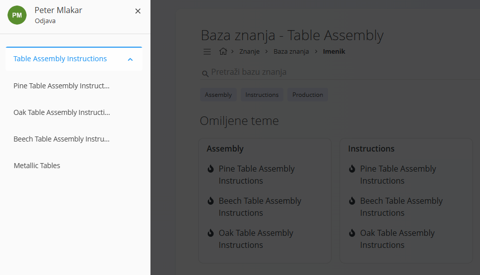

<!-- app_route: /management/knowledge/directories -->
<!-- app_label: Directories -->
<!-- canonical_source_url: https://github.com/Tom-PIT/Connected.Docs/blob/main/hr/Domene/Znanje/Upravljanje/Kazalo.md -->
<!-- canonical_source_title: Kazalo -->

# Kazalo

**Kazalo** određuje **strukturu navigacije** unutar imenika u [**bazi znanja**](../BazaZnanja/BazaZnanja.md). Omogućuje imeniku da članke organizira hijerarhijski i korisnicima daje jasan način pregledavanja sadržaja.

Imenik može sadržavati **jedno ili više** kazala. Svako kazalo prikazuje se kao stablo i može sadržavati mape, poveznice na članke i URL-ove.

Kazalo uređujete tako da u [navigaciji](../../../Zajednicko/UI/Navigacija.md) odaberete **Znanje / Upravljanje / Imenici** i kliknete **Kazalo** kod željenog imenika (vidi [**Imenici**](Imenici.md)).

### Pregled

Kazalo se prikazuje kao **stablo** i može sadržavati:

- **mape** – služe za grupiranje stavki
- **članke** – poveznice na [članke](Clanci.md) domene Znanje
- **URL-ove** – poveznice na vanjske izvore

Stavke se poredaju prema **rednom broju**.

> [!TIP]
> Redoslijed stavki mijenja se u polju **Redoslijed**. Povlačenje i ispuštanje nije podržano.

## Shema

| Polje | Opis |
|------|------|
| **Tip** | Vrsta stavke: **Mapa**, **Članak** ili **Url**. Naziv vrste ostaje u obliku u kojem ga prikazuje aplikacija. |
| **Naziv** | Prikazani naziv stavke kazala. |
| **Omogućen** | Samo za glavno kazalo imenika: određuje je li kazalo vidljivo u [**bazi znanja**](../BazaZnanja/BazaZnanja.md). |
| [**Članak**](Clanci.md) | Članak povezan sa stavkom (dostupno kada je Tip = Članak). |
| **Hiperveza** | Prikazani tekst poveznice za stavke tipa URL. |
| **Redoslijed** | Položaj stavke unutar njezine razine u kazalu. |
| **Prikaži neupotrebljene** | Prikazuje članke koji još nisu upotrijebljeni u kazalu pri odabiru [članka](Clanci.md). |
| **Uskladi naziv** | Održava naziv stavke usklađenim s nazivom povezanog [članka](Clanci.md). |

## Stvaranje kazala

Ako imenik još nema kazalo, ekran je prazan.

Za stvaranje novog kazala kliknite **ikonu mape** u alatnoj traci.

Imenik može sadržavati više kazala.  
Za stvaranje novog kazala (korijena) provjerite da u bočnom panelu **nije odabrano postojeće kazalo**, zatim kliknite **ikonu mape**.

Na ekranu za uređivanje glavnog kazala možete omogućiti ili onemogućiti cijelo kazalo pomoću polja **Omogućen** i promijeniti njegov **Naziv**.

## Stvaranje stavke kazala

Za dodavanje stavki prvo u bočnom panelu odaberite ciljno **kazalo**, zatim kliknite **ikonu dokumenta** da biste dodali novu stavku.

Pri stvaranju stavke odaberite **Tip** i ispunite potrebna polja.

Kliknite **Dodaj** da biste stvorili stavku.

Za stavku tipa **Url** prikazuju se polja **Hiperveza** (tekst poveznice) i **Naziv**.

## Uređivanje stavki

Kliknite postojeću mapu ili stavku u stablu da biste otvorili ekran za uređivanje.

Na ekranu za uređivanje možete:

- promijeniti **naziv**
- promijeniti **redoslijed**
- promijeniti povezani **članak** ili **URL**, ovisno o tipu
- za stavke tipa **Članak** naziv možete po želji uskladiti s nazivom [članka](Clanci.md).

Ako je u stablu odabrana **mapa**, nove stavke koje stvorite dodaju se **unutar te mape**, što omogućuje izradu ugniježdene strukture kazala.

## Redoslijed i hijerarhija

- stavke se prikazuju prema vrijednosti **Redoslijed**
- mape mogu sadržavati druge mape ili stavke
- hijerarhija određuje kako korisnici pregledavaju sadržaj u [**bazi znanja**](../BazaZnanja/BazaZnanja.md)

Promjene u kazalu odmah se odražavaju u odabranom imeniku.

> [!NOTE]
> Kazalo upravlja **samo navigacijom**. Sadržaj članaka upravlja se zasebno, u [člancima](Clanci.md).

## Brisanje kazala ili stavke

Kliknite **Izbriši** kod kazala ili stavke da biste otvorili dijalog za potvrdu:

**Jeste li sigurni da želite izbrisati zapis?**

Ako potvrdite, kazalo ili stavka se trajno uklanja.

## Korištenje kazala u bazi znanja

Nakon postavljanja kazalo se koristi pri pregledavanju imenika u [**bazi znanja**](../BazaZnanja/BazaZnanja.md).

Unutar imenika kliknite **ikonu hamburgera** da biste otvorili bočni panel kazala. Pomoću njega korisnici se kreću između mapa i članaka definiranih u kazalu.

