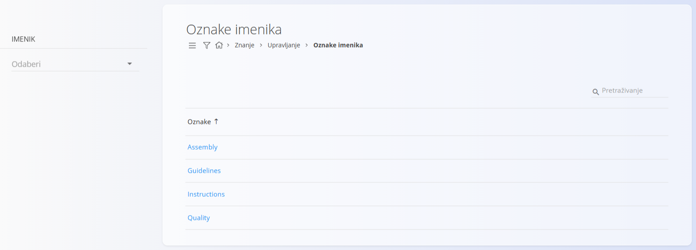
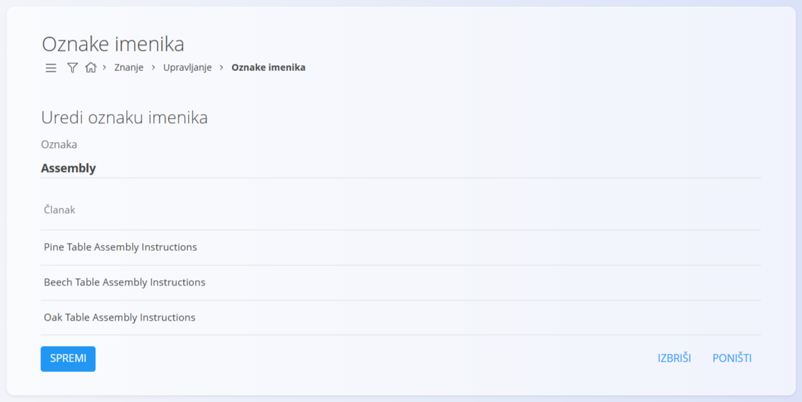

<!-- app_route: /management/knowledge/directory-tags -->
<!-- app_label: Directory tags -->
<!-- canonical_source_url: https://github.com/Tom-PIT/Connected.Docs/blob/main/hr/Domene/Znanje/Upravljanje/OznakeImenika.md -->
<!-- canonical_source_title: Oznake imenika -->

# Oznake imenika

Popis šifara **Oznake imenika** određuje oznake koje se mogu dodijeliti **člancima** domene Znanje. Oznake pomažu u kategorizaciji sadržaja i olakšavaju pretraživanje i filtriranje u [**bazi znanja**](../BazaZnanja/BazaZnanja.md).

Oznake imenika zajedničke su cijeloj domeni Znanje i mogu se ponovno koristiti u više imenika i članaka.

Do ovog ekrana dolazite tako da u [navigaciji](../../../Zajednicko/UI/Navigacija.md) odaberete **Znanje / Upravljanje / Oznake imenika**.

## Shema

| Polje | Opis |
|------|------|
| **Oznaka** | Naziv oznake imenika (obavezno). |

## Upravljanje

### Popis oznaka imenika

Popis prikazuje sve konfigurirane oznake imenika.

Svaki redak prikazuje:
- **Oznake** – naziv oznake kojom se klasificiraju [članci](Clanci.md) domene Znanje

Oznake možete brzo filtrirati po nazivu pomoću polja **Pretraživanje**.

Klik na oznaku otvara je za uređivanje.

## Radnje

### Dodavanje nove oznake imenika

U lijevom bočnom panelu odaberite **Imenik**, zatim kliknite [gumb radnji](../../../Zajednicko/UI/AkcijskiGumb.md) da biste dodali novu oznaku imenika.

Unesite potrebni naziv u polje **Oznaka**.

Kliknite **Dodaj** da biste spremili novu oznaku.

Oznaka odmah postaje dostupna za korištenje u [člancima](Clanci.md).

## Uređivanje oznake imenika

Kliknite oznaku na popisu da biste otvorili ekran za uređivanje.

Na ekranu za uređivanje možete:

- **mijenjati naziv oznake**
- **pregledati članke** koji trenutno koriste tu oznaku (popis samo za čitanje)

Odjeljak **Članak** pomaže vam da prije izmjene ili brisanja oznake vidite gdje se koristi.
