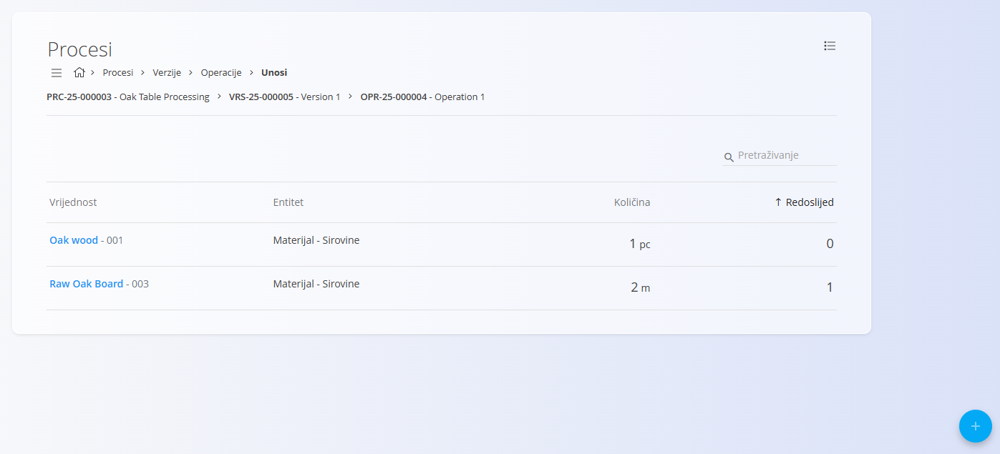
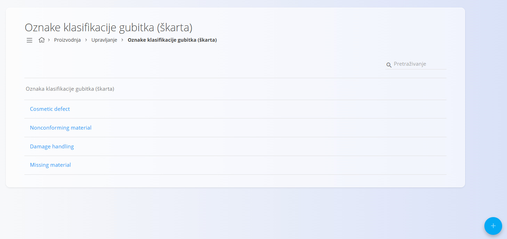
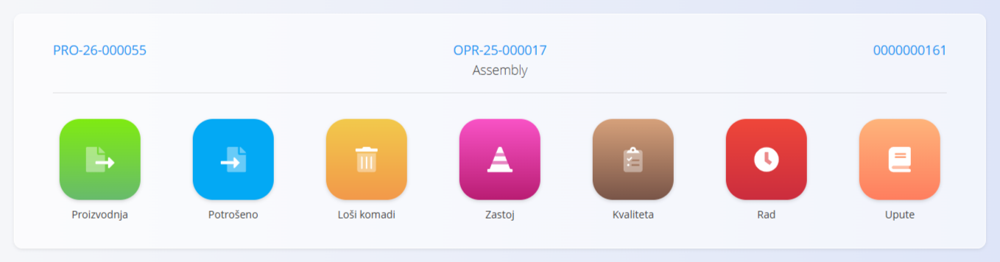
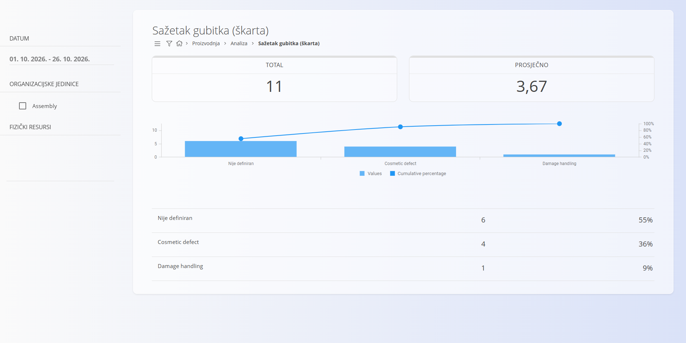

<!-- canonical_source_url: https://github.com/Tom-PIT/Connected.Docs/blob/main/hr/Uvod/Efficiency.md -->
<!-- canonical_source_title: Poboljšanje učinkovitosti proizvodnje -->

# Poboljšanje učinkovitosti proizvodnje

Ovaj vodič u jednostavnim koracima objašnjava kako pratiti proizvodni rad i poboljšati rezultate. Zabilježit ćete što je obavljeno (utrošeni materijali, izlazi, gubici, zastoji, rad) pa ćete pomoću jasnih izvješća i pokazatelja otkriti uska grla i odlučiti što prvo popraviti.

**Cilj:** zabilježiti stvarni rad (potrošnja, gubici, zastoji, rad) i pregledati pokazatelje i sažetke kako bi se otkrila uska grla.

## Preduvjeti

- Procesi i resursi: **[Procesi](../Domene/Proizvodnja/Upravljanje/Procesi.md)**, **[Ulazi](../Domene/Proizvodnja/Upravljanje/Unosi.md)**, **[Izlazi](../Domene/Proizvodnja/Upravljanje/Izlazi.md)**
- Oznake klasifikacije: **[Oznake klasifikacije gubitka](../Domene/Proizvodnja/Upravljanje/OznakeKlasifikacijeGubitka.md)**, **[Oznake zastoja](../Domene/Proizvodnja/Upravljanje/OznakeZastoja.md)**
- Ljudi i uloge: **[Sistematizacija radnih mjesta](../Domene/Proizvodnja/Upravljanje/SistematizacijaRadnihMjesta.md)**, **[Ljudski resursi](../Domene/Proizvodnja/Upravljanje/LjudskiResursi.md)**
- (Neobavezno) Lokacije skladišta za materijale: **[Lokacije skladišta](../Domene/Proizvodnja/Upravljanje/SkladisneLokacije.md)**

## Koraci

### 1. Definirajte procese i standarde
- Otvorite **[Procesi](../Domene/Proizvodnja/Upravljanje/Procesi.md)** i definirajte operacije, ulaze, izlaze i očekivana vremena ciklusa.
- Provjerite postoje li **[Ulazi](../Domene/Proizvodnja/Upravljanje/Unosi.md)** i **[Izlazi](../Domene/Proizvodnja/Upravljanje/Izlazi.md)** za sve materijale i proizvode.

> [!NOTE]
> Jasne definicije procesa omogućuju točne izračune potrošnje i učinkovitosti tijekom izvođenja.

### 2. Pripremite oznake i resurse
- Dodajte **[Oznake klasifikacije gubitka](../Domene/Proizvodnja/Upravljanje/OznakeKlasifikacijeGubitka.md)** za otpad, doradu i kvalitetne probleme.
- Dodajte **[Oznake zastoja](../Domene/Proizvodnja/Upravljanje/OznakeZastoja.md)** za zaustavljanja opreme i kašnjenja.
- Provjerite **[Ljudske resurse](../Domene/Proizvodnja/Upravljanje/LjudskiResursi.md)** i **[Fizičke resurse](../Domene/Proizvodnja/Upravljanje/FizickiResursi.md)** prema potrebi.

> [!TIP]
> Držite popis oznaka kratkim i smislenim kako bi operateri brzo odabrali ispravan razlog.

### 3. Zabilježite izvođenje
- Koristite **[Izvedbu](../Domene/Proizvodnja/Dokumenti/Izvedba.md)** za evidentiranje:
  - utrošenih materijala
  - proizvedenih izlaza
  - gubitka (otpad/dorada) s razlozima
  - zastoja s razlozima
  - rada (radno vrijeme)

> [!TIP]
> Koristite **Povezane dokumente** u proizvodnim nalozima kako biste pratili potrošnju po nalogu, a zatim usporedite zabilježenu potrošnju s **[Zalihama](../Domene/Logistika/Pogledi/Zaliha.md)** i dokumentima kretanja (**[Međuskladišni promet](../Domene/Logistika/Dokumenti/MeduskladisniPromet.md)**, **[Premještaj serijskog broja](../Domene/Logistika/Dokumenti/PremjestajSpremnika.md)**) kako biste potvrdili razlike i utvrdili uzroke.

### 4. Pregledajte pokazatelje i sažetke
- Otvorite analitiku za procjenu učinkovitosti:
  - **[Pokazatelji proizvodnje](../Domene/Proizvodnja/Analiza/KljucniPokazateljiProizvodnje.md)** — pregled propusnosti, učinkovitosti i kvalitete
  - **[Sažetak gubitaka](../Domene/Proizvodnja/Analiza/SazetakGubitka.md)** — otpad i dorada po razlogu i razdoblju
  - **[Sažetak zastoja](../Domene/Proizvodnja/Analiza/SazetakZastoja.md)** — zaustavljanja opreme po razlogu i trajanju
  - **[Sažetak opreme](../Domene/Proizvodnja/Analiza/SazetakStroja.md)** — učinkovitost po stroju ili liniji
  - **[Gubitak organizacijske jedinice](../Domene/Proizvodnja/Analiza/OrganizationUnitLoss.md)** — gubitak po organizacijskoj jedinici
  - **[Zastoj organizacijske jedinice](../Domene/Proizvodnja/Analiza/OrganizationUnitDowntime.md)** — zastoj po organizacijskoj jedinici

> [!TIP]
> - Filtrirajte po vremenskom rasponu i jedinici, zatim usporedite najčešće razloge kako biste odredili prioritete poboljšanja.
>
> - Za uvid u troškove:
>   - U popisu zatvorenih **[Proizvodnih naloga](../Domene/Proizvodnja/Dokumenti/ProizvodniNalozi.md)** pregledajte jediničnu cijenu sa strelicama koje pokazuju promjenu u odnosu na prethodni nalog.
>   - Otvorite **[Troškove stavki rada](../Domene/Resursi/Pogledi/WorkItemsCosts.md)** kako biste usporedili trendove jedinične cijene po nalogu i vidjeli raspodjelu troškova materijala, rada i troškova s grafikonima (trošak, raspodjela, učinak).

### 5. Djelujte prema nalazima
- Ažurirajte standarde procesa ili obuku ako se često pojavljuju isti razlozi gubitka.
- Zakažite održavanje ili prilagodite planiranje za ponavljajuće zastoje.
- Prilagodite tijek materijala ili lokacije zaliha ako su odstupanja u potrošnji velika.

> [!TIP]
>
> - Održavajte unos podataka jednostavnim (unaprijed postavljene oznake, zadane vrijednosti) kako bi ga operateri prihvatili.
> - Pregledavajte pokazatelje redovito (npr. tjedno) i djelujte na jedno poboljšanje istodobno.
> - Oznake preispitujte svaka tri mjeseca kako biste spojili duplikate i zadržali razloge koji se mogu djelotvorno koristiti.

## Primjer: poboljšanje učinkovitosti na liniji za pakiranje
Srednje velika podružnica za pakiranje primijetila je veliki otpad i česta kratka zaustavljanja.

1. Definiranje procesa i oznaka
   - Očekivano vrijeme po komadu ili seriji postavljeno je u operacijama, definiranim na **[Ljudskim resursima](../Domene/Proizvodnja/Upravljanje/LjudskiResursi.md)** i **[Fizičkim resursima](../Domene/Proizvodnja/Upravljanje/FizickiResursi.md)**; osigurano je da su svi **[Ulazi](../Domene/Proizvodnja/Upravljanje/Unosi.md)** i **[Izlazi](../Domene/Proizvodnja/Upravljanje/Izlazi.md)** postavljeni.
   - Izrađene su kratke oznake: gubitak = „Pogrešan tisak etikete”, „Neispravan zavar”; zastoj = „Zaglavljen pisač”, „Zamjena folije”.
2. Zabilježeno izvođenje za jedan tjedan
   - Operateri su u **[Izvedbi](../Domene/Proizvodnja/Dokumenti/Izvedba.md)** bilježili utrošenu foliju i etikete, izlaze te odabrane razloge gubitka i zastoja po seriji.
3. Pregled pokazatelja i sažetaka
   - **[Sažetak gubitaka](../Domene/Proizvodnja/Analiza/SazetakGubitka.md)** pokazao je 3,2 % otpada, uzrokovanog razlogom „Pogrešan tisak etikete” u popodnevnoj smjeni.
   - **[Sažetak zastoja](../Domene/Proizvodnja/Analiza/SazetakZastoja.md)** istaknuo je česta zaglavljenja pisača, ukupno 2,4 sata tjedno.
   - Provjereni su trendovi jedinične cijene u **[Troškovima stavki rada](../Domene/Resursi/Pogledi/WorkItemsCosts.md)** i zatvorenom popisu **[Proizvodnih naloga](../Domene/Proizvodnja/Dokumenti/ProizvodniNalozi.md)** kako bi se potvrdio utjecaj troška materijala.
4. Djelovanje prema nalazima
   - Operateri su obučeni za poravnanje etiketa; zamijenjeni su istrošeni valjci pisača.
   - Prilagođena je opskrba kako bi se role folije pripremile unaprijed i skratilo vrijeme prebacivanja.
5. Provjera rezultata
   - Sljedećeg mjeseca otpad je pao na 1,1 %, a zastoji zbog zaglavljenja smanjili su se za 60 %. Propusnost je porasla za 8 %.
