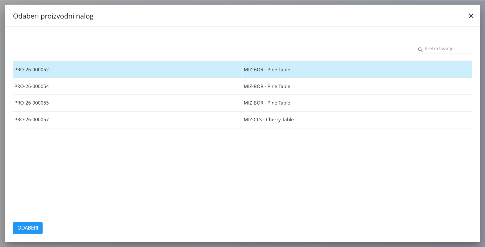
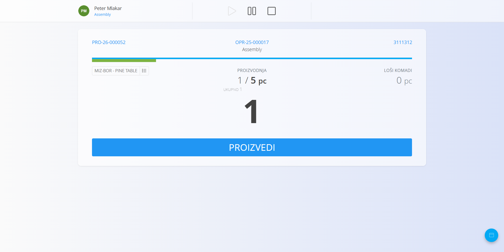
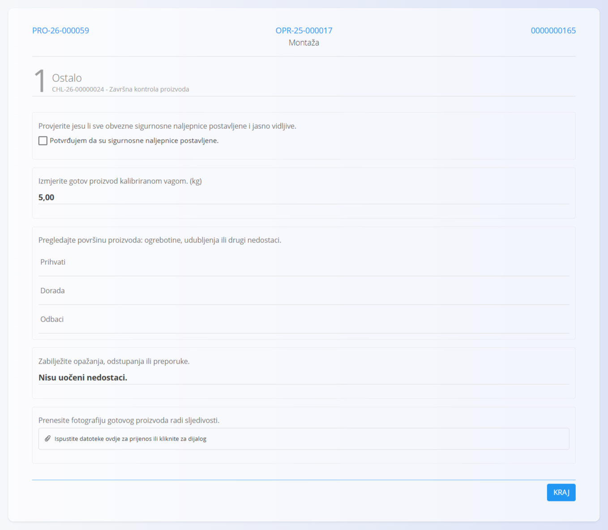

<!-- app_route: /production-orders/execution -->
<!-- app_label: Izvedba -->
<!-- canonical_source_url: https://github.com/Tom-PIT/Connected.Docs/blob/main/hr/Uvod/ExecutionQuickUserGuide.md -->
<!-- canonical_source_title: Izvedba – brzi vodič za korisnike -->

# Izvedba – brzi vodič za korisnike

Ovaj vodič prikazuje **osnovne korake** za izvođenje proizvodnje na zaslonu **Izvedba**.

> [!NOTE]
>
> Za više pojedinosti pogledajte potpunu dokumentaciju za **[Izvedbu](../Domene/Proizvodnja/Dokumenti/Izvedba.md)**.

## 1. Odaberite proizvodni nalog

Kad otvorite **Izvedbu**:
- provjerite je li odabrana ispravna organizacijska jedinica
- odaberite proizvodni nalog i operaciju na kojoj ćete raditi

Ako ništa nije odabrano ili nema dostupnih proizvodnih naloga, zaslon će vas zamoliti da odaberete **proizvodni nalog**.

## 2. Pokrenite operaciju

Rad možete započeti na dva načina:

### Mogućnost A — pritisnite Pokreni

Dodirnite **Pokreni** da započnete mjerenje vremena i rad na operaciji.

### Mogućnost B — pritisnite Proizvedi

Pritiskom na **Proizvedi** operacija se **automatski pokreće**, čak i ako ne mijenjate količinu.

## 3. Proizvedite artikle

1. Unesite broj proizvedenih artikala (npr. **1**).
2. Pritisnite **Proizvedi**.
3. Sustav ažurira:
   - proizvedenu količinu
   - preostalu količinu

Ponovite kad se završi još artikala.

> **NAPOMENA**
> Pregledajte **Upute** ako se pojave ili kad je potrebno:
> - dodirnite **Upute** za prikaz koraka sastavljanja, slika ili napomena specifičnih za operaciju.

## 4. Dovršite kontrolne popise kvalitete (ako je primjenjivo)

[Kontrolni popisi i kontrole kvalitete](../Domene/Proizvodnja/Dokumenti/Izvedba.md#kontrolni-popisi-i-kontrole-kvalitete) jednostavne su provjere korak po korak koje pomažu da rad bude siguran, a proizvodi ispravni. Kontrolni popis može se pojaviti na početku, tijekom rada ili prije završetka, ovisno o postavkama operacije.

1. Slijedite korake prikazane na zaslonu.

   

2. Dovršite svaki korak. Kad ste gotovi, dodirnite **Završi**.
3. Ako kontrolni popis treba ponovno ispuniti:
    1. Otvorite izbornik radnji preko [akcijskog gumba](../Zajednicko/UI/AkcijskiGumb.md).
    2. Uđite u odjeljak **[Kvaliteta](../Domene/Proizvodnja/Dokumenti/ProizvodniNaloziKvaliteta.md)**.
    3. Dodirnite **Ponovi** za kontrolni popis koji želite ponoviti.

> [!NOTE]
> Operaciju ne možete zaustaviti dok nije dovršen obavezni kontrolni popis.

## 5. Evidentirajte gubitke (ako je primjenjivo)

1. Idite u izbornik radnji klikom na [akcijski gumb](../Zajednicko/UI/AkcijskiGumb.md).
2. Uđite u odjeljak **[Gubitak](../Domene/Proizvodnja/Dokumenti/Izvedba.md#gubitak)**.
3. Unesite količinu neispravnih artikala.
4. Odaberite razlog gubitka.
5. Potvrdite klikom na žuti gumb **Gubitak**.

## 6. Evidentirajte utrošene materijale

Koristite ovo kad se materijali troše tijekom operacije:

1. Idite u izbornik radnji klikom na [akcijski gumb](../Zajednicko/UI/AkcijskiGumb.md).
2. Uđite u odjeljak **[Potrošeno](../Domene/Proizvodnja/Dokumenti/Potroseno.md)**.
3. Skenirajte, upišite ili odaberite materijal.
4. Unesite utrošenu količinu.
5. Potvrdite.

## 7. Evidentirajte zastoje (ako je primjenjivo)

1. Idite u izbornik radnji klikom na [akcijski gumb](../Zajednicko/UI/AkcijskiGumb.md).
2. Uđite u odjeljak **[Zastoj](../Domene/Proizvodnja/Dokumenti/Zastoj.md)**.
3. Kliknite pokreni i zaustavi kako biste zabilježili razdoblje prekida.
4. Odaberite razlog prekida.
5. Po potrebi prilagodite vremena.
6. Spremite.

Ovo koristite za svaki prekid, na primjer čekanje materijala ili kvar stroja.

## 8. Evidentirajte rad (radno vrijeme)

1. Idite u izbornik radnji klikom na [akcijski gumb](../Zajednicko/UI/AkcijskiGumb.md).
2. Uđite u odjeljak **[Rad](../Domene/Proizvodnja/Dokumenti/Rad.md)** ako to vaš tijek rada zahtijeva.

### Automatski

Dodirnite **Pokreni** → radite → dodirnite **Zaustavi**.

### Ručno

Otvorite **Rad**, zatim unesite:
- datum
- početak i kraj ili trajanje
- napomene (neobavezno)

Spremite unos. Popis evidentiranog rada nalazi se ispod.

## 9. Završite operaciju

Kad je sav proizvodni posao dovršen:

1. Provjerite proizvedenu količinu.
2. Evidentirajte gubitke, zastoje, utrošene materijale ili kontrolne popise ako ih ima.
3. Dodirnite **Zaustavi** za završetak operacije.

## Povezani vodiči

- [**Nalog za održavanje – brzi vodič za korisnike**](MaintenanceOrderQuickUserGuide.md)
