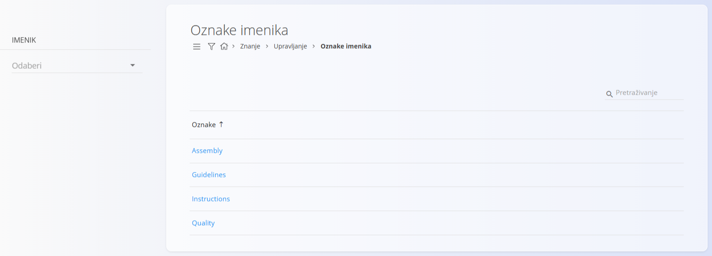
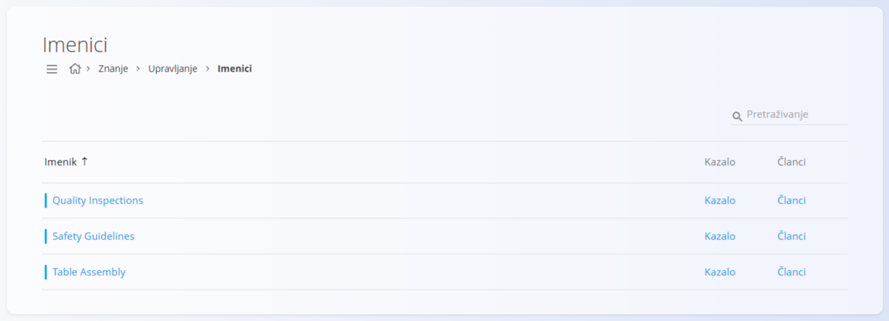
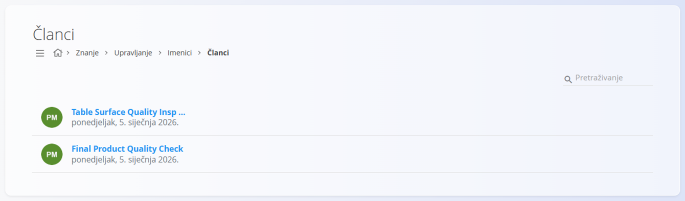
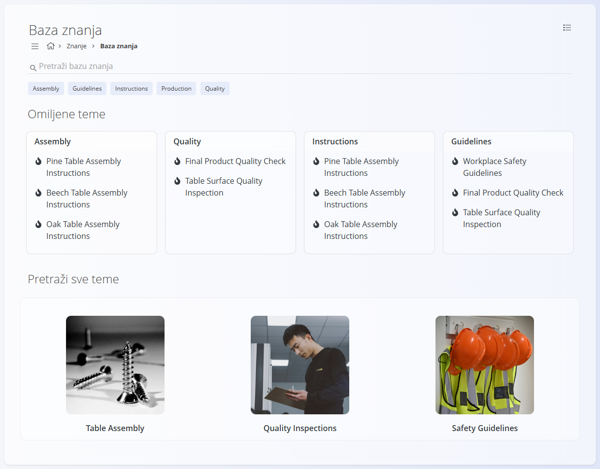

<!-- canonical_source_url: https://github.com/Tom-PIT/Connected.Docs/blob/main/hr/Uvod/IzradaIOdrzavanjeBazeZnanja.md -->
<!-- canonical_source_title: Izrada i održavanje baze znanja -->

# Izrada i održavanje baze znanja

Ovaj vodič objašnjava kako izraditi strukturiranu bazu znanja koju korisnici mogu pretraživati i pregledavati te je održavati tijekom vremena.

Izradit ćete:

* oznake imenika za kategorizaciju
* imenike za organizaciju sadržaja
* članke s dokumentacijom
* kazalo za navigaciju

Na kraju vodiča korisnici će moći pregledavati i pretraživati dokumentaciju kroz bazu znanja.

## Cilj

Izradite bazu znanja koja:

* organizira dokumentaciju u logične teme
* omogućuje jasnu navigaciju kroz kazalo
* podržava pretraživanje i filtriranje po oznakama
* omogućuje održavanje sadržaja tijekom vremena

## Koraci

### 1. Isplanirajte strukturu znanja

Prije izrade sadržaja odredite teme koje želite dokumentirati.

Tipični primjeri uključuju:

* radne upute
* sigurnosne postupke
* smjernice za kvalitetu
* postupke održavanja
* često postavljana pitanja
* materijale za uvođenje novih zaposlenika

Razmislite o sljedećem:

* koji će imenici biti potrebni
* koji članci pripadaju kojem imeniku
* kako se korisnici trebaju kretati kroz sadržaj

> [!TIP]
> Počnite s jednostavnom strukturom i proširujte je tijekom vremena.

### 2. Stvorite oznake imenika

[**Oznake imenika**](../Domene/Znanje/Upravljanje/OznakeImenika.md) pomažu korisnicima da pronađu sadržaj pretraživanjem i filtriranjem.

Primjeri:

* Montaža
* Kvaliteta
* Sigurnost
* Pakiranje
* Održavanje



1. Otvorite **Znanje / Upravljanje / Oznake imenika**.
2. Stvorite oznake potrebne za vašu dokumentaciju.
3. Spremite oznake.

### 3. Stvorite imenike

[**Imenici**](../Domene/Znanje/Upravljanje/Imenici.md) su glavni spremnici za organizaciju sadržaja baze znanja.

Primjeri:

* Radne upute
* Upravljanje kvalitetom
* Sigurnosni postupci
* Održavanje



1. Otvorite **Znanje / Upravljanje / Imenici**.
2. Stvorite novi imenik.
3. Unesite naziv, ključ i neobavezni opis.
4. Spremite imenik.

### 4. Stvorite članke

**Članci** sadrže stvarnu dokumentaciju koju će korisnici čitati.

Primjeri:

* Sastavljanje okvira stola
* Postupak pakiranja
* Dnevni pregled opreme



1. Otvorite **Znanje / Upravljanje / Imenici**.
2. Odaberite **Članci** u željenom imeniku.
3. Kliknite [**gumb radnji**](../Zajednicko/UI/AkcijskiGumb.md) da biste stvorili novi članak.
4. Unesite:
   * naslov
   * ključ
   * sadržaj
   * po želji:
        * dodajte priloge
        * omogućite komentare
        * zakažite datume objave ili isteka
5. Dodijelite odgovarajuće oznake.
6. Spremite članak.

Za pojedinosti pogledajte [**Članci**](../Domene/Znanje/Upravljanje/Clanci.md).

### 5. Izradite kazalo

Kazalo određuje kako korisnici prolaze kroz imenik.

1. Otvorite **Znanje / Upravljanje / Imenici**.
2. Odaberite **Kazalo** za željeni imenik.
3. Stvorite mape za organizaciju članaka u teme.
4. Dodajte članke u mape.
5. Poredajte stavke pomoću rednih brojeva da biste odredili redoslijed.

Za pojedinosti pogledajte [**Kazalo**](../Domene/Znanje/Upravljanje/Kazalo.md).

Primjer:

```text
Radne upute
├── Montaža
│   ├── Sastavljanje okvira stola
│   └── Ugradnja radne ploče
├── Pakiranje
│   └── Postupak pakiranja
└── Održavanje
    └── Dnevni pregled opreme
```

> [!NOTE]
> Kazalo upravlja samo navigacijom. Sadržaj članaka održava se odvojeno.

### 6. Pregledajte bazu znanja

Kad su imenici, članci i navigacija konfigurirani:

1. Otvorite **Znanje / Baza znanja**.
2. Pronađite svoj imenik.
3. Otvorite imenik.
4. Pregledavajte članke pomoću kazala.
5. Provjerite pretraživanje i filtriranje po oznakama.



Korisnici mogu:

* filtrirati po oznakama
* pregledavati imenike
* otvarati članke
* preuzimati priloge
* dodavati komentare (ako su omogućeni)

Za pojedinosti pogledajte [**Baza znanja**](../Domene/Znanje/BazaZnanja/BazaZnanja.md).

### 7. Održavajte sadržaj

Baza znanja treba se redovito pregledavati.

Preporučene prakse:

* članke držite sažetima i usredotočenima
* koristite dosljedne konvencije za nazive
* uklanjajte duplikate
* povremeno pregledavajte zastarjele informacije
* oznake koristite dosljedno
* onemogućite neaktivne imenike kad je to potrebno
* koristite datume objave i isteka kad je to primjereno

> [!TIP]
> Svaki imenik dodijelite određenoj osobi ili timu na održavanje.

## Primjer: izrada knjižnice radnih uputa

Proizvodna tvrtka želi centralizirati dokumentaciju s proizvodnog poda.

1. Stvorite oznake:

   * Montaža
   * Pakiranje
   * Održavanje

2. Stvorite imenik:

   * Radne upute

3. Stvorite članke:

   * Sastavljanje okvira stola
   * Postupak pakiranja
   * Dnevni pregled opreme

4. Izradite kazalo:

   * Montaža
   * Pakiranje
   * Održavanje

5. Pregledajte imenik u bazi znanja.

Operateri sada mogu pretraživati upute, pregledavati dokumentaciju po temama i pristupati najnovijim odobrenim postupcima s jednog mjesta.
