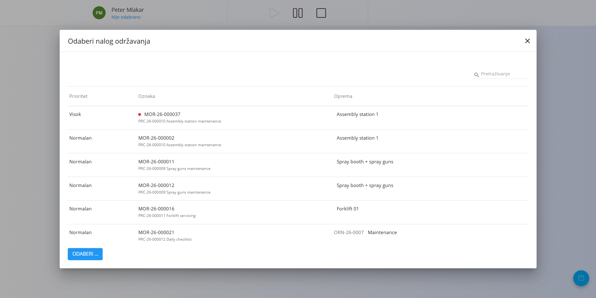
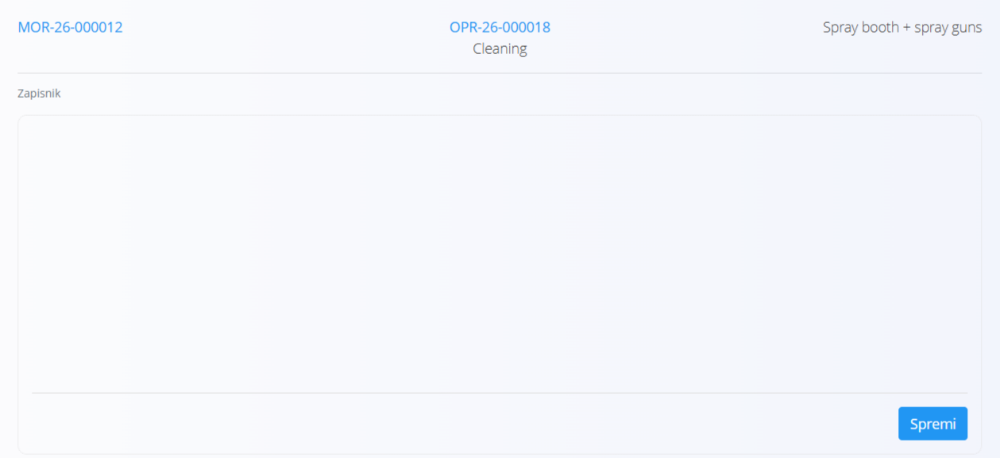

<!-- app_route: /maintenance-orders/execution -->
<!-- app_label: Nalog za održavanje – brzi vodič -->
<!-- canonical_source_url: https://github.com/Tom-PIT/Connected.Docs/blob/main/hr/Uvod/IzvodenjeOdrzavanjaBrziVodic.md -->
<!-- canonical_source_title: Nalog za održavanje – brzi vodič -->

# Nalog za održavanje – brzi vodič

Ovaj vodič sažeto opisuje **osnovne korake** za izvođenje održavanja pomoću zaslona Izvođenje održavanja.

> [!NOTE]
>
> Za više informacija i pojedinosti pogledajte cjelovitu dokumentaciju za [**Izvođenje održavanja**](../Domene/Odrzavanje/Dokumenti/IzvodenjeOdrzavanja.md).

## 1. Odaberite nalog za održavanje

Kad otvorite **Izvođenje održavanja**:
- provjerite je li na vrhu zaslona odabrana ispravna organizacijska jedinica
- provjerite jesu li prikazani nalog za održavanje i operacija s kojima ćete raditi

Za odabir drugog naloga za održavanja kliknite **nalog za održavanje** u gornjem lijevom kutu. U dijaloškom okviru odaberite nalog (prikazuje se **Prioritet**, **Oznaka** i **Oprema**) i kliknite **Odaberi**. Pogledajte [**Odabir naloga za održavanje**](../Domene/Odrzavanje/Dokumenti/IzvodenjeOdrzavanja.md#odabir-naloga-za-odrzavanje).

Ako nije odabran nalog za održavanje ili nijedan nije dostupan, zaslon će vas zamoliti da odaberete nalog.

## 2. Pokrenite operaciju

Pritisnite **Pokreni** da biste započeli trenutačnu operaciju. Operacija postaje aktivna i počinje se bilježiti vrijeme izvođenja. Pogledajte [**Pokretanje održavanja**](../Domene/Odrzavanje/Dokumenti/IzvodenjeOdrzavanja.md#pokretanje-odrzavanja).

Ako morate prekinuti rad, pritisnite **Pauza**. Operacija ostaje otvorena, a nastavljate je ponovnim pritiskom na **Pokreni**. Pogledajte [**Pauziranje održavanja**](../Domene/Odrzavanje/Dokumenti/IzvodenjeOdrzavanja.md#pauziranje-odrzavanja).

## 3. Dovršite kontrolne popise (ako je primjenjivo)

[Kontrolni popisi kvalitete](../Domene/Proizvodnja/Dokumenti/Izvedba.md#kontrolni-popisi-i-kontrole-kvalitete) jednostavne su provjere korak po korak koje pomažu da rad bude siguran, a rezultat ispravan. Kontrolni popis može se pojaviti pri pokretanju, dok je operacija pauzirana ili pri zaustavljanju, ovisno o postavkama operacije.

1. Slijedite korake prikazane na zaslonu.
2. Dovršite svaki korak. Kad završite, potvrdite popis.
3. Za pregled kontrolnih popisa u bilo kojem trenutku otvorite [gumb radnji](../Zajednicko/UI/AkcijskiGumb.md) i odaberite **Kvaliteta**. Pogledajte [**Kvaliteta**](../Domene/Odrzavanje/Dokumenti/IzvodenjeOdrzavanja.md#kvaliteta).

> [!NOTE]
> Operaciju ne možete zaustaviti dok obavezni kontrolni popis nije dovršen.

## 4. Slijedite upute (ako su dostupne)

Ako su za operaciju definirane upute, otvorite [gumb radnji](../Zajednicko/UI/AkcijskiGumb.md) i odaberite **Upute**. Pogledajte [**Upute**](../Domene/Odrzavanje/Dokumenti/IzvodenjeOdrzavanja.md#upute).

Pregledajte ih prije početka posla i koristite ih kao smjernicu tijekom rada. Mogu sadržavati sigurnosne napomene, korake ili vizualne prikaze.

## 5. Evidentirajte utrošeni materijal (ako je primjenjivo)

Ovo koristite kad se tijekom održavanja troši materijal:

1. Otvorite [gumb radnji](../Zajednicko/UI/AkcijskiGumb.md) i odaberite **Ulazi**. Pogledajte [**Ulazi**](../Domene/Odrzavanje/Dokumenti/IzvodenjeOdrzavanja.md#ulazi).
2. Odaberite materijal.
3. Unesite utrošenu količinu.
4. Kliknite **Spremi**.

Zaslon prikazuje utrošenu količinu u odnosu na planiranu, na primjer **0 / 3 kom**.

## 6. Evidentirajte izvedeni rad

1. Otvorite [gumb radnji](../Zajednicko/UI/AkcijskiGumb.md) i odaberite [**Zapisnik**](../Domene/Odrzavanje/Dokumenti/IzvodenjeOdrzavanja.md#zapisnik).
2. U polje slobodnog teksta unesite opis izvedenog posla.
3. Kliknite **Spremi**.

Spremljeni zapisnik prikazuje se i na nalogu za održavanje.

## 7. Evidentirajte rad (radno vrijeme)

1. Otvorite [gumb radnji](../Zajednicko/UI/AkcijskiGumb.md) i odaberite [**Rad**](../Domene/Odrzavanje/Dokumenti/IzvodenjeOdrzavanja.md#rad) ako to zahtijeva vaš tijek rada.

### Trenutačna aktivnost:

Pritisnite **Pokreni**, izvedite posao, zatim pritisnite **Zaustavi**.

### Ručno:

Otvorite **Rad**, zatim unesite:
- datum
- vrijeme početka i završetka ili trajanje
- napomene (neobavezno)

Spremite unos. Evidentirani rad prikazan je u popisu ispod.

## 8. Završite operaciju

Kad je sav posao održavanja završen:

1. Provjerite jesu li kontrolni popisi dovršeni te jesu li materijal i rad evidentirani.
2. Pritisnite **Zaustavi** da biste završili operaciju. Pogledajte [**Završetak održavanja**](../Domene/Odrzavanje/Dokumenti/IzvodenjeOdrzavanja.md#zavrsetak-odrzavanja).

Operacija se označava kao **Dovršena**, a bilježi se i vrijeme završetka.

Ako proces ima više operacija, sljedeća operacija otvara se automatski kad zaustavite trenutačnu. Nastavite sa sljedećom operacijom od koraka 2.

Kad se zaustavi posljednja operacija naloga za održavanje, nalog se automatski zatvara.

Nalog za održavanje možete dovršiti i iz samog naloga, bez zaustavljanja preostalih operacija. Otvorite izbornik u gornjem desnom kutu naloga i u odjeljku **Akcija** odaberite **Dovrši nalog za održavanje**.

## 9. Ponovno aktivirajte dovršenu operaciju (ako je potrebno)

Dovršenu operaciju ne možete ponovno aktivirati na zaslonu Izvođenje održavanja. Da biste je ponovno otvorili, otvorite nalog za održavanje i u retku operacije odaberite **Ponovno aktiviraj**. Pogledajte bilješku u odjeljku [**Završetak održavanja**](../Domene/Odrzavanje/Dokumenti/IzvodenjeOdrzavanja.md#zavrsetak-odrzavanja).

## Povezani vodiči

- [**Izvođenje – brzi vodič**](IzvedbaBrziVodic.md)
