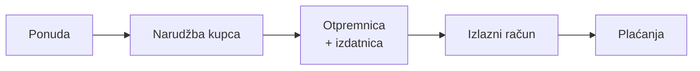
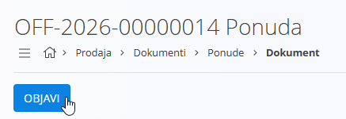
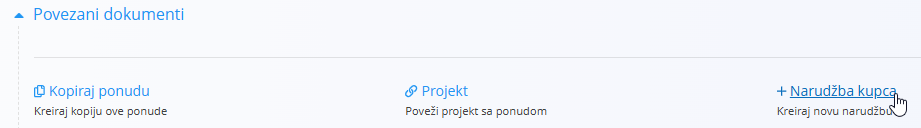
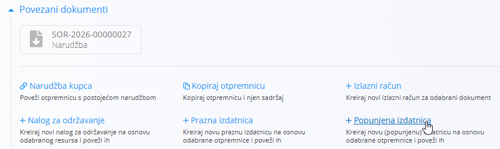
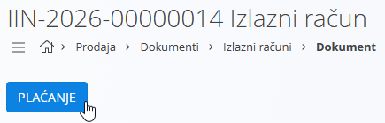

<!-- canonical_source_url: https://github.com/Tom-PIT/Connected.Docs/blob/main/hr/Uvod/ProdajniProcesBezPredujma.md -->
<!-- canonical_source_title: Prodajni proces (bez predujma) -->

# Prodajni proces (bez predujma)

Ovaj vodič prolazi kroz tipičan prodajni proces bez korištenja predujmova. Koristite poveznice za pojedinosti; konfiguraciju ovdje ne ponavljajte.

> [!TIP]
> Slijedite ovaj vodič korak po korak kako biste konfigurirali platformu. Koristite poveznice za otvaranje svake šifrarnice ili postavke ako trebate dodatne pojedinosti, zatim se vratite na ovu stranicu i nastavite sa sljedećim korakom.

> [!NOTE]
> - U nekim slučajevima proces počinje izravno **narudžbom kupca**. Korak **ponude** je neobavezan.
> - Promet zaliha nastaje pri **izdavanju**.
> - **Izlazni račun** bilježi prihod i plaćanja.

## Koraci

<!-- app_route: /sales/documents/offers -->
<!-- app_label: Ponude -->

### 1. Stvorite i objavite ponudu za prodaju (neobavezno)

Stvorite komercijalnu ponudu radi potvrde cijena, količina i roka valjanosti s kupcem.

1. Idite na **Prodaja / Dokumenti / Ponude**.
2. Pomoću [**gumba radnji**](../Zajednicko/UI/AkcijskiGumb.md) stvorite nacrt [ponude za prodaju](../Domene/Prodaja/Dokumenti/Ponude.md).
3. Ispunite **Kupac**, **Datum isteka** i dodajte stavke u odjeljku **Stavke**.
4. Kliknite **Objavi** da biste potvrdili dokument.

   

<!-- app_route: /sales/documents/sales-orders -->
<!-- app_label: Narudžbe kupca -->

### 2. Stvorite narudžbu kupca

Stvorite narudžbu kupca radi rezervacije zaliha i planiranja isporuke.

1. Iz potvrđene ponude odaberite **Povezani dokumenti → [+ Narudžba kupca](../Domene/Prodaja/Dokumenti/NarudzbeKupcaIzrada.md)**.

   

2. Potvrdite količine i podatke o isporuci, zatim kliknite **Objavi**.

<!-- app_route: /production-orders -->
<!-- app_label: Proizvodni nalozi -->

### 2a. Ponovna nabava ili proizvodnja (ako je potrebno)

Ako artikli nisu dostupni, pogledajte [**Ponovnu nabavu ili proizvodnju**](PonovnaNabavaIliProizvodnja.md) za mogućnosti nabave ili izrade prije isporuke.

Za proizvodne tvrtke brz način stvaranja proizvodnog naloga je iz objavljene narudžbe kupca:
- **Povezani dokumenti → [+ Proizvodni nalog](../Domene/Proizvodnja/Dokumenti/ProizvodniNaloziIzrada.md)**.

Time se stvara nacrt proizvodnog naloga koji se kasnije može potvrditi u [**domeni Proizvodnja**](../Domene/Proizvodnja/README.md).

<!-- app_route: /sales/documents/delivery-notes -->
<!-- app_label: Otpremnice -->

### 3. Isporučite robu

Narudžba kupca je spremna. Pripremite pošiljku i premjestite zalihe iz skladišta.

1. Iz narudžbe kupca otvorite **Povezani dokumenti → [+ Otpremnica](../Domene/Prodaja/Dokumenti/Otpremnice.md)**.  
   Provjerite **Kupac** i **Adresu isporuke** te dodajte stavke za isporuku. Količine možete prilagoditi ako se isporučuje samo dio narudžbe.
2. U otpremnici otvorite **Povezani dokumenti → [+ Popunjena izdatnica](../Domene/Logistika/Dokumenti/Izdatnica.md)**.

   

   Odaberite **Skladište** i **Lokacije** te potvrdite količine za izuzimanje.
3. Kliknite **Objavi** da biste potvrdili izdatnicu.  
   Time se zalihe izuzimaju iz skladišta i ažuriraju stanja zaliha.
4. (Neobavezno) Provjerite promjenu u [**pregledu zaliha po lokacijama**](../Domene/Logistika/Pogledi/PogledNaZalihePremaLokacijama.md).

<!-- app_route: /sales/documents/issued-invoices -->
<!-- app_label: Izlazni računi -->

### 4. Izdajte konačni račun i evidentirajte plaćanja

Naplatite isporučenu robu i evidentirajte plaćanja.

1. Iz narudžbe kupca ili otpremnice otvorite **Povezani dokumenti → [+ Izlazni račun](../Domene/Prodaja/Dokumenti/IzlazniRacuniIzrada.md)**.
2. Provjerite konačne iznose i po potrebi dodajte **načine plaćanja**.
3. Kliknite **Objavi**.
4. Evidentirajte ulazna plaćanja (djelomična ili potpuna) pomoću gumba **Plaćanje**.

   

> [!TIP]
> - Koristite **Povezane dokumente** za korak po korak kretanje kroz svaku fazu i provjerite automatski popunjene podatke (kupac, stavke).
> - Otvorite [**Kartice tvrtke**](../Domene/Prodaja/Pogledi/KarticeTvrtke.md) za pregled povijesti kupca, narudžbi i stanja.
