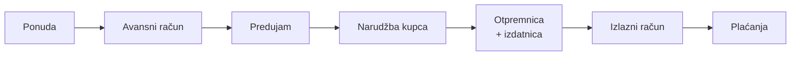
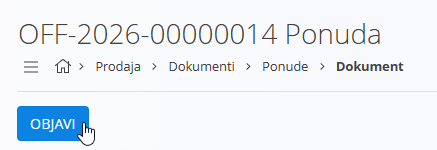
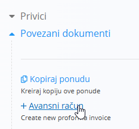
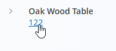
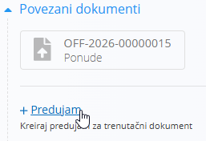
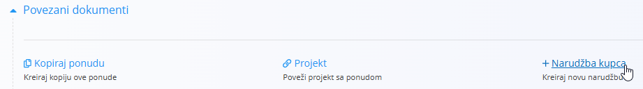
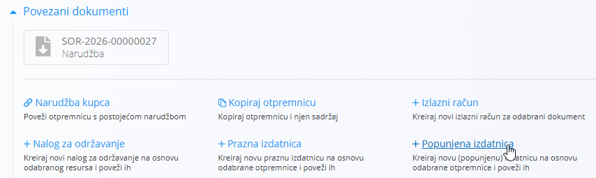
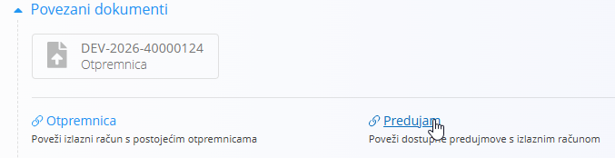
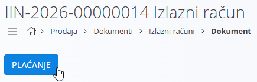

<!-- canonical_source_url: https://github.com/Tom-PIT/Connected.Docs/blob/main/hr/Uvod/ProdajniProcesSPredujmom.md -->
<!-- canonical_source_title: Prodajni proces (s predujmom) -->

# Prodajni proces (s predujmom)

Ovaj vodič prolazi kroz tipičan prodajni proces koji uključuje korak predujma. Koristite poveznice za pojedinosti; konfiguraciju ovdje ne ponavljajte.

> [!TIP]
> Slijedite ovaj vodič korak po korak kako biste konfigurirali platformu. Koristite poveznice za otvaranje svake šifrarnice ili postavke ako trebate dodatne pojedinosti, zatim se vratite na ovu stranicu i nastavite sa sljedećim korakom.

> [!NOTE]
> Promet zaliha nastaje pri **izdavanju**. **Predujam** i **Izlazni račun** bilježe financijske transakcije.

## Koraci

<!-- app_route: /sales/documents/offers -->
<!-- app_label: Ponude -->

### 1. Stvorite i objavite ponudu za prodaju

Stvorite komercijalnu ponudu radi potvrde cijena, količina i roka valjanosti s kupcem.

1. Idite na **Prodaja / Dokumenti / Ponude**.
2. Pomoću [**gumba radnji**](../Zajednicko/UI/AkcijskiGumb.md) stvorite nacrt [ponude](../Domene/Prodaja/Dokumenti/Ponude.md).
3. Ispunite **Kupac**, **Datum isteka** i dodajte stavke u odjeljku **Stavke**.
4. Po potrebi ispunite i ostala neobavezna polja.
5. Kliknite **Objavi** da biste potvrdili dokument.

   

<!-- app_route: /sales/documents/proforma-invoices -->
<!-- app_label: Avansni računi -->

### 2. Stvorite avansni račun

Pretvorite dogovorenu ponudu u avansni račun radi traženja predujma i dijeljenja podataka o plaćanju.

1. Iz potvrđene ponude odaberite **Povezani dokumenti → [+ Avansni račun](../Domene/Prodaja/Dokumenti/AvansniRacuni.md)**.

   

2. Prilagodite **Tip poziva na broj** i **Poziv na broj**, **Bankovni račun organizacije**, **Datum valjanosti** i ostala neobavezna polja prema potrebi.
3. Prilagodite količine proizvoda prema iznosu koji je kupac dogovorio unaprijed platiti. Kliknite redak proizvoda da biste otvorili odjeljak za uređivanje i postavili količinu koja će se platiti unaprijed; ukupni iznosi se ažuriraju u skladu s tim.

   

4. Kliknite **Objavi**.

<!-- app_route: /sales/documents/prepayments -->
<!-- app_label: Predujmovi -->

### 3. Evidentirajte predujam (djelomičan ili potpun)

Evidentirajte predujam kupca kako bi narudžba bila financijski pokrivena prije isporuke.

1. Iz objavljenog avansnog računa odaberite **Povezani dokumenti → [+ Predujam](../Domene/Prodaja/Dokumenti/Predujmovi.md)**.

   

2. Ispunite:
    1. **Datum dospijeća**
    2. **Tip poziva na broj** i **Poziv na broj**
    3. **Bankovni račun organizacije**
    4. **Način plaćanja**
3. Provjerite jesu li stavke i iznosi predujma usklađeni s količinama avansnog računa postavljenima u [Koraku 2 – Stvorite avansni račun](#2-stvorite-avansni-racun).
4. Kliknite **Objavi** da biste potvrdili predujam.

<!-- app_route: /sales/documents/sales-orders -->
<!-- app_label: Narudžbe kupca -->

### 4. Stvorite narudžbu kupca

Stvorite narudžbu kupca radi rezervacije zaliha i planiranja isporuke.

1. Vratite se na ranije potvrđenu ponudu i odaberite **Povezani dokumenti → [+ Narudžba kupca](../Domene/Prodaja/Dokumenti/NarudzbeKupcaIzrada.md)**.

   

2. Potvrdite količine i podatke o isporuci te kliknite **Objavi**.

<!-- app_route: /production-orders -->
<!-- app_label: Proizvodni nalozi -->

### 4a. Ponovna nabava ili proizvodnja (ako je potrebno)

Ako artikli nisu dostupni, pogledajte [**Ponovnu nabavu ili proizvodnju**](PonovnaNabavaIliProizvodnja.md) za mogućnosti nabave ili izrade prije isporuke.

Za proizvodne tvrtke brz način stvaranja proizvodnog naloga je iz objavljene narudžbe kupca:
- **Povezani dokumenti → [+ Proizvodni nalog](../Domene/Proizvodnja/Dokumenti/ProizvodniNaloziIzrada.md)**

Time se stvara nacrt proizvodnog naloga koji se kasnije može potvrditi u [**domeni Proizvodnja**](../Domene/Proizvodnja/README.md).

<!-- app_route: /sales/documents/delivery-notes -->
<!-- app_label: Otpremnice -->

### 5. Isporučite robu

Narudžba kupca je spremna. Pripremite pošiljku i premjestite zalihe iz skladišta.

Slijedite ove korake za izuzimanje zaliha iz skladišta:

1. Iz narudžbe kupca otvorite **Povezani dokumenti → [+ Otpremnica](../Domene/Prodaja/Dokumenti/Otpremnice.md)**.  
   Provjerite kupca i adresu isporuke te dodajte stavke za isporuku. Količine možete prilagoditi ako se isporučuje samo dio narudžbe.
2. U otpremnici otvorite **Povezani dokumenti → [+ Popunjena izdatnica](../Domene/Logistika/Dokumenti/Izdatnica.md)**.

   

   Odaberite **Skladište** i **Lokacije** te potvrdite količine za izuzimanje.
3. Kliknite **Objavi** da biste potvrdili izdatnicu.  
   Time se zalihe izuzimaju iz našeg skladišta i ažuriraju stanja zaliha.
4. (Neobavezno) Provjerite promjenu u [**pregledu zaliha po lokacijama**](../Domene/Logistika/Pogledi/PogledNaZalihePremaLokacijama.md).

<!-- app_route: /sales/documents/issued-invoices -->
<!-- app_label: Izlazni računi -->

### 6. Izdajte konačni račun i primijenite predujam

Izdajte konačni račun za isporučenu robu, primijenite predujam i naplatite eventualni preostali iznos.

1. Iz otpremnice ili narudžbe kupca otvorite **Povezani dokumenti → [+ Izlazni račun](../Domene/Prodaja/Dokumenti/IzlazniRacuniIzrada.md)**.
2. Povežite ranije evidentirani predujam putem **Povezani dokumenti → [Predujam](../Domene/Prodaja/Dokumenti/Predujmovi.md)** kako biste smanjili iznos za plaćanje.

   

3. Provjerite konačne iznose i po potrebi dodajte **načine plaćanja**.
4. Kliknite **Objavi** i evidentirajte preostala plaćanja pomoću gumba **Plaćanje** da biste dovršili transakciju.

   

> [!TIP]
> - Koristite **Povezane dokumente** za korak po korak kretanje kroz svaku fazu i provjerite automatski popunjene podatke (kupac, stavke).
> - Otvorite [**Kartice tvrtke**](../Domene/Prodaja/Pogledi/KarticeTvrtke.md) za pregled povijesti kupca, narudžbi i stanja.
