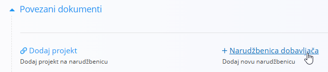
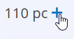

<!-- canonical_source_url: https://github.com/Tom-PIT/Connected.Docs/blob/main/hr/Uvod/RestockOrProduce.md -->
<!-- canonical_source_title: Ponovna nabava ili proizvodnja -->

# Ponovna nabava ili proizvodnja

Ovaj vodič jednostavnim riječima objašnjava što učiniti kad dobijete narudžbu kupca, a prije isporuke nemate dovoljno zaliha.

- Možete kupiti više (ponovna nabava) — naručite nedostajuću robu od dobavljača. Primjer: prodajete drvene stolove, na zalihi imate 2, a trebate 10. Izradite **Narudžbenicu** za 8 gotovih stolova (ili za drvo, noge i vijke ako sastavljate u vlastitoj proizvodnji).
- Ili možete proizvesti više (izraditi) — izradite nedostajuću robu vlastitim postupkom. Primjer: izrađujete drvene stolove od drva i okova. Izradite **Proizvodni nalog** za 8 stolova i potrošite potrebne materijale.

> [!NOTE]
> Koja opcija vrijedi ovisi o vašem poslovnom modelu:
> - Trgovačko društvo (kupnja i prodaja gotove robe) → obično kupnja
> - Proizvođač (sami izrađujete robu) → obično proizvodnja (i kupnja sirovina ako nedostaju)
> - Usluge/softver → obično ništa od toga (nema zaliha za kretanje)

> [!TIP]
> Prije početka provjerite jesu li definirani **[Procesi](../Domene/Proizvodnja/Upravljanje/Procesi.md)**, **[Ulazi](../Domene/Proizvodnja/Upravljanje/Unosi.md)** i **[Izlazi](../Domene/Proizvodnja/Upravljanje/Izlazi.md)**.

## Detaljni koraci

### 1. Otkrijte manjak

- Otvorite objavljenu **Narudžbu kupca**, pregledajte naručene artikle, zatim otvorite **[Zalihe](../Domene/Logistika/Pogledi/Zaliha.md)** kako biste provjerili trenutna stanja po skladištu i lokaciji.
- Pri izradi dokumenta **[Izdatnica](../Domene/Logistika/Dokumenti/Izdatnica.md)**, primjerice putem **Povezani dokumenti → + Puna izdatnica**. Ako zaliha nije dovoljna, sustav prikazuje upozorenje i ne dopušta nastavak ili objavu dok količine nisu dostupne.
- U proizvodnji otvorite **Potrebe** kako biste vidjeli koji su materijali ili poluproizvodi nedostatni za planirane operacije.

### 2. Odlučite: ponovna nabava ili proizvodnja

- Ako kupujete/prodajete gotovu robu → nastavite s ponovnom nabavom.
- Ako proizvodite robu → nastavite s proizvodnjom (i ponovnom nabavom sirovina/poluproizvoda prema potrebi).

### 3. Ponovna nabava (kupnja)

#### 3.1 (Neobavezno) Pošaljite upit

1. Idite na **Nabava / Dokumenti / Upiti**.
2. Akcijskim gumbom stvorite skicu **[upita](../Domene/Nabava/Dokumenti/Upiti.md)**.
3. Dodajte artikle, zatražite cijenu i rok isporuke; kliknite **Objavi** za potvrdu upita.

#### 3.2 Izradite narudžbenicu

- Iz upita (ili izravno) otvorite **Povezani dokumenti → [+ Narudžbenica](../Domene/Nabava/Dokumenti/NarudzbeniceIzrada.md)**.

   

- Potvrdite dobavljača, artikle i datum isporuke; kliknite **Objavi**.

#### 3.3 Primite na zalihu

1. U narudžbenici otvorite **Povezani dokumenti → [+ Primka](../Domene/Logistika/Dokumenti/Primke.md)**.
2. Odaberite **Skladište** i **Lokacije**, potvrdite primljene količine; kliknite **Objavi**.
3. (Neobavezno) Provjerite stanja u **[Zalihama](../Domene/Logistika/Pogledi/Zaliha.md)** ili u **[Zalihama po lokacijama](../Domene/Logistika/Pogledi/PogledNaZalihePremaLokacijama.md)**.

> [!NOTE]
> U uobičajenom lancu nabave, nakon primitka robe, primljeni račun dobavljača mora se evidentirati i podmiriti putem **[Naloga za plaćanje](../Domene/Racunovodstvo/Dokumenti/PaymentOrders.md)** u domeni **[Računovodstvo](../Domene/Racunovodstvo/README.md)**. Ti se financijski koraci dokumentiraju zasebno.

### 4. Proizvodnja

> [!IMPORTANT]
> Provjerite da su vaš proces i operacije izrađeni u **[Procesima](../Domene/Proizvodnja/Upravljanje/Procesi.md)** s definiranim **[Ulazima](../Domene/Proizvodnja/Upravljanje/Unosi.md)** i **[Izlazima](../Domene/Proizvodnja/Upravljanje/Izlazi.md)**.

#### 4.1 Izradite proizvodni nalog

1. Idite na **Proizvodnja / Proizvodni nalozi**.
2. Akcijskim gumbom stvorite skicu **[proizvodnog naloga](../Domene/Proizvodnja/Dokumenti/ProizvodniNaloziIzrada.md)**.
3. Odaberite **Proizvod**, **Proces**, **Količinu**, **Rok** i **Organizacijsku jedinicu**; kliknite **Objavi** za potvrdu.
4. Postavite status na **Aktivan** kako bi nalog bio dostupan u **[Izvedbi](../Domene/Proizvodnja/Dokumenti/Izvedba.md)**.

> [!TIP]
> Pojedinosti o izradi proizvodnih naloga potražite u **[Kako izraditi novi proizvodni nalog](../Domene/Proizvodnja/Dokumenti/ProizvodniNaloziIzrada.md)**.

#### 4.2 Riješite manjak ulaza

1. Otvorite **Potrebe**.
2. Upotrijebite filtar **Prikaži planirane operacije** kako biste vidjeli materijale ili poluproizvode koji nedostaju za proizvodni nalog.
3. Za nedostajuće ulaze upotrijebite znak **+** kako biste izradili novu **[narudžbenicu](../Domene/Nabava/Dokumenti/NarudzbeniceIzrada.md)** i dovršili korak **[Primka](../Domene/Logistika/Dokumenti/Primke.md)** (vidi [3.3](#33-primite-na-zalihu)).

   

#### 4.3 Evidentirajte izvođenje

Koristite modul **[Izvedba](../Domene/Proizvodnja/Dokumenti/Izvedba.md)** za praćenje proizvodnog napretka:

1. Unesite proizvedene artikle gumbom **Proizvedi**.
2. Pristupite izborniku aktivnosti preko **[akcijskog gumba](../Zajednicko/UI/AkcijskiGumb.md)** kako biste evidentirali:
    - **[Potrošeno](../Domene/Proizvodnja/Dokumenti/Potroseno.md)** — materijale utrošene u proizvodnji
    - **[Rad](../Domene/Proizvodnja/Dokumenti/Rad.md)** — utrošeno radno vrijeme
    - **[Gubitak](../Domene/Proizvodnja/Upravljanje/OznakeKlasifikacijeGubitka.md)** — količina otpada i razlog (ako postoji)
    - **[Zastoj](../Domene/Proizvodnja/Dokumenti/Zastoj.md)** — zaustavljanja opreme i njihovo trajanje (ako postoje)
3. Kad je nalog dovršen, kliknite gumb **Zaustavi** kako biste ga završili.

### 5. Nastavak prodajnog tijeka

- Vratite se na **Narudžbu kupca** i slijedite vodiče za isporuku i fakturiranje:
  - **[Proces prodaje (s predujmom)](SalesProcessWithPrepayment.md)**
  - **[Proces prodaje (bez predujma)](SalesProcessWithoutPrepayment.md)**

> [!TIP]
> Nakon dovršetka pojedinosti možete pregledati na popisu zatvorenih **[Proizvodnih naloga](../Domene/Proizvodnja/Dokumenti/ProizvodniNalozi.md)**.
